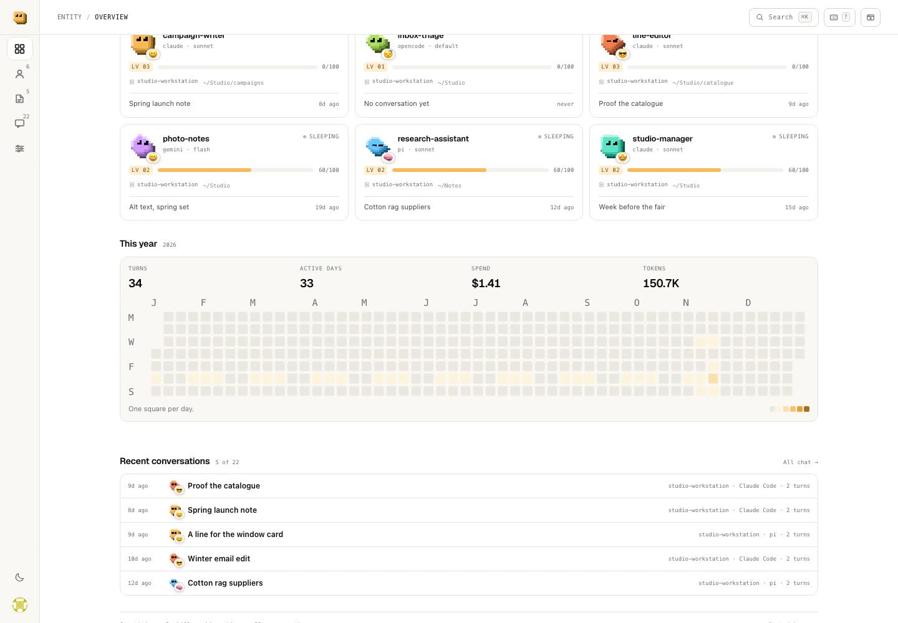

<h1 align="center">
  <a href="https://github.com/agung2001/entity"></a> Entity
</h1>

<p align="center">
  
  
  
  
</p>

<p align="center">
  <strong>One calm place for everything you ask AI to do.</strong><br/>
  An assistant is a Markdown file. A workspace is a folder. A conversation is a real
  <code>claude</code>, <code>codex</code>, <code>pi</code>, <code>opencode</code> or
  <code>gemini</code> process on your own machine — nothing simulated.
</p>

<p align="center">
  <picture><source srcset="docs/assets/readme-hero.webp" type="image/webp" /></picture>
</p>

## What it is

You already own capable agent CLIs. What you do not own is a place to keep them:
their instructions, their files, what they cost, which machine they ran on, and what
they did yesterday. Entity is that place.

Every assistant is a plain `.md` file in a folder you can open in any editor. Every
answer is a real process with a real exit code, a transcript you can read and a price
the harness actually reported. Nothing is synced to a service you did not choose.

## Why it feels different

- **Your files, your machine.** Workspaces are directories under `~/.entity/`;
  nothing is uploaded unless you connect a server yourself.
- **The instruction is a file.** Edit it, version it, hand it to someone, keep it
  forever. A frontmatter block decides harness, model, folder, skills and tools.
- **Nothing is simulated.** Missing binary or a signed-out CLI is reported as a
  failed turn, not a friendly fake answer.
- **Answers you can audit.** Every step keeps its thought, tool output, duration and
  tokens. One click shows where the time and the money went.
- **It is not only for code.** Campaigns, budgets, itineraries, research memos,
  support inboxes — the screenshots below are one workspace doing all of it.
- **Your own CLIs stay yours.** No wrapper, no proxy, no rewriting of their config.

## A look inside

<table>
<tr>
<td width="50%" valign="middle">

### Conversations you can re-read

Ask in plain language. Long turns fold into steps you can open: what the assistant
thought, what it ran, what came back. Every answer can be retried, copied, shared
with a link, or saved into the workspace as a file.

</td>
<td width="50%">
  <a href="docs/conversations.md"><picture><source srcset="docs/assets/readme-features/chat.webp" type="image/webp" /></picture></a>
</td>
</tr>
<tr>
<td width="50%" valign="middle">

### An assistant is a file you can read

A little configuration at the top, its instructions below. Give it a face, watch
conversations turn into a calendar of the days it worked, and let **Learning** propose
a sharper brief from its own last ten threads — reviewed as a diff, applied only when
you click.

</td>
<td width="50%">
  <a href="docs/workspaces.md"><picture><source srcset="docs/assets/readme-features/entity.webp" type="image/webp" /></picture></a>
</td>
</tr>
<tr>
<td width="50%" valign="middle">

### Rooms, not projects

A studio, a marketing desk, your notes: each workspace owns its assistants, skills,
files, MCP servers and history. Export it as one file, back it up, or connect it to a
server so a team can share it.

</td>
<td width="50%">
  <a href="docs/workspaces.md"><picture><source srcset="docs/assets/readme-features/workspaces.webp" type="image/webp" /></picture></a>
</td>
</tr>
<tr>
<td width="50%" valign="middle">

### Skills and tools that travel

A skill is a recipe you can hand to any assistant with `/` — the workspace's own
first, then every library on this machine. Add an MCP server once and every assistant
in the room can use it; secrets stay on disk and are never sent back to the window.

</td>
<td width="50%">
  <a href="docs/skills.md"><picture><source srcset="docs/assets/readme-features/skills.webp" type="image/webp" /></picture></a>
</td>
</tr>
<tr>
<td width="50%" valign="middle">

### Your other computers

If you already reach a machine over ssh, Entity reads the host from `~/.ssh/config`.
Test it once and remember its harnesses and models — no key copy, no ssh config in the
workspace. A thread can be pinned there, terminal included.

</td>
<td width="50%">
  <a href="docs/machines.md"><picture><source srcset="docs/assets/readme-features/machines.webp" type="image/webp" /></picture></a>
</td>
</tr>
<tr>
<td width="50%" valign="middle">

### The year, in two charts

Spend and activity are folded from the turns themselves — cost and tokens per day, one
square per day that stays grey when nothing ran. The workspace gets the year; each
assistant gets its own calendar and bill.

</td>
<td width="50%">
  <a href="docs/conversations.md#usage-and-activity"><picture><source srcset="docs/assets/readme-features/usage.webp" type="image/webp" /></picture></a>
</td>
</tr>
</table>

**Also in the box:** an execution timeline per answer · a links-and-paths drawer
derived from each thread · `@entity`, `@artifact:`, `@maka:`, `@youtrack:` and
`@orca:` mentions resolved before the agent sees them · a folder-per-thread base
directory with `/project:` skills · a terminal beside the chat (``Ctrl+` ``) · voice
with barge-in and read-aloud · ZIP backups on a rolling schedule · one-verb agent CLI
with an audit log · two-way sync with a shared server · a command palette and a
keyboard guide that cannot drift from the handlers.

## Use cases

| you want to… | how it looks here |
| --- | --- |
| **Run a small content studio** | one workspace, an entity per role (brand writer, editor, researcher), shared Notion and Slack servers, skills for voice and structure — a launch campaign produced end to end |
| **Review numbers every week** | an entity with `dir:` pointing at the finance folder and a budget skill; answers land as artifacts on the shelf with the chart inline |
| **Keep research you can cite** | `@maka:` pulls notes from your vault, `@youtrack:` scopes issues to a project, and the links drawer collects every reference the thread touched |
| **Give a coding agent a home** | one entity per repo with `dir:` and its own skill set, `@file:` mention for files, a terminal in the same folder, spend per repo in the charts |
| **Share assistants with a team** | connect a workspace to a server, members sign in as themselves, MCP servers and skills travel with the workspace, and the guard scans everything before it is written |
| **Keep the office on your machines** | pin a thread to an ssh host and the harness runs there, inventories from one read-only scan, nothing installed on the server |

## Supported assistants

Works with the assistant CLIs you already have. Entity finds them on `PATH`, and an
assistant's Configuration dialog can pin a machine-wide executable per harness. They
are installed from a terminal once; after that you never need one to use the app.

<p>
  <kbd>Claude Code · <code>claude</code></kbd> &nbsp;
  <kbd>Codex CLI · <code>codex</code></kbd> &nbsp;
  <kbd>Gemini CLI · <code>gemini</code></kbd> &nbsp;
  <kbd>opencode · <code>opencode</code></kbd> &nbsp;
  <kbd>pi · <code>pi</code></kbd>
</p>

A run is a real process with a real exit code. Entity never invents a reply: if the
binary is missing or not signed in, the turn says so.

## Getting started

Requirements: **Node.js `^20.19` or `>=22.12`**, plus one of the CLIs above.

```bash
git clone https://github.com/agung2001/entity.git
cd entity
npm install
npm run dev:desktop      # Vite + Electron, HMR included
```

On a fresh profile the app lands on **Create a workspace**. Prefer a scratch profile?
`ENTITY_HOME=/tmp/entity-scratch npm run dev:desktop`.

| Command | What it does |
| --- | --- |
| `npm run dev` | Renderer only, in a browser at http://localhost:5183 |
| `npm run dev:desktop` | Vite **and** Electron, pointed at the dev server |
| `npm run test` | Unit tests + the static UI contract |
| `npm run test:gate` | Unit + smoke — the release gate |
| `npm run package` | A distributable for the current platform → `release/` |

Full command list, ports, test packs and release builds:
**[Quickstart →](docs/quickstart.md)**

## Documentation

| Document | What is in it |
| --- | --- |
| [Quickstart](docs/quickstart.md) | requirements, every `npm` command, ports, profiles, test packs, tagged releases |
| [Workspaces and entities](docs/workspaces.md) | the folder tree, the entity file, Learning, moving in from another tool |
| [Conversations](docs/conversations.md) | transcripts, timeline, mentions, base directories, links/paths, usage and activity |
| [Skills](docs/skills.md) | how `/project:`, `/workspace:` and `/<harness>:` resolve, attach versus link |
| [MCP servers](docs/mcp.md) | one set per workspace, how each harness receives it, the agent-facing endpoint |
| [Artifacts and backups](docs/artifacts.md) | the shelf, `artifact://`, ZIP snapshots and retention |
| [Machines](docs/machines.md) | `~/.ssh/config`, test & scan, pinned threads, the terminal |
| [Voice](docs/voice.md) | barge-in, transcription engines, privacy, sound cues |
| [Remote workspaces](docs/remote-sync.md) | two-way sync, the three-way diff, the guard before any write |
| [Agent CLI](docs/agent-cli.md) | the verbs an entity can call on its own workspace |
| [Deploy the server](docs/deploy.md) | Docker, GHCR image, reverse proxy, hardening |
| [Architecture](docs/architecture.md) | layers, the one call table, child processes, the server |
| [Security](docs/security.md) | trust boundaries, what a run may write, credentials |
| [Limits](docs/limits.md) | what it deliberately does not do |
| [Status](docs/status.md) | what "growing" means here, and what is out of scope |
| [Migrating from Multica](docs/migrating-from-multica.md) | a real 8-agent port, step by step |
| [README media](docs/assets/README.md) | how the demos are recorded, encoded and checked |
| [`DESIGN.md`](DESIGN.md) | the interface contract every UI change is held to |

<p align="center">
  <sub>
    Built with Vue 3, Vite and Electron.
    <a href="docs/credits.md">Credits</a> ·
    <a href="docs/status.md">Status</a> ·
    <a href="docs/limits.md">Limits</a> ·
    <a href="docs/assets/README.md">How these demos are made</a>
  </sub>
</p>
