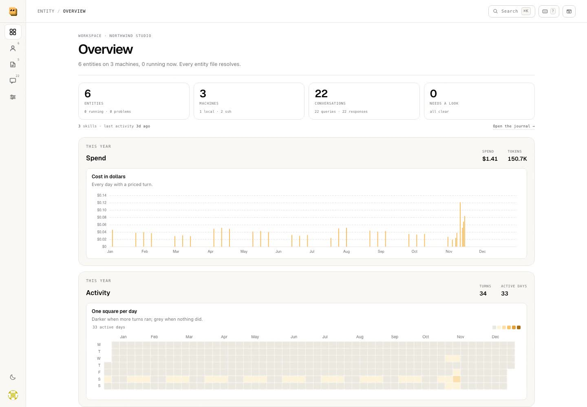
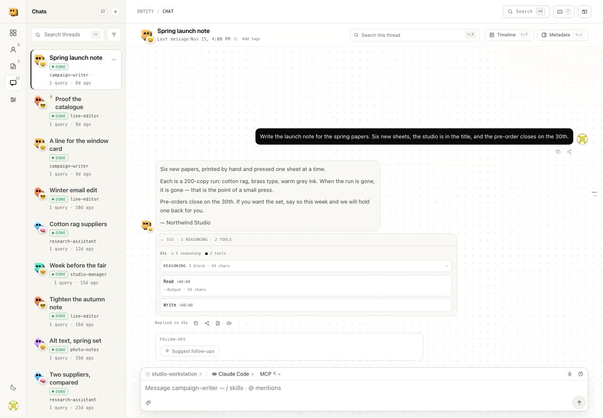
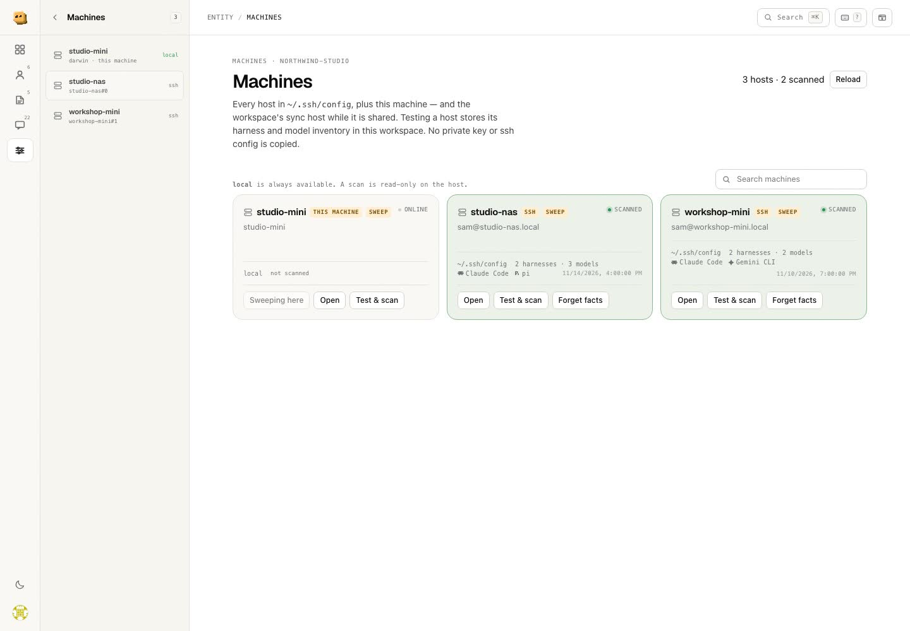
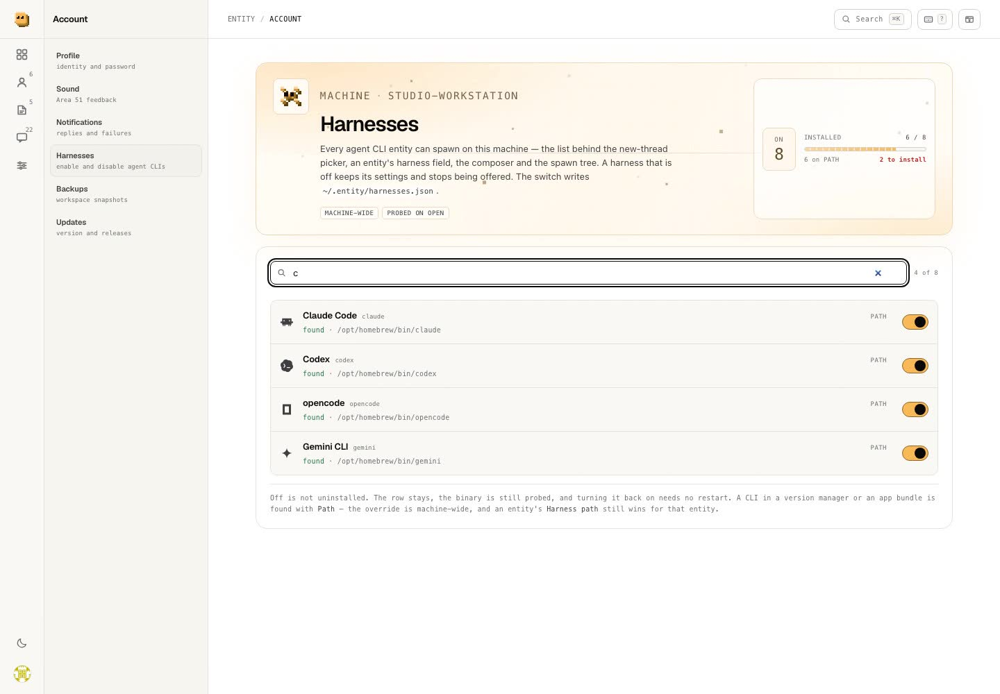
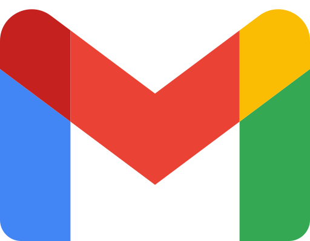
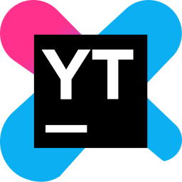

<h1 align="center">
  <a href="https://github.com/agung2001/entity"><picture><source srcset="docs/assets/entity-logo.webp" type="image/webp" /></picture></a> Entity
</h1>

<p align="center">
  
  
  
</p>

<p align="center">
  <strong>One calm place for everything you ask AI to do.</strong><br/>
  An assistant is a Markdown file. A workspace is a folder. A conversation is a real
  <code>claude</code>, <code>codex</code>, <code>pi</code> or <code>gemini</code>
  process — one of eight agent CLIs — on your own machine. Nothing simulated.
</p>

<p align="center">
  <picture><source srcset="docs/assets/readme-hero.webp" type="image/webp" /></picture>
</p>

## What it is

You already own capable agent CLIs. What you do not own is a place to keep them:
their instructions, their files, what they cost, which machine they ran on, and what
they did yesterday. Entity is that place.

Every assistant is a plain `.md` file in a folder you can open in any editor. Every
answer is a real process with a real exit code, a transcript you can read and a price
the harness actually reported. Nothing is synced to a service you did not choose.

## Why it feels different

- **Your files, your machine.** Workspaces are directories under `~/.entity/`;
  nothing is uploaded unless you connect a server yourself.
- **The instruction is a file.** Edit it, version it, hand it to someone, keep it
  forever. A frontmatter block decides harness, model, folder, skills and tools.
- **Nothing is simulated.** Missing binary or a signed-out CLI is reported as a
  failed turn, not a friendly fake answer.
- **Answers you can audit.** Every step keeps its thought, tool output, duration and
  tokens. One click shows where the time and the money went.
- **It is not only for code.** Campaigns, budgets, itineraries, research memos,
  support inboxes — the screenshots below are one workspace doing all of it.
- **Your own CLIs stay yours.** No wrapper, no proxy, no rewriting of their config.

## A look inside

<table>
<tr>
<td width="50%" valign="middle">

### Conversations you can re-read

Ask in plain language. Long turns fold into steps you can open: what the assistant
thought, what it ran, what came back. A mention does more than answer here — it leaves a
**session** you can continue, and `spawn N` or `spawn per` can hand one instruction to
several runs at once. Every answer can be retried, copied, shared with a link, or saved
into the workspace as a file.

</td>
<td width="50%">
  <a href="docs/conversations.md"><picture><source srcset="docs/assets/readme-features/chat.webp" type="image/webp" /></picture></a>
</td>
</tr>
<tr>
<td width="50%" valign="middle">

### An assistant is a file you can read

A little configuration at the top, its instructions below. Give it a face, watch
conversations turn into a calendar of the days it worked, and let **Learning** propose
a sharper brief from its own last ten threads — reviewed as a diff, applied only when
you click.

</td>
<td width="50%">
  <a href="docs/workspaces.md"><picture><source srcset="docs/assets/readme-features/entity.webp" type="image/webp" /></picture></a>
</td>
</tr>
<tr>
<td width="50%" valign="middle">

### Rooms, not projects

A studio, a marketing desk, your notes: each workspace owns its assistants, skills,
files, MCP servers and history. Export it as one file, back it up, or connect it to a
server so a team can share it.

</td>
<td width="50%">
  <a href="docs/workspaces.md"><picture><source srcset="docs/assets/readme-features/workspaces.webp" type="image/webp" /></picture></a>
</td>
</tr>
<tr>
<td width="50%" valign="middle">

### A shelf that keeps itself

Every save lands on **your** shelf first — an upload, a file a turn wrote, the render
you dragged in. Share one with the room and it becomes everyone's; the rest never
leaves your machine. Two clocks then archive and delete what nobody opened, on the one
machine you choose, and a file a live conversation still names is held back.

</td>
<td width="50%">
  <a href="docs/artifacts.md"><picture><source srcset="docs/assets/readme-features/artifacts.webp" type="image/webp" /></picture></a>
</td>
</tr>
<tr>
<td width="50%" valign="middle">

### Skills and tools that travel

A skill is a recipe you can hand to any assistant with `/` — the workspace's own
first, then every library on this machine. Add an MCP server once and every assistant
in the room can use it; its page states the transport, the command or URL and the tools
the server actually reported, searchable and split read/write. Secrets stay on disk and
are never sent back to the window.

</td>
<td width="50%">
  <a href="docs/skills.md"><picture><source srcset="docs/assets/readme-features/skills.webp" type="image/webp" /></picture></a>
</td>
</tr>
<tr>
<td width="50%" valign="middle">

### Your other computers

If you already reach a machine over ssh, Entity reads the host from `~/.ssh/config`.
Test it once and remember its harnesses and models — no key copy, no ssh config in the
workspace. A thread can be pinned there, terminal included.

</td>
<td width="50%">
  <a href="docs/machines.md"><picture><source srcset="docs/assets/readme-features/machines.webp" type="image/webp" /></picture></a>
</td>
</tr>
<tr>
<td width="50%" valign="middle">

### Fifteen connectors, one roster

Fifteen rows, one table. The Gmail, Drive, YouTube Studio and Habitify accounts sit
beside the MCP servers, the CLI binaries this machine already had, and one row that is
neither — Tailscale, which reads a local daemon and gates one command instead of storing
a credential. One row per connector, not one per mailbox — and each row states its kind,
its scope and whether it answers: a rejected YouTrack token, a `gh` that is installed but
not signed in, a mailbox with one of two accounts holding the scopes its tier asked for. An
account-bearing row carries its accounts and a `read` → `write` → `full` tier chosen per
workspace. A row's page is readable **before** you install it — the pitch, the mention
it offers and where its credential would live, with no configuration to fill in yet. The
definition travels with the workspace; the tokens stay on this machine.

</td>
<td width="50%" valign="middle">

<a href="docs/connectors.md"><picture><source srcset="docs/assets/readme-features/connectors.webp" type="image/webp" /></picture></a>

</td>
</tr>
<tr>
<td width="50%" valign="middle">

### The machine's own switches

**Account → Harnesses** is the inventory: every agent CLI this machine has, where its
binary lives, the models it reports and one switch. Off is not uninstalled — the CLI
keeps its path and stops being spawned or offered in any picker. The profile, sound and
notification pages sit beside it, and the same inventory is what a **Test & scan** stores
for an ssh host.

</td>
<td width="50%" valign="middle">

<a href="docs/machines.md"><picture><source srcset="docs/assets/readme-features/account-harnesses.webp" type="image/webp" /></picture></a>

</td>
</tr>
<tr>
<td width="50%" valign="middle">

### The year, in two charts

Spend and activity are folded from the turns themselves — cost and tokens per day, one
square per day that stays grey when nothing ran. The workspace gets the year; each
assistant gets its own calendar and bill.

</td>
<td width="50%">
  <a href="docs/conversations.md#usage-and-activity"><picture><source srcset="docs/assets/readme-features/usage.webp" type="image/webp" /></picture></a>
</td>
</tr>
</table>

**Also in the box:** fifteen shipped connectors with per-account OAuth and a
`read` → `write` → `full` tier per workspace · the harness inventory at **Account →
Harnesses**, with the profile, sound and notification pages beside it · **Learning**
with a scope you choose before it spends a run · a rebuilt composer dock and
delegation cards that fold into a session tree behind `spawn N` / `spawn per` · an
execution timeline per answer · a links-and-paths drawer derived from each thread ·
`@entity`, `@thread:`, `@artifact:`, `@maka:`, `@opendesign:`, `@youtrack:`, `@orca:`,
`@github:`, `@gmail:`, `@drive:`, `@youtube:`, `@youtube-studio:`, `@x:`, `@threads:`,
`@clockify:` and `@habitify:` mentions resolved before the agent
sees them · personal and shared artifact shelves with a two-clock archive sweep · a
folder-per-thread base directory with `/project:` skills · a terminal beside the chat
(``Ctrl+` ``) · voice with barge-in and read-aloud · ZIP backups on a rolling schedule ·
one-verb agent CLI with an audit log · two-way sync with a shared server, evaluator
included · a command palette and a keyboard guide that cannot drift from the handlers.

## Use cases

| you want to… | how it looks here |
| --- | --- |
| **Run a small content studio** | one workspace, an entity per role (brand writer, editor, researcher), shared Notion and Slack servers, skills for voice and structure — a launch campaign produced end to end |
| **Review numbers every week** | an entity with `dir:` pointing at the finance folder and a budget skill; answers land as artifacts on the shelf with the chart inline |
| **Keep research you can cite** | `@maka:` pulls notes from your vault, `@opendesign:` reads the workspace's design files, `@youtrack:` scopes issues to a project, and the links drawer collects every reference the thread touched |
| **Give a coding agent a home** | one entity per repo with `dir:` and its own skill set, `@file:` mention for files, a terminal in the same folder, spend per repo in the charts |
| **Share assistants with a team** | connect a workspace to a server, members sign in as themselves, MCP servers and skills travel with the workspace, and the guard scans everything before it is written |
| **Keep a shelf without hoarding** | saves land personal, one click shares a file with the room, and two clocks archive then delete by last opened — while a live thread keeps the files it still names |
| **Fan one instruction across a list** | `spawn per @youtrack:… @coder fix it` turns every matching issue into its own session, card and continuation, with the rows painted as they run |
| **Keep the office on your machines** | pin a thread to an ssh host and the harness runs there, inventories from one read-only scan, nothing installed on the server |

## Supported assistants

Works with the assistant CLIs you already have — eight of them. Entity finds each on
`PATH`, and **Account → Harnesses** pins a machine-wide executable where a version
manager or an app bundle put one somewhere else. They are installed from a terminal
once; after that you never need one to use the app.

<p>
  <a href="https://docs.claude.com/en/docs/claude-code/overview"><kbd> Claude Code · <code>claude</code></kbd></a> &nbsp;
  <a href="https://developers.openai.com/codex/cli/"><kbd> Codex · <code>codex</code></kbd></a> &nbsp;
  <a href="https://opencode.ai/docs/"><kbd> opencode · <code>opencode</code></kbd></a> &nbsp;
  <a href="https://github.com/google-gemini/gemini-cli"><kbd> Gemini CLI · <code>gemini</code></kbd></a> &nbsp;
  <a href="https://ollama.com"><kbd> Ollama · <code>ollama</code></kbd></a> &nbsp;
  <a href="https://github.com/earendil-works/pi"><kbd> pi · <code>pi</code></kbd></a> &nbsp;
  <a href="https://antigravity.google"><kbd> Antigravity · <code>agy</code></kbd></a> &nbsp;
  <a href="https://github.com/NousResearch/hermes-agent"><kbd> Hermes Agent · <code>hermes</code></kbd></a>
</p>

A run is a real process with a real exit code. Entity never invents a reply: a missing
binary or a signed-out CLI is reported as a failed turn, not a friendly fake answer.

## Connectors

Everything a workspace can reach lives in one roster at **Workspace settings →
Connectors**: an MCP server, a CLI binary and a REST service are three *kinds* of one
row, and the old bulk MCP list is a permanent redirect into it. Entity ships fifteen —
`gmail`, `google-drive`, `youtube`, `youtube-studio`, `x`, `habitify` and `threads`
account-bearing (`threads`' token is pasted rather than consented); `orca`, `youtrack` and
`github` the three the composer offered before connectors existed
(`orca` and `github` are `cli` rows, `youtrack` is an `mcp` row); `maka` and `open-design`
the MCP-backed ones; `clockify`, whose credential is one API key you paste once;
`tailscale`, a `cli` row that authenticates nothing at all — it reads this machine's
daemon and gates one command; and `chrome-devtools`, an `mcp` row that drives the Chrome
this machine already has open. Installing one records a *definition* in the workspace's
`connectors.json`, never a credential. An account-bearing connector gets its accounts
from a browser consent round-trip, one refresh token per account, kept beside
`integrations.json` in `~/.entity/` at `0600` and never returned by any read — and a
paste-once key lives in `connector-tokens.json` beside it, also `0600`, of which a page
only ever learns the last four characters. **Every connector's page reads before you
install it**: the pitch, the mention it answers and where its credential would live, with
the configuration cards held back until there is a binding for them to write to.

<p>
  <a href="https://mail.google.com"><kbd> Gmail · <code>@gmail:</code></kbd></a> &nbsp;
  <a href="https://drive.google.com"><kbd> Google Drive · <code>@drive:</code></kbd></a> &nbsp;
  <a href="https://www.youtube.com"><kbd> YouTube · <code>@youtube:</code></kbd></a> &nbsp;
  <a href="https://studio.youtube.com"><kbd> YouTube Studio · <code>@youtube-studio:</code></kbd></a> &nbsp;
  <a href="https://x.com"><kbd> X · <code>@x:</code></kbd></a> &nbsp;
  <a href="https://www.jetbrains.com/youtrack"><kbd> YouTrack · <code>@youtrack:</code></kbd></a> &nbsp;
  <a href="https://cli.github.com"><kbd> GitHub CLI · <code>@github:</code></kbd></a> &nbsp;
  <a href="https://orca.dev"><kbd> Orca · <code>@orca:</code></kbd></a> &nbsp;
  <a href="https://maka.agungsundoro.com"><kbd> Maka · <code>@maka:</code></kbd></a> &nbsp;
  <a href="https://clockify.me"><kbd> Clockify · <code>@clockify:</code></kbd></a> &nbsp;
  <a href="https://habitify.me"><kbd> Habitify · <code>@habitify:</code></kbd></a> &nbsp;
  <a href="https://open-design.ai/"><kbd> Open Design · <code>@opendesign:</code></kbd></a> &nbsp;
  <a href="https://tailscale.com"><kbd> Tailscale · no <code>@</code> form</kbd></a> &nbsp;
  <a href="https://developer.chrome.com/blog/chrome-devtools-mcp-debug-your-browser-session"><kbd> Chrome DevTools · no <code>@</code> form</kbd></a>
</p>

Two rows answer no `@` form, on purpose. Tailscale stores no credential, reads this
machine's daemon and puts the tailnet address in a QR, on
[its own page](docs/connectors/tailscale.md). Chrome DevTools stores no credential either:
it drives the Chrome this machine already has open, on
[its own page](docs/connectors/chrome-devtools.md). Every connector has one —
[Orca](docs/connectors/orca.md), [GitHub](docs/connectors/github.md),
[YouTrack](docs/connectors/youtrack.md), [Maka](docs/connectors/maka.md),
[Open Design](docs/connectors/open-design.md), [Gmail](docs/connectors/gmail.md),
[Drive](docs/connectors/google-drive.md), [YouTube](docs/connectors/youtube.md),
[YouTube Studio](docs/connectors/youtube-studio.md),
[Habitify](docs/connectors/habitify.md), [Clockify](docs/connectors/clockify.md),
[Threads](docs/connectors/threads.md), [X](docs/connectors/x.md) and
[Chrome DevTools](docs/connectors/chrome-devtools.md) — with
the detail page, what it reaches and the mention it answers.

**[Connectors →](docs/connectors.md)** · **[MCP servers →](docs/mcp.md)**

## Getting started

Requirements: **Node.js `^20.19` or `>=22.12`**, plus one of the eight CLIs above.

```bash
git clone https://github.com/agung2001/entity.git
cd entity
npm install
npm run dev:desktop      # Vite + Electron, HMR included
```

On a fresh profile the app lands on a three-step **welcome** card: name the room, pick
an agent CLI, say hello. It creates the machine-local owner on the way in, so there is
no sign-in form to fill. Prefer a scratch profile?
`ENTITY_HOME=/tmp/entity-scratch npm run dev:desktop`.

| Command | What it does |
| --- | --- |
| `npm run dev` | Renderer only, in a browser at http://localhost:5183 |
| `npm run dev:lan` | The same, bound to `0.0.0.0` so another machine on your network can open it |
| `npm run dev:desktop` | Vite **and** Electron, pointed at the dev server |
| `npm run test` | Unit tests + the static UI contract |
| `npm run test:gate` | Unit + smoke — the release gate |
| `npm run package` | A distributable for the current platform → `release/` |

Full command list, ports, test packs and release builds:
**[Quickstart →](docs/quickstart.md)**

## Documentation

| Document | What is in it |
| --- | --- |
| [Quickstart](docs/quickstart.md) | requirements, every `npm` command, ports, LAN dev, profiles, test packs, tagged releases |
| [Onboarding](docs/onboarding.md) | the first run: three steps, the silent owner account, and the return launch |
| [Workspaces and entities](docs/workspaces.md) | the folder tree, the entity file, Learning, chat retention, moving in from another tool |
| [Conversations](docs/conversations.md) | transcripts, timeline, mentions, delegation sessions and fan-out, base directories, usage and activity |
| [Skills](docs/skills.md) | how `/project:`, `/workspace:` and `/<harness>:` resolve, attach versus link |
| [Connectors](docs/connectors.md) | one roster, three kinds, the connector page, accounts and the consent round-trip, tiers, mentions |
| [MCP servers](docs/mcp.md) | one set per workspace, the server page and its tool list, how each harness receives it, the agent-facing endpoint |
| [Artifacts and backups](docs/artifacts.md) | personal versus shared shelves, share and unshare, the archive sweep, `artifact://`, ZIP snapshots |
| [Machines](docs/machines.md) | `~/.ssh/config`, test & scan, the machine that sweeps, pinned threads, the terminal |
| [Voice](docs/voice.md) | barge-in, transcription engines, privacy, sound cues |
| [Remote workspaces](docs/remote-sync.md) | two-way sync, the three-way diff, the guard and its evaluator, the artifact scope index |
| [Agent CLI](docs/agent-cli.md) | the verbs an entity can call on its own workspace |
| [Deploy the server](docs/deploy.md) | Docker, GHCR image, reverse proxy, hardening |
| [Architecture](docs/architecture.md) | layers, the one call table, child processes, the server |
| [Security](docs/security.md) | trust boundaries, what a run may write, credentials |
| [Limits](docs/limits.md) | what it deliberately does not do |
| [Status](docs/status.md) | what "growing" means here, and what is out of scope |
| [Migrating from Multica](docs/migrating-from-multica.md) | a real 8-agent port, step by step |
| [README media](docs/assets/README.md) | how the demos and the animated mark are recorded, encoded and checked |
| [`DESIGN.md`](DESIGN.md) | the interface contract every UI change is held to |

<p align="center">
  <sub>
    Built with Vue 3, Vite and Electron.
    <a href="docs/credits.md">Credits</a> ·
    <a href="docs/status.md">Status</a> ·
    <a href="docs/limits.md">Limits</a> ·
    <a href="docs/assets/README.md">How these demos are made</a>
  </sub>
</p>
