<h1 align="center">
  <a href="https://github.com/agung2001/entity"></a> Entity
</h1>

<p align="center">
  
  
  
  
</p>

<p align="center">
  <strong>One calm place for everything you ask AI to do.</strong><br/>
  An assistant is a Markdown file. A workspace is a folder. A conversation is a real
  <code>claude</code>, <code>codex</code>, <code>pi</code>, <code>opencode</code> or
  <code>gemini</code> process on your own machine — nothing simulated.
</p>

<p align="center">
  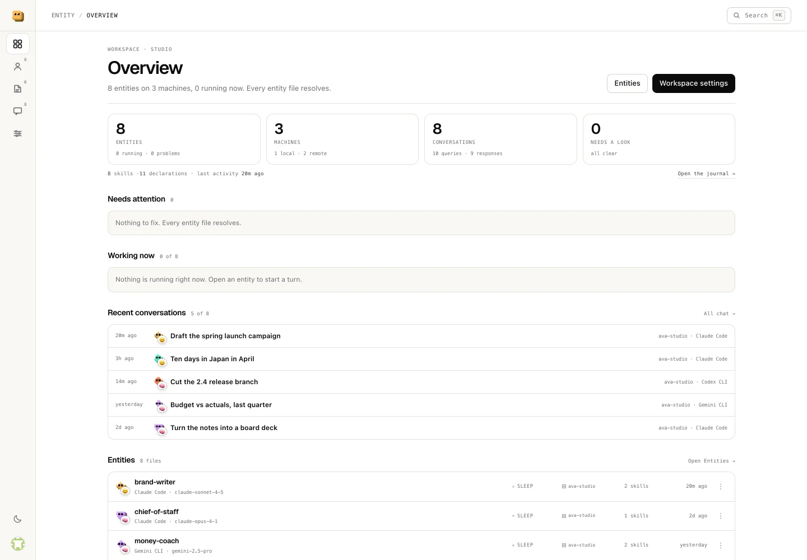
</p>

## Features

<table>
<tr>
<td width="50%" valign="middle">

### A conversation, not a console

Ask in plain language. Long turns fold into steps you can open: what the assistant
thought, what it ran, what came back. Every answer can be retried, copied, shared
with a link, or saved to the workspace as a file.

[Where it lives →](electron/chat-store.cjs)

</td>
<td width="50%">
  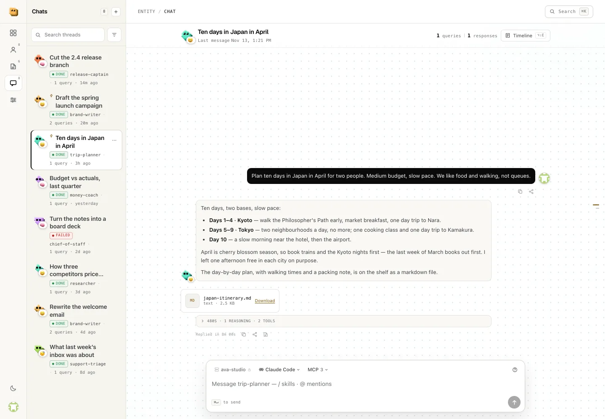
</td>
</tr>
<tr>
<td width="50%" valign="middle">

### An assistant is a file you can read

A little configuration at the top, its instructions below. Edit it in place, give
it a face, and watch conversations turn into levels. It stays a plain `.md` file
you can open in any editor — or put in a folder and keep forever.

[Entity file →](#one-file-is-the-entity)

</td>
<td width="50%">
  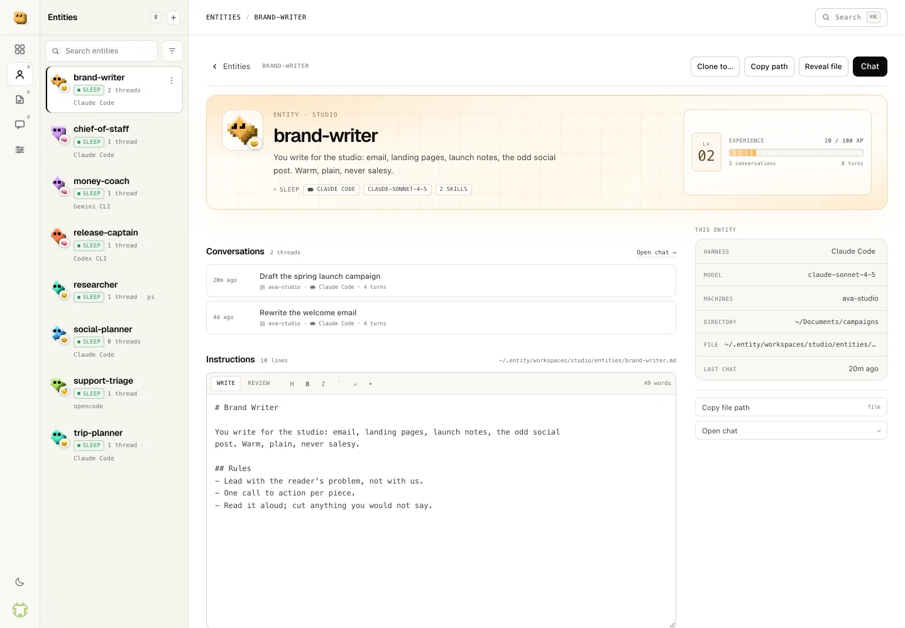
</td>
</tr>
<tr>
<td width="50%" valign="middle">

### See how an answer was made

Every turn keeps what it ran, where, with which model, and how long each step
took. Click a step to read the thought or the tool output behind it — no guessing
and no black box.

[Where it lives →](src/components/TimelineDialog.vue)

</td>
<td width="50%">
  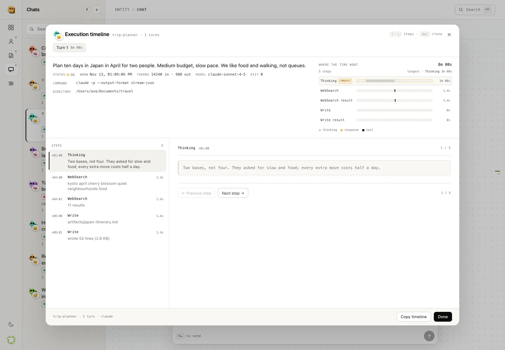
</td>
</tr>
<tr>
<td width="50%" valign="middle">

### Workspaces are rooms

A studio, a marketing desk, your personal notes: each room owns its assistants,
skills, files and history, all under `~/.entity/workspaces/<id>/`. Pick one, import
or export it, or connect it to a server to share with other people.

[Workspaces →](#workspaces-and-entities)

</td>
<td width="50%">
  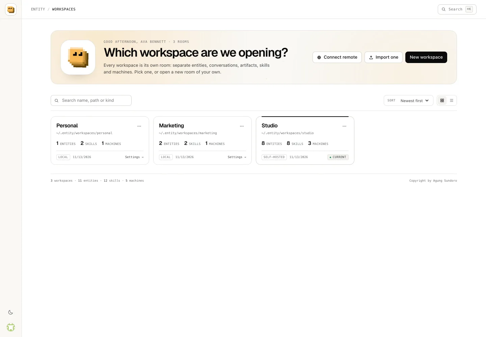
</td>
</tr>
<tr>
<td width="50%" valign="middle">

### Skills you can hand over

A skill is a recipe: how you write, how you research, how you check numbers. Type
`/` in a message to hand one to the assistant — the workspace's own first, then
every library on this machine. Two libraries with the same name is an error, never
a guess.

[Skills →](#skills-are-called-not-just-declared)

</td>
<td width="50%">
  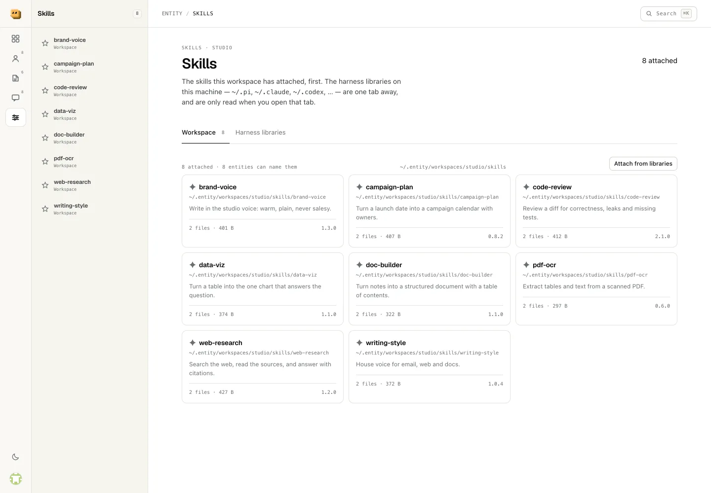
</td>
</tr>
<tr>
<td width="50%" valign="middle">

### Connect the tools you already use

Notion, Slack, a notes vault: add a connection once and every assistant in the
workspace can use it. One assistant can keep to a subset, or none. Secrets stay on
disk and are never sent back to the window.

[MCP →](#shared-mcp-servers)

</td>
<td width="50%">
  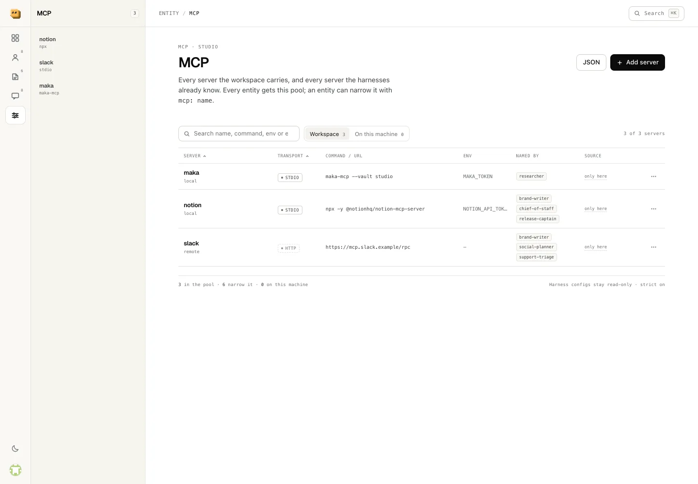
</td>
</tr>
<tr>
<td width="50%" valign="middle">

### Your other computers

If you already reach a machine over ssh, attach it to a workspace. The workspace
decides which hosts it may use and carries a copy of the key — attach, test and
detach without editing a config by hand.

[Machines →](#machines)

</td>
<td width="50%">
  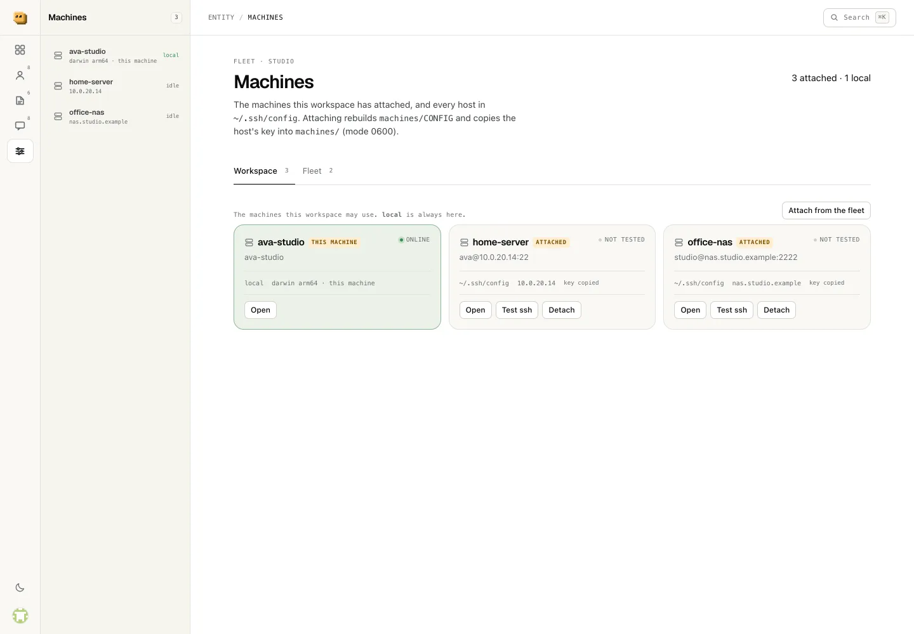
</td>
</tr>
<tr>
<td width="50%" valign="middle">

### Files live beside the conversation

A document, a chart, an itinerary the assistant wrote lands on the workspace shelf,
not in `/tmp`. The chat shows it inline, keeps whatever a turn saved, and opens any
file on its own page.

[Artifacts →](#artifacts)

</td>
<td width="50%">
  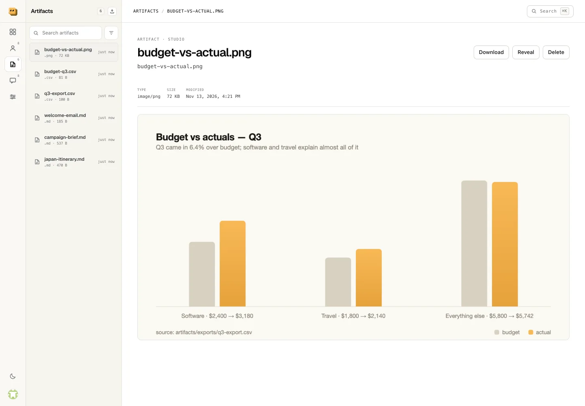
</td>
</tr>
<tr>
<td width="50%" valign="middle">

### Find anything, fast

One shortcut opens a palette over workspaces, conversations, assistants, skills,
machines and the journal. Type three letters, press enter, and you are there.

</td>
<td width="50%">
  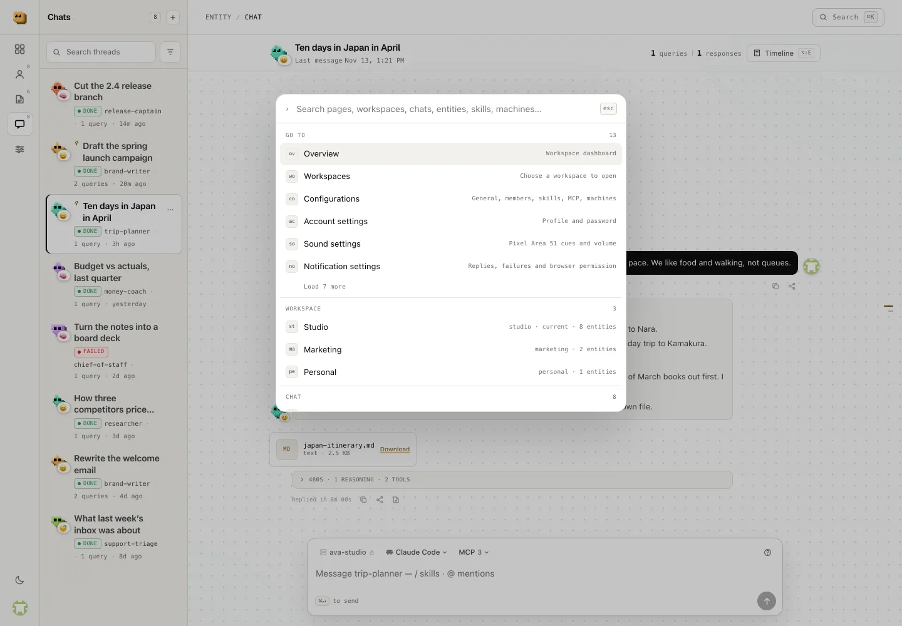
</td>
</tr>
<tr>
<td width="50%" valign="middle">

### Every conversation in one place

The Activity journal keeps a row per thread — who, what, when and where — and a
tab for each assistant's own session history. Search it by title, assistant or
context.

</td>
<td width="50%">
  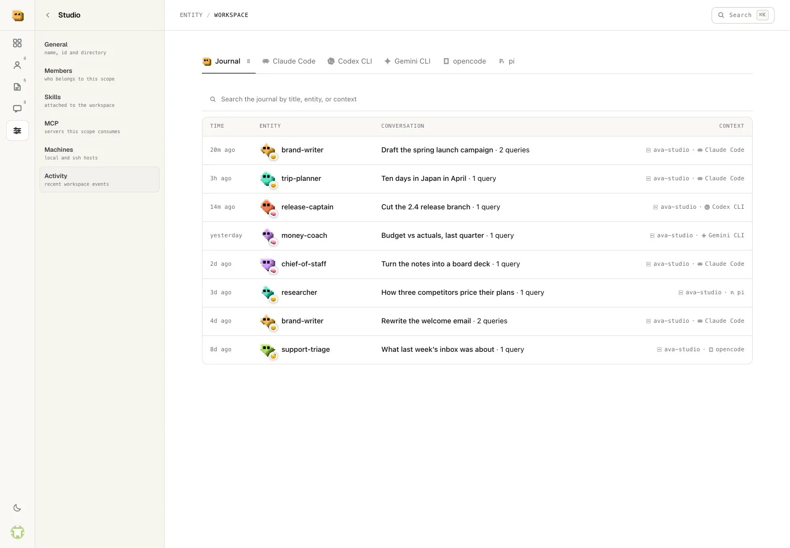
</td>
</tr>
<tr>
<td width="50%" valign="middle">

### A hub with a soundtrack

Twenty small cues for opening a room, sending a message, landing a reply and
failing a turn. Synthesized locally with Web Audio — no files, no downloads — and
one volume slider in Account → Sound.

</td>
<td width="50%">
  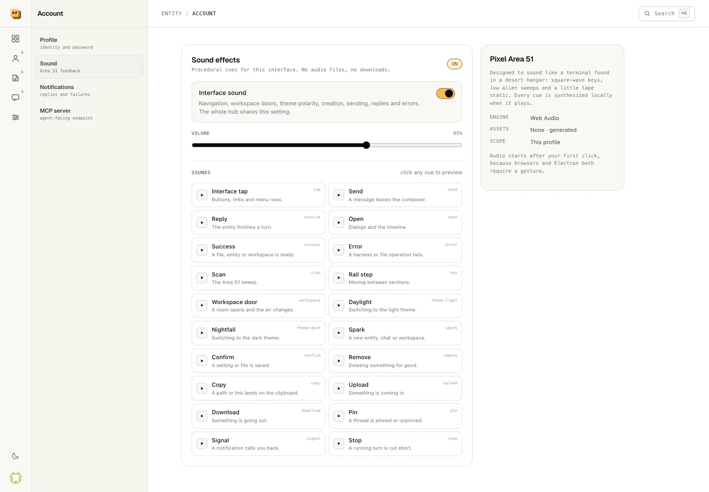
</td>
</tr>
</table>

**Built for more than code.** The screenshots above are one workspace doing a
launch campaign, a quarterly budget review, a ten-day itinerary, a research memo, a
support-inbox triage and a release — each with its own assistant and its own files.
Coding is one of the things you can do here, not the thing the app is about.

**Also in the box:**

- **Notifications that stay quiet**: a banner when a reply lands or a turn fails, only while you are elsewhere, never carrying a token or a transcript.
- **Mentions that resolve before the assistant sees them**: `@entity`, `@artifact:`, `@maka:`, `@youtrack:`, `@orca:`.
- **A CLI your agents can call**: `entity` can list workspaces, read and rewrite an entity, add an MCP server, and every write is audited.
- **Remote workspaces**: two-way sync with a shared server, with a guard that runs before any pulled byte is written.

---

## Supported assistants

Works with the assistant CLIs you already have. Entity finds them on `PATH`, and an
assistant's Configuration dialog can pin a machine-wide executable per harness. They
are installed from a terminal once; after that you never need one to use the app.

<p>
  <kbd>Claude Code · <code>claude</code></kbd> &nbsp;
  <kbd>Codex CLI · <code>codex</code></kbd> &nbsp;
  <kbd>Gemini CLI · <code>gemini</code></kbd> &nbsp;
  <kbd>opencode · <code>opencode</code></kbd> &nbsp;
  <kbd>pi · <code>pi</code></kbd>
</p>

A run is a real process with a real exit code. Entity never invents a reply: if the
binary is missing or not signed in, the turn says so.

---

## Getting started

Requirements: **Node.js `^20.19` or `>=22.12`** (Vite 8).

```bash
git clone https://github.com/agung2001/entity.git
cd entity
npm install
npm run dev:desktop      # Vite + Electron, HMR included
```

| Command | What it does |
| --- | --- |
| `npm run dev` | Renderer only, in a browser at http://localhost:5183 |
| `npm run dev:desktop` | Vite **and** Electron, pointed at the dev server |
| `npm run build` | Builds the renderer into `dist/` |
| `npm run start` | Runs Electron against the existing `dist/` build |
| `npm run test` | Node's test runner over `electron/**/*.test.cjs` |
| `npm run package` | Builds a distributable with electron-builder → `release/` |
| `npm run clean:dev` | Stops a dev server or headless browser this checkout left behind |

The dev server uses **5183** so it does not collide with the projects that grab
Vite's default 5173. Override it with `VITE_DEV_PORT=6000`.

`ENTITY_HOME` moves the whole profile — account, workspaces, run logs — which is
handy for a scratch hub:

```bash
ENTITY_HOME=/tmp/entity-scratch npm run dev:desktop
```

On a fresh profile the app lands on **Create a workspace**. An empty account owns
the hub; until one is registered, the first sign-in with the workspace owner's
email and the documented default password `123456` bootstraps it.

## Workspaces and entities

A workspace is a directory, not a database row. Switching workspaces changes the
entities, skills, machines, artifacts and run history at once, and everything
survives quitting the app.

```
~/.entity/
  auth.json                     account + scrypt verifier + encrypted password
  harnesses.json                optional per-harness binary paths
  workspaces/<id>/
    workspace.json              { label, kind, context, mcpStrict, members }
    members.json                owner + roster
    entities/<name>.md          frontmatter = config, body = instructions
    skills/<name>               symlink into a harness skill library
    mcp.json                    the workspace MCP pool (mode 0600)
    machines/CONFIG             this workspace's ssh_config, + one key per host
    chats/<threadId>.json       one conversation per file, private to its account
    artifacts/<path>            documents, screenshots and other deliverables
    runs/<runId>.jsonl          append-only run log
    audit.jsonl                 one line per agent-initiated write
```

### One file is the entity

```markdown
---
name: brand-writer
harness: claude
model: claude-sonnet-4-5
dir: ~/Documents/campaigns
skills: brand-voice, writing-style
mcp: notion, slack
---
# Brand Writer

You write for the studio: email, landing pages, launch notes, the odd social
post. Warm, plain, never salesy.

## Rules
- Lead with the reader's problem, not with us.
- One call to action per piece.
- Read it aloud; cut anything you would not say.
```

The body reaches the harness as a system prompt (`claude`, `pi`) or as prompt text
(`codex`, `opencode`, `gemini`); the prompt itself always goes in on **stdin**, and
`cwd` is the entity's `dir`. A `skills:` or `mcp:` name that does not resolve is
reported as a problem on the entity — the file stays readable and the run is still
allowed.

Nothing is seeded behind your back: a new workspace is empty, and the sample roles
are a checkbox in the create form — each one listed so you choose which files to
write. A fresh entity can also start from one of those roles, or from a blank brief.

## Chat transcripts

Each turn is a real harness process in JSONL stream mode
(`claude --output-format stream-json`, `pi --mode json`, equivalents for the rest).
The transcript keeps the thinking, the answer, and a row per tool call with its
output; the execution metadata (command, cwd, model, duration, usage, exit code)
stays on the assistant message, so there is no second copy anywhere.

- Older messages without a transcript simply show no transcript.
- A failed turn carries **Retry** — it re-runs the same question without adding a
  second copy of it, and keeps the files it already saved.
- Every message has copy and share; share is a deep link (`?thread=…&msg=…`) that
  opens the thread and scrolls to the row.
- A thread records the account that created it. List, read, rename, send, cancel and
  remove only see that account's threads, even in a shared workspace.
- The right-edge outline draws one tick per message and opens a jump card.

### Skills are called, not just declared

| reference | resolves to |
| --- | --- |
| `/workspace:<name>` | `<ws>/skills/<name>` — attached to this workspace |
| `/<harness>:<name>` | that harness's own library, e.g. `~/.claude/skills/<name>` |
| `/<name>` | any library on this machine, when exactly one has that name |

The `/` menu inserts the qualified form. A bare `/name` is accepted only when one
library has it; two libraries with the same name is an error listing both forms,
not a guess. The backend resolves the reference to an absolute path **on the
machine the thread is pinned to** and sends `use this skill /abs/path` above the
prompt. The reference itself is not sent, and a reference this app owns that does
not resolve stops the message.

### Mentions are resolved before the agent sees them

| mention | becomes |
| --- | --- |
| `@release-captain cut the branch` | that entity **runs** the job first; its answer is injected into this turn |
| `@artifact:q3-usage.csv` | a file on this workspace's shelf, as `artifact://…` plus its path |
| `@maka:atlas:plan` | notes found through the Maka MCP server (vault, then query) |
| `@youtrack:AC:login bug` | issues through the YouTrack MCP server, scoped to `project: AC` |
| `@orca:Atlas:src/app.ts` | an absolute path inside an Orca project |

A mention owns the text after it up to the next `@`, which is how a query can
contain spaces without quotes. While one word is being typed the composer lists
matches ten at a time, with **Show 10 more** to page the source. A **name** that
does not exist stops the message; a **search** with no hits only adds a note.

## Shared MCP servers

The workspace has one pool (`<ws>/mcp.json`) and every entity gets it. Add a server
once — on the MCP page, or by attaching one a harness already has configured — and
any thread can use it. An entity may narrow the pool in its own frontmatter, and
`mcp: none` opts out entirely.

What the turn spawns was checked against each CLI; none of it writes into your own
config:

| harness | how the pool reaches it | merge or replace |
| --- | --- | --- |
| `claude` | `--mcp-config <file> --strict-mcp-config` | replaces (only the pool) |
| `opencode` | `OPENCODE_CONFIG=<file>` | merges over its own |
| `codex` | `-c mcp_servers.<name>.*`; a bearer token rides in `ENTITY_MCP_<NAME>_TOKEN` | merges; the token never appears in `ps` |
| `pi` | a generated `--extension` that calls `pi.registerMcpServer()`; an older pi gets a mirrored agent dir with a merged `mcp.json` | merges; pi's own `mcp.json` wins a clash |
| `gemini` | a mirrored temp `~/.gemini` with `settings.json` merged, plus `--skip-trust` | merges |

The temp file or directory sits under `<ws>/runs/.mcp-*`, mode 0600, and is removed
when the process exits. A server that is missing from the pool, or whose secret is
unset, is reported on the turn instead of half-written — and the turn still runs.

Attaching a server copies its definition **verbatim**, including the header or env
value that makes it work. That is the point, and it is why the pool is 0600. No verb
returns a value back: the inventory reports `envKeys`/`headerKeys`, the MCP page
shows names, and the audit log records the server name only.

## Machines

Two rules make the scope coherent:

1. **The workspace is the scope, the machine is the source.** `~/.ssh/config` says
   which hosts exist; `machines/CONFIG` says which ones this workspace may use, and
   carries the key copy so it can prove it.
2. **No cross-workspace references.** `skills:` and `mcp:` resolve only inside their
   own workspace. The same name in two workspaces is two unrelated things.

`machines/CONFIG` is rebuilt from `~/.ssh/config` on every attach and detach; a host
that disappeared from your config stays attached as *missing*. Attaching copies the
host's key into `machines/<host>` (0600) and rewrites that `Host` block to point at
the copy.

Runs still execute on the machine whose window started them. Machines are a scope
and a set of credentials for a workspace, not a placement engine — see
[Ceilings](#ceilings-stated-not-hidden).

## Artifacts

The harness is told that workspace artifacts belong in `<ws>/artifacts`, that a
screenshot goes there rather than `/tmp`, and that a saved file should be referenced
as `artifact://<relative-path>`. The chat renders that reference as an image or a
download card, and also attaches any file written to the shelf during the turn even
when the answer never names it.

The rail's artifact panel browses, uploads, searches and removes; a row opens the
artifact's own page with an inline preview, metadata, download and reveal.

## The agent-facing side

Every run gets `ENTITY_CLI_PATH` and a short brief, so an entity can work on its own
workspace:

```bash
"$ENTITY_CLI_PATH" entity list
"$ENTITY_CLI_PATH" entity get release-captain --output json
"$ENTITY_CLI_PATH" entity set-instructions release-captain --body-stdin
"$ENTITY_CLI_PATH" mcp add github --command npx --args -y,server-github
"$ENTITY_CLI_PATH" workspace set-context --context-stdin
```

Four things make that safe to hand out:

- **One writer.** `electron/platform-core.cjs` owns every verb; `cli.cjs` is a
  transport over it and touches no paths.
- **Containment on the resolved path.** A name must match the entity grammar *and*
  the resulting real path must be inside the workspace.
- **Optimistic concurrency.** `set-instructions --if-unchanged <stamp>` refuses a
  write that would clobber a person editing the same file in `$EDITOR`.
- **An audit line.** Every mutation appends to `<ws>/audit.jsonl`; `entity audit`
  reads it back.

The same verbs are reachable from the window through `platform.verbs` /
`platform.call`, so a UI for them does not need a second implementation. Account →
MCP is the other direction: a loopback Streamable HTTP MCP server with a bearer
token and writes opt-in, exposing workspaces, entities, chats and artifacts to a
client outside a run. It is off until you enable it.

## Remote workspaces (two-way sync)

The same app can run as a shared server. On the workspace picker, **Connect remote**
asks for the server URL and your account, lists the workspaces you may open, and
clones the one you pick into a local workspace of the same name.

- **What syncs:** `entities/**`, `artifacts/**`, attached skill names and harnesses,
  the MCP pool (secrets redacted) and the shared workspace metadata.
- **What does not:** skill bodies (each machine links its own library), MCP secrets,
  copied ssh keys, chats and run logs.
- **Incremental:** both ends hash a content-addressed manifest; the local side keeps
  the base manifest and does a three-way diff, so only changed paths move.
- **Conflict copies, never silent loss:** if both sides changed a file, the remote
  version keeps the path and the local bytes go to
  `artifacts/conflicts/<path>.<stamp>.local.<ext>`. Deletes move to
  `.remote-trash/<stamp>/`. Writes are conditional (`x-entity-base`), so a
  concurrent edit answers `409` and is resolved on the next pass.
- **MCP is quarantined:** a server new to this machine lands in `mcp.json`'s
  `disabled[]` until a person enables it. A remote `command` is code.
- **The guard runs first:** every pulled text blob is scanned for prompt injection,
  credential export, shell pipes, invisible unicode and injected markup. A
  high-severity finding aborts before any write, marks the connection `blocked` and
  shows the excerpt. Approving binds to the exact sha256.
- **Second opinion:** the connect dialog can run one installed CLI over the pulled
  bytes with a strict JSON brief. If that evaluator cannot run, the sync stops with
  an error rather than pretending it was checked.

Connection state lives in `<ws>/.remote.json`; the bearer token in
`<ws>/.remote.token` (0600). The password is not stored.

## Deploy the server (Docker)

```bash
cp .env.example .env        # set ENTITY_ADMIN_EMAIL + a long ENTITY_ADMIN_PASSWORD
docker compose up -d --build
docker compose logs -f entity
```

The admin account is created only while the account store is empty. Add teammates
from the container (the password is read from the environment, never argv):

```bash
docker compose exec -e ENTITY_NEW_PASSWORD='a long password' entity \
  node server/users.cjs add teammate@example.com "Teammate"
```

Then sign in, create a workspace, and add the teammate's email under Workspace
settings → Members.

`docker-compose.yml` publishes **port 1020** and nothing else. Point nginx at it
(`proxy_pass http://127.0.0.1:1020;`), forward `Host`, set
`X-Forwarded-Proto: https`, and disable buffering for `/__entity/events` so run
output streams. Keep `ENTITY_SECURE_COOKIE=true` behind TLS.

The image runs as uid 10001 with a read-only root filesystem, a tmpfs `/tmp`,
`cap_drop: ALL` and `no-new-privileges`; it needs Node built-ins only. The data
directory is the named volume `entity-data` at `/data` (`ENTITY_HOME`).

## How it is put together

<details>
<summary>Layers, the one call table, and child processes</summary>

- **Renderer** (`src/`): Vue 3, a two-tier rail, hash history in the packaged app
  and clean URLs when a server can resolve a path. The guard runs in order
  **session → workspace → route**.
- **One call table** (`electron/rpc.cjs`): every local read and write goes through
  it. Electron exposes it as `ipcMain.handle('entity:call')`; the Vite dev server
  exposes the same table at `POST /__entity/call` and streams run events at
  `GET /__entity/events`. The renderer never touches `fs` and never receives a
  path or a shell string to run.
- **Main process** (`electron/`): workspace, entity, chat, artifact, harness, MCP
  and remote-sync stores; `platform-core.cjs` is the only writer an agent can
  reach.
- **Server** (`server/`): the same call table behind scrypt accounts, HMAC
  sessions, membership checks and the sync API.
- **Child processes** (`electron/child-registry.cjs`): a harness is not one
  process. The child is a process-group leader on POSIX (and `taskkill /T` on
  Windows), every live child is written to a pid journal, and shutdown is SIGTERM
  then SIGKILL after 3 s on the whole group. A hard kill runs no handler, so the
  next boot reaps what the last one left — after proving the pid is still ours.

Add a feature by adding a handler to the call table — not by inventing a channel
per feature. Keep `contextIsolation: true`, `nodeIntegration: false` and
`sandbox: true`, and never expose `ipcRenderer` itself.

</details>

## Security notes

- The renderer is sandboxed with context isolation; the CSP in `index.html` allows
  the HMR websocket in dev and nothing extra in production.
- Prompts go to the harness on stdin, never through a shell (`shell: false`).
  `harness` is one of five known ids; names are `[a-z0-9-]+`; `dir` is resolved in
  main before anything spawns.
- A run can write its own workspace, so the CLI re-checks containment on the
  resolved path, refuses a write that raced an outside edit, and logs every
  mutation. It cannot reach another workspace, the ssh config or a key.
- The MCP pool may hold a credential (0600). No verb returns a value; the
  inventory and audit log show names only; tool discovery returns names,
  descriptions and schemas.
- Chat transcripts hold model thinking and tool output. They live only in the
  workspace's thread JSON and are never sent anywhere by the hub.
- On the server, every call and the event stream require a session, membership is
  enforced per workspace, and host-level actions are administrator-only. Sync
  paths are scoped to `entities/` and `artifacts/`, re-checked against the
  workspace root, and dotfiles, `..`, absolute paths, symlinks and files over
  25 MB are refused or skipped.

## Ceilings (stated, not hidden)

- A run dies with the app; there is no daemon. Nothing keeps working while the
  window is closed.
- **Remote agent placement is not implemented.** Workspace sync is real; a run
  still executes on the machine whose window started it, and the server image has
  no harness binaries.
- Sync is file-level, not a CRDT: simultaneous edits keep both bytes as a conflict
  copy, but they are not merged line by line.
- Skills are not sandboxed per workspace at execution time; a harness loads its own
  user-level library. Only this machine's libraries can be read, so a thread pinned
  to an ssh host offers none rather than a path the far side cannot see.
- The remote guard is a deterministic scan plus an optional model reviewer, not a
  sandbox. It catches the obvious payloads before they reach a harness; it cannot
  prove a file is benign.
- `audit.jsonl` is written and readable from the CLI but has no window yet.
- Export carries entities, chats, artifacts, copied skills and the MCP pool. Copied
  private keys, generated ssh config and run logs are deliberately left out.
- `machines/CONFIG` holds absolute `IdentityFile` paths, so moving a workspace
  directory by hand breaks the key reference — attach the host again.

## Status

The app is growing and this README tracks what exists today, not what is planned.
There is no separate documentation site yet; the code is the reference, and the
test suite (`npm test`) is the closest thing to a specification. Interfaces may
move while the shape settles.

Not included on purpose: state management (`pinia`), TypeScript, auto-update.

## Credits

Built with Vue 3, Vite and Electron. The interface, the pixel marks and the
"Pixel Area 51" sound design are part of the app. Fonts: Geist, bundled locally.
