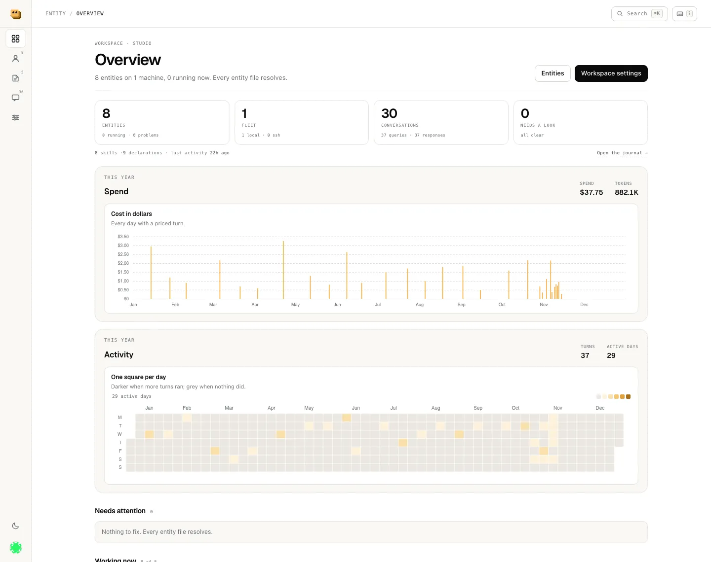
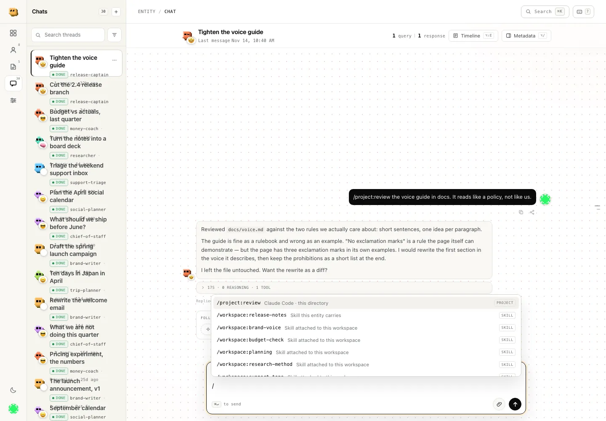
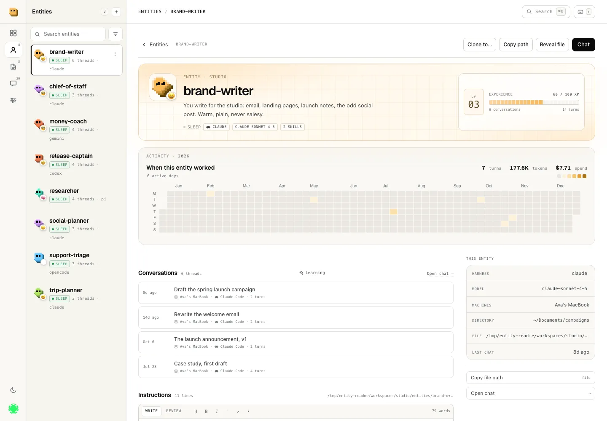
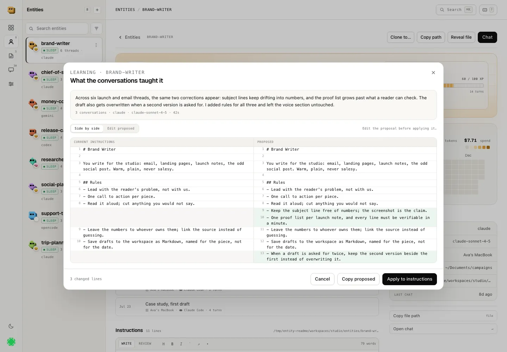
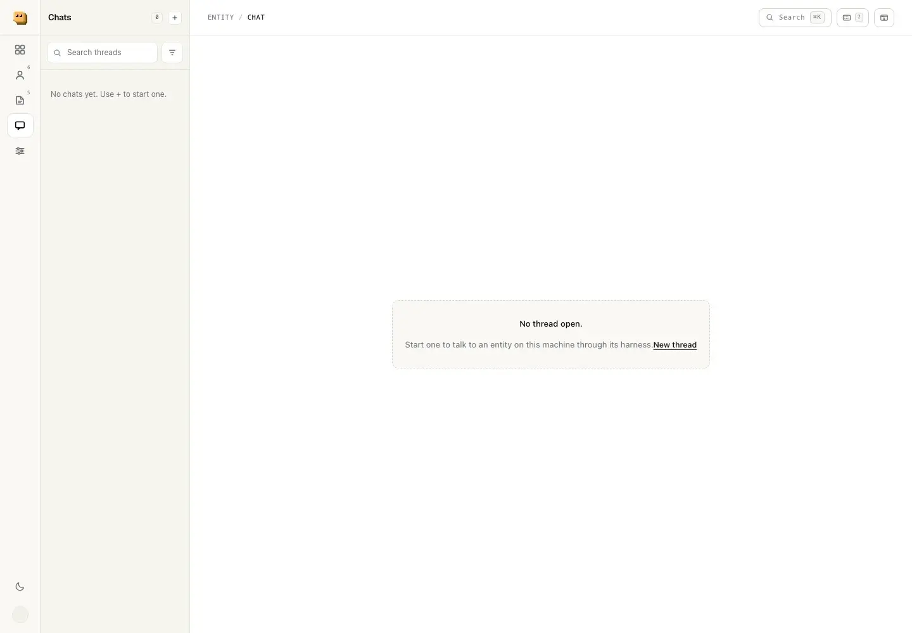
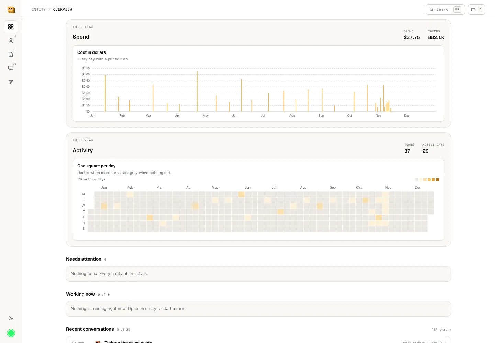

<h1 align="center">
  <a href="https://github.com/agung2001/entity"></a> Entity
</h1>

<p align="center">
  
  
  
  
</p>

<p align="center">
  <strong>One calm place for everything you ask AI to do.</strong><br/>
  An assistant is a Markdown file. A workspace is a folder. A conversation is a real
  <code>claude</code>, <code>codex</code>, <code>pi</code>, <code>opencode</code> or
  <code>gemini</code> process on your own machine — nothing simulated.
</p>

<p align="center">
  
</p>

## Features

<table>
<tr>
<td width="50%" valign="middle">

### A conversation, not a console

Ask in plain language. Long turns fold into steps you can open: what the assistant
thought, what it ran, what came back. Every answer can be retried, copied, shared
with a link, or saved to the workspace as a file — and a file the turn wrote shows
up on the answer without a reload. A finished reply suggests three follow-ups; one
click sends one.

[Where it lives →](electron/chat-store.cjs)

</td>
<td width="50%">
  
</td>
</tr>
<tr>
<td width="50%" valign="middle">

### Start in the folder the work lives in

A thread can name a project folder: the harness starts there, `/` lists that
folder's `.claude/`, `.agents/` and `.pi/` skills as `/project:…`, and `@file:`
browses the project instead of asking you to know the path. Optional, per
thread, and only on this machine.

[Base directories →](#a-folder-per-thread)

</td>
<td width="50%">
  
</td>
</tr>
<tr>
<td width="50%" valign="middle">

### An assistant is a file you can read

A little configuration at the top, its instructions below. Edit it in place, give
it a face, and watch conversations turn into levels and a calendar of the days it
worked. It stays a plain `.md` file you can open in any editor — or put in a
folder and keep forever.

[Entity file →](#one-file-is-the-entity)

</td>
<td width="50%">
  
</td>
</tr>
<tr>
<td width="50%" valign="middle">

### The entity learns from its own conversations

Learning reads the last ten threads and proposes a sharper brief: what people
keep asking for, what it keeps missing. You get a side-by-side diff and an
editor; reviewing never touches the file, and Apply is a separate, deliberate
click.

[Learning →](#learning-from-conversations)

</td>
<td width="50%">
  
</td>
</tr>
<tr>
<td width="50%" valign="middle">

### See how an answer was made

Every turn keeps what it ran, where, with which model, how long each step took
and what the tokens cost. Click a step to read the thought or the tool output
behind it — no guessing and no black box.

[Where it lives →](src/components/TimelineDialog.vue)

</td>
<td width="50%">
  
</td>
</tr>
<tr>
<td width="50%" valign="middle">

### The year, in two charts

Spend and activity are folded from the turns themselves — cost and tokens per
day, and one square per day that stays grey when nothing ran. The workspace gets
the year; each entity gets its own calendar and bill on its page.

[Usage →](#usage-and-activity)

</td>
<td width="50%">
  
</td>
</tr>
<tr>
<td width="50%" valign="middle">

### Workspaces are rooms

A studio, a marketing desk, your personal notes: each room owns its assistants,
skills, files and history, all under `~/.entity/workspaces/<id>/`. Pick one, import
or export it, or connect it to a server to share with other people.

[Workspaces →](#workspaces-and-entities)

</td>
<td width="50%">
  
</td>
</tr>
<tr>
<td width="50%" valign="middle">

### Skills you can hand over

A skill is a recipe: how you write, how you research, how you check numbers. Type
`/` in a message to hand one to the assistant — the workspace's own first, then
every library on this machine. Two libraries with the same name is an error, never
a guess.

[Skills →](#skills-are-called-not-just-declared)

</td>
<td width="50%">
  
</td>
</tr>
<tr>
<td width="50%" valign="middle">

### Connect the tools you already use

Notion, Slack, a notes vault: add a connection once and every assistant in the
workspace can use it. One assistant can keep to a subset, or none. Secrets stay on
disk and are never sent back to the window.

[MCP →](#shared-mcp-servers)

</td>
<td width="50%">
  
</td>
</tr>
<tr>
<td width="50%" valign="middle">

### Your other computers

If you already reach a machine over ssh, the fleet reads its host from
`~/.ssh/config`. Test it once and the workspace keeps a non-secret inventory of
the harnesses and models installed there — no key copy, no ssh config in the
workspace.

[Fleet →](#fleet)

</td>
<td width="50%">
  
</td>
</tr>
<tr>
<td width="50%" valign="middle">

### Files live beside the conversation

A document, a chart, an itinerary the assistant wrote lands on the workspace shelf,
not in `/tmp`. The chat shows it inline, keeps whatever a turn saved, and opens any
file on its own page.

[Artifacts →](#artifacts)

</td>
<td width="50%">
  
</td>
</tr>
<tr>
<td width="50%" valign="middle">

### Find anything, fast

One shortcut opens a palette over workspaces, conversations, assistants, skills,
the fleet and the journal. Type three letters, press enter, and you are there.

</td>
<td width="50%">
  
</td>
</tr>
<tr>
<td width="50%" valign="middle">

### Every conversation in one place

The Activity journal keeps a row per thread — who, what, when and where — and a
tab for each assistant's own session history. Search it by title, assistant or
context.

</td>
<td width="50%">
  
</td>
</tr>
<tr>
<td width="50%" valign="middle">

### A hub with a soundtrack

Twenty small cues for opening a room, sending a message, landing a reply and
failing a turn. Synthesized locally with Web Audio — no files, no downloads — and
one volume slider in Account → Sound.

</td>
<td width="50%">
  
</td>
</tr>
</table>

**Built for more than code.** The screenshots above are one workspace doing a
launch campaign, a quarterly budget review, a ten-day itinerary, a research memo, a
support-inbox triage and a release — each with its own assistant and its own files.
Coding is one of the things you can do here, not the thing the app is about.

**Also in the box:**

- **Notifications that stay quiet**: a banner when a reply lands or a turn fails, only while you are elsewhere, never carrying a token or a transcript.
- **A keyboard guide**: the `?` in the top bar lists every shortcut, grouped by where you are. It is generated from one catalog, so it cannot drift from the handlers.
- **Mentions that resolve before the assistant sees them**: `@entity`, `@artifact:`, `@maka:`, `@youtrack:`, `@orca:`.
- **A CLI your agents can call**: `entity` can list workspaces, read and rewrite an entity, add an MCP server, and every write is audited.
- **Remote workspaces**: two-way sync with a shared server, with a guard that runs before any pulled byte is written.

---

## Supported assistants

Works with the assistant CLIs you already have. Entity finds them on `PATH`, and an
assistant's Configuration dialog can pin a machine-wide executable per harness. They
are installed from a terminal once; after that you never need one to use the app.

<p>
  <kbd>Claude Code · <code>claude</code></kbd> &nbsp;
  <kbd>Codex CLI · <code>codex</code></kbd> &nbsp;
  <kbd>Gemini CLI · <code>gemini</code></kbd> &nbsp;
  <kbd>opencode · <code>opencode</code></kbd> &nbsp;
  <kbd>pi · <code>pi</code></kbd>
</p>

A run is a real process with a real exit code. Entity never invents a reply: if the
binary is missing or not signed in, the turn says so.

---

## Getting started

Requirements: **Node.js `^20.19` or `>=22.12`** (Vite 8).

```bash
git clone https://github.com/agung2001/entity.git
cd entity
npm install
npm run dev:desktop      # Vite + Electron, HMR included
```

| Command | What it does |
| --- | --- |
| `npm run dev` | Renderer only, in a browser at http://localhost:5183 |
| `npm run dev:desktop` | Vite **and** Electron, pointed at the dev server |
| `npm run build` | Builds the renderer into `dist/` |
| `npm run start` | Runs Electron against the existing `dist/` build |
| `npm run test` | Unit tests + the static UI contract (`tests/unit/`) |
| `npm run test:smoke` | The release-blocking Playwright pack, including real `opencode` and `pi` turns |
| `npm run test:regression` | The deterministic Playwright regression pack |
| `npm run test:e2e` | Both Playwright packs |
| `npm run test:gate` | Unit + smoke — the release gate |
| `npm run package` | Builds a distributable with electron-builder → `release/` |
| `git tag v0.0.1 && git push origin v0.0.1` | Builds macOS and Windows installers, publishes a GitHub Release, and pushes the container image to GHCR |
| `npm run clean:dev` | Stops a dev server or headless browser this checkout left behind |

Tag builds are unsigned: macOS may ask you to open the app from **System
Settings → Privacy & Security**, and Windows SmartScreen may warn before running
the installer. The workflow uses the tag as the app version, so `v0.0.1`
produces installers named `0.0.1` and the image tag `ghcr.io/agung2001/entity:0.0.1`
(also `:v0.0.1`, `:0.0`, and `:latest`).

The default E2E packs start their own server on port **5199** and seed a
throwaway profile under `.tmp/` — no real account, workspace, SSH host or MCP
secret is used. The opt-in remote and MCP cases read an alias or the user's
existing harness config from the environment at run time; no value is committed.
Install the browser once with `npx playwright install chromium`. See
[`tests/README.md`](tests/README.md) for the smoke/regression split.

The dev server uses **5183** so it does not collide with the projects that grab
Vite's default 5173. Override it with `VITE_DEV_PORT=6000`.

`ENTITY_HOME` moves the whole profile — account, workspaces, run logs — which is
handy for a scratch hub:

```bash
ENTITY_HOME=/tmp/entity-scratch npm run dev:desktop
```

On a fresh profile the app lands on **Create a workspace**. An empty account owns
the hub; until one is registered, the first sign-in with the workspace owner's
email and the documented default password `123456` bootstraps it.

## Workspaces and entities

A workspace is a directory, not a database row. Switching workspaces changes the
entities, skills, artifacts and run history at once, and everything
survives quitting the app.

```
~/.entity/
  auth.json                     account + scrypt verifier + encrypted password
  harnesses.json                optional per-harness binary paths
  workspaces/<id>/
    workspace.json              { label, kind, context, mcpStrict, members }
    members.json                owner + roster
    entities/<name>.md          frontmatter = config, body = instructions
    skills/<name>               symlink into a harness skill library
    mcp.json                    the workspace MCP pool (mode 0600)
    machine-facts.json          harness/model inventory from an explicit ssh test
    chats/<threadId>.json       one conversation per file, private to its account
    artifacts/<path>            documents, screenshots and other deliverables
    runs/<runId>.jsonl          append-only run log
    audit.jsonl                 one line per agent-initiated write
```

### One file is the entity

```markdown
---
name: brand-writer
harness: claude
model: claude-sonnet-4-5
dir: ~/Documents/campaigns
skills: brand-voice, writing-style
mcp: notion, slack
---
# Brand Writer

You write for the studio: email, landing pages, launch notes, the odd social
post. Warm, plain, never salesy.

## Rules
- Lead with the reader's problem, not with us.
- One call to action per piece.
- Read it aloud; cut anything you would not say.
```

The body reaches the harness as a system prompt (`claude`, `pi`) or as prompt text
(`codex`, `opencode`, `gemini`); the prompt itself always goes in on **stdin**, and
`cwd` is the entity's `dir`. A `skills:` or `mcp:` name that does not resolve is
reported as a problem on the entity — the file stays readable and the run is still
allowed.

Nothing is seeded behind your back: a new workspace is empty, and the sample roles
are a checkbox in the create form — each one listed so you choose which files to
write. A fresh entity can also start from one of those roles, or from a blank brief.

### Learning from conversations

**Learning** on an entity page reads the ten most recent threads and asks the
entity's own harness for a complete replacement brief. The review is a proposal,
not a write:

- the dialog shows the current file and the proposal **side by side**, line by
  line, with only the changed lines marked;
- **Edit proposed** turns the proposal into a textarea, so a good suggestion can
  be made exact before it lands;
- **Apply to instructions** writes the body through the same writer the editor
  uses, keeping the frontmatter; **Cancel** leaves the file untouched;
- the source threads are listed, so it is clear which conversations produced the
  rules.

Reviewing costs one run of the entity's harness. If the harness cannot answer,
the dialog says so and nothing changes.

## Moving in from another tool

There is no importer and no import button, on purpose: an entity is a file, so a
migration is a reading pass plus a handful of writes you can review before they
land.

[`docs/migrating-from-multica.md`](docs/migrating-from-multica.md) is the runbook,
written from a real 8-agent port: what maps to what, the export commands, the
order that keeps every entity valid while you work (pool → skills → create →
update), and the four failures that do not show up as errors — a per-agent MCP
list that means the opposite thing here, `skill create` dropping `references/`,
invented shape/colour ids falling back to one identical badge, and a brief that
still points at the tool you just left.

## Chat transcripts

Each turn is a real harness process in JSONL stream mode
(`claude --output-format stream-json`, `pi --mode json`, equivalents for the rest).
The transcript keeps the thinking, the answer, and a row per tool call with its
output; the execution metadata (command, cwd, model, duration, usage, exit code)
stays on the assistant message, so there is no second copy anywhere.

- A slow turn does not lock the composer for other conversations: each thread has
  its own live turn, Stop control and trace. A working thread cannot be deleted
  until it is stopped.
- Older messages without a transcript simply show no transcript.
- A failed turn carries **Retry** — it re-runs the same question without adding a
  second copy of it, and keeps the files it already saved.
- Every message has copy and share; share is a deep link (`?thread=…&msg=…`) that
  opens the thread and scrolls to the row.
- The newest reply offers three **follow-ups** — short actions with a full prompt
  behind them. One click sends it down the same path as typed text; a refresh
  asks for another set.
- A screenshot or document a turn saved is attached to that turn as soon as it
  finishes, so it appears without reloading the thread.
- Asking to delete an entity in a thread opens a confirmation first: what will be
  removed, how many conversations it owns, and what closing them means. The
  harness never sees the request.
- A thread records the account that created it. List, read, rename, send, cancel and
  remove only see that account's threads, even in a shared workspace.
- The right-edge outline draws one tick per message and opens a jump card.

### The links and paths are a second view

A thread's useful residue — the YouTrack issue, the PR it opened, the files it
read, the folder it worked in — is scattered across answers and tool output. The
panel button in the chat header opens a drawer with that residue, newest first:

- **Links** — every URL in the transcript, including resolved `@youtrack:` and
  `@orca:` mentions. Click one to open it in your browser; the copy button puts
  it on the clipboard.
- **Paths** — files and folders the conversation mentioned, relative to the
  directory the turn actually ran in. Click a row for **Reveal in Finder /
  File Explorer** (a folder opens directly) or **Open in VS Code** for a file;
  every row also copies its absolute path.
- Only paths that exist on this machine are listed. A remote thread lists its
  paths but offers copy only, because opening them here would look at the wrong
  machine.
- Nothing is stored twice: the drawer is derived from the thread's own messages
  and tool calls on demand, so it cannot disagree with the chat.

[Where it lives →](electron/thread-metadata.cjs)

### Usage and activity

Every turn stores its execution: model, duration, token counts and, when the
harness reports it, a price. The overview folds those records into the current
year; an entity page folds the same set for one entity.

- **Spend** — one bar per day with a priced turn, plus the year's total spend and
  tokens. A day with no price is not invented into one.
- **Activity** — one square per day, darker for more turns; a day with nothing
  stays grey rather than taking the faintest warm step.
- The source is the conversation itself, not a second ledger: deleting a thread
  removes its cost, and a harness that reports no price contributes turns and
  tokens but no dollars.
- A single turn's timeline asks the same records and shows tokens in/out, time
  and spend beside its steps.

[Where it lives →](electron/usage.cjs)

### Skills are called, not just declared

| reference | resolves to |
| --- | --- |
| `/project:<name>` | a skill in the thread's base directory — `.claude/skills`, `.agents/skills`, … |
| `/workspace:<name>` | `<ws>/skills/<name>` — attached to this workspace |
| `/<harness>:<name>` | that harness's own library, e.g. `~/.claude/skills/<name>` |
| `/<name>` | any library this thread can reach, when exactly one has that name |

The `/` menu inserts the qualified form. A bare `/name` is accepted only when one
library has it; two libraries with the same name is an error listing both forms,
not a guess. In a thread with a base directory, project skills come first, then
the workspace's, then the machine's. The backend resolves the reference to an absolute path **on the
machine the thread is pinned to** and sends `use this skill /abs/path` above the
prompt. The reference itself is not sent, and a reference this app owns that does
not resolve stops the message.

An entity can also **write a new workspace skill when asked**. `entity skill
create <name> --body-stdin` writes `<ws>/skills/<name>/SKILL.md`, audits the
write, and the composer's `/` menu picks it up without reopening the workspace.

### Mentions are resolved before the agent sees them

| mention | becomes |
| --- | --- |
| `@release-captain cut the branch` | that entity **runs** the job first; its answer is injected into this turn |
| `@artifact:q3-usage.csv` | a file on this workspace's shelf, as `artifact://…` plus its path |
| `@maka:atlas:plan` | notes found through the Maka MCP server (vault, then query) |
| `@youtrack:AC:login bug` | issues through the YouTrack MCP server, scoped to `project: AC` |
| `@orca:Atlas:src/app.ts` | an absolute path inside an Orca project |

A mention owns the text after it up to the next `@`, which is how a query can
contain spaces without quotes. While one word is being typed the composer lists
matches ten at a time, with **Show 10 more** to page the source. A **name** that
does not exist stops the message; a **search** with no hits only adds a note.

### A folder per thread

**New thread → Start from a folder** pins an optional project directory to the
conversation. It hides behind a toggle because most threads do not need one.

- The harness starts in that folder instead of the entity's `dir`.
- `/` lists the folder's own skills first — `.claude/`, `.agents/`, `.pi/`,
  `.opencode/`, `.codex/`, `.gemini/`, `.antigravity/` and a plain `skills/` — as
  `/project:<name>`. A bare name resolves project first.
- `@file:` lists files under the folder (bounded walk, VCS and build folders
  skipped) and resolves relative paths from it when the turn is sent.
- The composer shows the folder beside the harness, and the thread keeps it after
  a reload.
- Absolute, existing directories only, and only on this machine — a remote thread
  cannot read this disk, so the field is hidden there.

[Where it lives →](electron/chat-store.cjs)

## Voice

The microphone in the composer (immediately before Composer help, or `⌘⇧V`;
`⌥⇧V` in a browser tab, where `⌘⇧V` stays paste-as-plain inside a text field)
opens a full-screen voice surface: the entity's animated mark, its mood emoji at
full size, and a live transcript. Talk and the entity answers out loud.

Speaking *while* it works is part of the design. Talk over a spoken answer and
the voice stops immediately; finish a sentence while a turn is running and that
turn is interrupted — the app cancels it, waits for the harness to settle, and
sends your new words as the next message. Say "stop" (or "cancel", "never
mind") to cancel a turn without sending anything at all.

While the entity speaks, the microphone keeps listening for an interruption but
records nothing, so the entity can never transcribe its own voice or cut itself
off. Taking the floor needs a sustained signal clearly above the room, not a
single loud frame.

**The transcription engine is chosen, not assumed.** Two are supported, in
order, and the dialog names the one it is using:

| Engine | Where it works | What it needs |
| --- | --- | --- |
| Browser speech (`SpeechRecognition`) | A Chrome/Edge tab | Nothing — the browser's recognition service |
| Local whisper | Desktop app and server | A `whisper-cli` or `whisper` binary **and a model** |
| Typing | Anywhere | Always available in the dialog |

Chromium in the desktop shell exposes `SpeechRecognition` but has no recognition
service behind it, so the packaged app uses whisper. Give it a model once and
it works offline:

```bash
brew install whisper-cpp          # or: pipx install openai-whisper
mkdir -p ~/.entity/models && cp ggml-base.bin ~/.entity/models/
```

The binary is found on `PATH` and in the usual install directories; pin it with
`$ENTITY_WHISPER_BIN` if it lives somewhere else. Models are looked up in
`$ENTITY_WHISPER_MODEL`, `~/.entity/models`,
`~/.cache/whisper.cpp`, `~/.cache/whisper` (the Python CLI's cache), and the
Homebrew `whisper-cpp` share directory. The smallest model wins: `tiny` and
`base` are what make voice feel immediate, and nothing is ever downloaded for
you. There is no settings page to visit: like a harness, this is a capability of
the machine, discovered when voice mode opens.

**Privacy.** A take is recorded as 16 kHz mono WAV in the renderer, sent as bytes
to the main process (never a path or a command), written to a private temp
directory, transcribed, and deleted in the same call — including when
transcription fails. In a browser tab the browser's own speech service does the
transcription; the audio never passes through Entity.

Speech synthesis is the platform's own voice (`speechSynthesis`), with a mute
control in the dialog and a real voice preferred over novelty voices. The words
being spoken are always on screen, with the current sentence highlighted — an
accent you have to work at is not a reason to guess. Every finished answer also
has its own **read aloud** button in the message actions, beside copy, share and
save, so a single reply can be heard without opening voice mode.

---

## Terminal

``Ctrl+` `` (Control, on every platform — the same key a terminal uses elsewhere)
opens a shell beside the conversation. The same combo hides it again and the shell
keeps running while it is hidden: the panel is a sheet, not a dialog, so a build you
started is still going when you look again.

It floats above the composer as a closed card — a border on all four sides, rounded
on every corner — because the sheet is wider than the box below it: a bottom edge
without a border reads as an unfinished box rather than a panel resting on the dock.

- **Which machine.** A thread pinned to a fleet host opens the shell *there*, over
  `ssh -tt` with the alias from `~/.ssh/config` and nothing else — no password
  prompt, no stored key. A local thread opens it in the thread's base directory. The
  picker is the one that routes the turn, so the shell and the answer run on the
  same host.
- **Which relay.** Nothing native to build and nothing to rebuild: util-linux
  `script` on Linux, and `python3` on macOS. macOS `script` calls `tcgetattr` on its
  own stdin and exits when that is not a terminal — Electron always hands a child a
  socketpair — so it would paint a prompt and then ignore the keyboard. `python3`
  allocates the pty itself and asks nothing of its stdin.
- **Which keys.** Inside the shell every key belongs to the shell, including `Esc`,
  the interrupt and reverse search; intercepting them would break vim and readline.
  The terminal shortcut is the one exception, because it has to be able to close the
  panel from inside it. The close button always works.
- **Not in the server build.** A shell is code execution on the host that serves the
  page. The window and `npm run dev` pass `terminal: true`; the shared server does
  not, and reports why instead of half-offering a box that cannot run anything.

Scrollback lives in the main process, so hiding and reopening the panel comes back to
the same prompt. Closing the window ends the shell — see
[Ceilings](#ceilings-stated-not-hidden).

[Where it lives →](electron/terminal-store.cjs)

## Shared MCP servers

The workspace has one pool (`<ws>/mcp.json`) and every entity gets it. Add a server
once — on the MCP page, or by attaching one a harness already has configured — and
any thread can use it. An entity may narrow the pool in its own frontmatter, and
`mcp: none` opts out entirely.

What the turn spawns was checked against each CLI; none of it writes into your own
config:

| harness | how the pool reaches it | merge or replace |
| --- | --- | --- |
| `claude` | `--mcp-config <file> --strict-mcp-config` | replaces (only the pool) |
| `opencode` | `OPENCODE_CONFIG=<file>` | merges over its own |
| `codex` | `-c mcp_servers.<name>.*`; a bearer token rides in `ENTITY_MCP_<NAME>_TOKEN` | merges; the token never appears in `ps` |
| `pi` | a generated `--extension` that calls `pi.registerMcpServer()`; an older pi gets a mirrored agent dir with a merged `mcp.json` | merges; pi's own `mcp.json` wins a clash |
| `gemini` | a mirrored temp `~/.gemini` with `settings.json` merged, plus `--skip-trust` | merges |

The temp file or directory sits under `<ws>/runs/.mcp-*`, mode 0600, and is removed
when the process exits. A server that is missing from the pool, or whose secret is
unset, is reported on the turn instead of half-written — and the turn still runs.

Attaching a server copies its definition **verbatim**, including the header or env
value that makes it work. That is the point, and it is why the pool is 0600. No verb
returns a value back: the inventory reports `envKeys`/`headerKeys`, the MCP page
shows names, and the audit log records the server name only.

## Fleet

Two rules make the scope coherent:

1. **The workspace is data; the fleet is the source.** `~/.ssh/config` is the only
   list of hosts, and it stays user-local. Nothing is attached to a workspace.
2. **No cross-workspace references.** `skills:` and `mcp:` resolve only inside their
   own workspace. The same name in two workspaces is two unrelated things.

**Test & scan** probes a host, runs a read-only scanner over ssh, and stores the
result in `machine-facts.json`: installed harnesses, their paths, the models each
CLI reports, and the configured default. No private key and no ssh config enters
the workspace. A host that disappears from `~/.ssh/config` simply stops appearing
in the fleet.

Runs still execute on the machine whose window started them. The stored inventory
is a capability snapshot, not a placement engine or a credential — see
[Ceilings](#ceilings-stated-not-hidden).

## Artifacts

The harness is told that workspace artifacts belong in `<ws>/artifacts`, that a
screenshot goes there rather than `/tmp`, and that a saved file should be referenced
as `artifact://<relative-path>`. The chat renders that reference as an image or a
download card, and also attaches any file written to the shelf during the turn even
when the answer never names it.

The rail's artifact panel browses, uploads, searches and removes; a row opens the
artifact's own page with an inline preview, metadata, download and reveal.

## Backups

Account → **Backups** keeps a rolling set of ZIP files outside the workspace. Each
run writes one `.zip` under `<folder>/<workspace>/`, with the workspace at the
archive root: entities, chats, artifacts, attached skill links, `workspace.json`
(including the workspace context), `members.json` and the MCP pool. It is a real
snapshot, not a re-export that can lose fields.

The **backup folder** defaults to `~/.entity/backups` and can be changed per
workspace on the page (the desktop app opens a native folder picker; a typed path
works in a browser build too). Existing ZIPs move with the setting.

- **Smart is the default:** daily for the last 7 days, one snapshot a week this
  month, one a month this year. Older snapshots are pruned after every run, so the
  shelf stays around two dozen entries.
- **Other schedules:** daily (14 days), weekly (12 weeks), monthly (12 months) and
  manual only (last 20 snapshots). **Back up now** works in every mode.
- The timer lives in the main process and runs while entity is open. The page is
  where you choose the policy and see the shelf; it is not the scheduler.
- **Restore** extracts a ZIP into a new workspace, never over the one you are
  using. Skills whose library target is gone are dropped with a warning.
- Secrets and transient state are deliberately left out: `.remote.token`,
  `.remote.json`, `.remote-trash/`, `.bin/` (absolute paths of this build) and
  `runs/` (harness logs and attachment temp dirs).

ZIPs are complete snapshots, so a large artifact shelf costs disk in each
retained file; compression helps text, not already-compressed images. The page
shows the total ZIP size and the retention policy that keeps it bounded.

[Where it lives →](electron/backup-store.cjs)

## The agent-facing side

Every run gets `ENTITY_CLI_PATH` and a short brief, so an entity can work on its own
workspace:

```bash
"$ENTITY_CLI_PATH" entity list
"$ENTITY_CLI_PATH" entity get release-captain --output json
"$ENTITY_CLI_PATH" entity set-instructions release-captain --body-stdin
"$ENTITY_CLI_PATH" skill create writing-skill --description "Plain, warm prose" --body-stdin
"$ENTITY_CLI_PATH" mcp add github --command npx --args -y,server-github
"$ENTITY_CLI_PATH" workspace list
"$ENTITY_CLI_PATH" workspace set-context --context-stdin
```

Five things make that safe to hand out:

- **One writer.** `electron/platform-core.cjs` owns every verb; `cli.cjs` is a
  transport over it and touches no paths.
- **Containment on the resolved path.** A name must match the entity grammar *and*
  the resulting real path must be inside the workspace.
- **Optimistic concurrency.** `set-instructions --if-unchanged <stamp>` refuses a
  write that would clobber a person editing the same file in `$EDITOR`.
- **An audit line.** Every mutation appends to `<ws>/audit.jsonl`; `entity audit`
  reads it back.
- **One pinned workspace, reads elsewhere.** A run is pinned to the workspace it was
  started in and may not write to another one, but `--workspace <id>` on a *read* is
  allowed and recorded in its own audit log as `cross.read`. `workspace list` names
  every workspace on the machine, so a caller can name one instead of reading
  `~/.entity/workspaces` with `ls`. From a shell outside the app — including the
  in-app terminal, where nothing is pinned — `--workspace` works for writes too.

The same verbs are reachable from the window through `platform.verbs` /
`platform.call`, so a UI for them does not need a second implementation. Account →
MCP is the other direction: a loopback Streamable HTTP MCP server with a bearer
token and writes opt-in, exposing workspaces, entities, chats and artifacts to a
client outside a run. It is off until you enable it.

## Remote workspaces (two-way sync)

The same app can run as a shared server. On the workspace picker, **Connect remote**
asks for the server URL and your account, lists the workspaces you may open, and
clones the one you pick into a local workspace of the same name.

- **What syncs:** `entities/**`, `artifacts/**`, attached skill names and harnesses,
  the MCP pool (secrets redacted) and the shared workspace metadata.
- **What does not:** skill bodies (each machine links its own library), MCP secrets,
  machine capability snapshots (they describe the local fleet), chats and run logs.
- **Incremental:** both ends hash a content-addressed manifest; the local side keeps
  the base manifest and does a three-way diff, so only changed paths move.
- **Conflict copies, never silent loss:** if both sides changed a file, the remote
  version keeps the path and the local bytes go to
  `artifacts/conflicts/<path>.<stamp>.local.<ext>`. Deletes move to
  `.remote-trash/<stamp>/`. Writes are conditional (`x-entity-base`), so a
  concurrent edit answers `409` and is resolved on the next pass.
- **MCP is quarantined:** a server new to this machine lands in `mcp.json`'s
  `disabled[]` until a person enables it. A remote `command` is code.
- **The guard runs first:** every pulled text blob is scanned for prompt injection,
  credential export, shell pipes, invisible unicode and injected markup. A
  high-severity finding aborts before any write, marks the connection `blocked` and
  shows the excerpt. Approving binds to the exact sha256.
- **Second opinion:** the connect dialog can run one installed CLI over the pulled
  bytes with a strict JSON brief. If that evaluator cannot run, the sync stops with
  an error rather than pretending it was checked.

Connection state lives in `<ws>/.remote.json`; the bearer token in
`<ws>/.remote.token` (0600). The password is not stored.

## Deploy the server (Docker)

```bash
cp .env.example .env        # set ENTITY_ADMIN_EMAIL + a long ENTITY_ADMIN_PASSWORD
docker compose up -d --build
docker compose logs -f entity
```

The admin account is created only while the account store is empty. Add teammates
from the container (the password is read from the environment, never argv):

```bash
docker compose exec -e ENTITY_NEW_PASSWORD='a long password' entity \
  node server/users.cjs add teammate@example.com "Teammate"
```

Then sign in, create a workspace, and add the teammate's email under Workspace
settings → Members.

Tagged builds also publish a container image to GitHub Container Registry:

```bash
docker pull ghcr.io/agung2001/entity:v0.0.1
```

Use it as the `image:` in a compose file (or `docker run`) instead of building
locally. The image is `linux/amd64` and runs as uid 10001 with no writable root
filesystem; mount `/data` for workspaces and keep the same `ENTITY_ADMIN_*` and
`ENTITY_SECURE_COOKIE` settings as the compose example. If the GHCR package is
private, either authenticate with `docker login ghcr.io` or make the package
public in its GitHub package settings.

`docker-compose.yml` publishes **port 1020** and nothing else. Point nginx at it
(`proxy_pass http://127.0.0.1:1020;`), forward `Host`, set
`X-Forwarded-Proto: https`, and disable buffering for `/__entity/events` so run
output streams. Keep `ENTITY_SECURE_COOKIE=true` behind TLS.

The image runs as uid 10001 with a read-only root filesystem, a tmpfs `/tmp`,
`cap_drop: ALL` and `no-new-privileges`; it ships the production Node modules
(the ZIP backup path needs `yazl` and `unzipper`) but no build tooling. The data
directory is the named volume `entity-data` at `/data` (`ENTITY_HOME`).

## How it is put together

<details>
<summary>Layers, the one call table, and child processes</summary>

- **Renderer** (`src/`): Vue 3, a two-tier rail, hash history in the packaged app
  and clean URLs when a server can resolve a path. The guard runs in order
  **session → workspace → route**.
- **One call table** (`electron/rpc.cjs`): every local read and write goes through
  it. Electron exposes it as `ipcMain.handle('entity:call')`; the Vite dev server
  exposes the same table at `POST /__entity/call` and streams run events at
  `GET /__entity/events`. The renderer never touches `fs` and never receives a
  path or a shell string to run.
- **Main process** (`electron/`): workspace, entity, chat, artifact, harness, MCP
  and remote-sync stores; `platform-core.cjs` is the only writer an agent can
  reach.
- **Server** (`server/`): the same call table behind scrypt accounts, HMAC
  sessions, membership checks and the sync API.
- **Child processes** (`electron/child-registry.cjs`): a harness is not one
  process. The child is a process-group leader on POSIX (and `taskkill /T` on
  Windows), every live child is written to a pid journal, and shutdown is SIGTERM
  then SIGKILL after 3 s on the whole group. A hard kill runs no handler, so the
  next boot reaps what the last one left — after proving the pid is still ours.

Add a feature by adding a handler to the call table — not by inventing a channel
per feature. Keep `contextIsolation: true`, `nodeIntegration: false` and
`sandbox: true`, and never expose `ipcRenderer` itself.

</details>

## Security notes

- The renderer is sandboxed with context isolation; the CSP in `index.html` allows
  the HMR websocket in dev and nothing extra in production.
- Prompts go to the harness on stdin, never through a shell (`shell: false`).
  `harness` is one of five known ids; names are `[a-z0-9-]+`; `dir` is resolved in
  main before anything spawns.
- A run can write its own workspace, so the CLI re-checks containment on the
  resolved path, refuses a write that raced an outside edit, and logs every
  mutation. It cannot reach another workspace, the ssh config or a key.
- The MCP pool may hold a credential (0600). No verb returns a value; the
  inventory and audit log show names only; tool discovery returns names,
  descriptions and schemas.
- Chat transcripts hold model thinking and tool output. They live only in the
  workspace's thread JSON and are never sent anywhere by the hub.
- On the server, every call and the event stream require a session, membership is
  enforced per workspace, and host-level actions are administrator-only. Sync
  paths are scoped to `entities/` and `artifacts/`, re-checked against the
  workspace root, and dotfiles, `..`, absolute paths, symlinks and files over
  25 MB are refused or skipped.

## Ceilings (stated, not hidden)

- A run dies with the app; there is no daemon. Nothing keeps working while the
  window is closed.
- **Remote chat is one ssh turn at a time.** A thread pinned to a fleet host
  stages a temporary workspace, runs the installed harness there and streams the
  answer back. The remote host is cleaned after the turn; entity *runs* still
  execute on the machine whose window started them. The server image has no
  harness binaries, so remote chat is a desktop feature.
- Sync is file-level, not a CRDT: simultaneous edits keep both bytes as a conflict
  copy, but they are not merged line by line.
- Skills are not sandboxed per workspace at execution time; a harness loads its own
  user-level library. Only this machine's libraries can be read, so a thread pinned
  to an ssh host offers none rather than a path the far side cannot see.
- The remote guard is a deterministic scan plus an optional model reviewer, not a
  sandbox. It catches the obvious payloads before they reach a harness; it cannot
  prove a file is benign.
- `audit.jsonl` is written and readable from the CLI but has no window yet.
- Export carries entities, chats, artifacts, copied skills and the MCP pool. Machine
  capability facts and run logs are deliberately left out.
- `machine-facts.json` is local to this copy of the workspace: host aliases and
  installed CLIs describe this user's fleet, not a shared project file.
- **A base directory is local-only.** A thread pinned to a fleet host cannot read
  this machine's disk, so the field is hidden there and `/project:` is refused
  rather than resolved to a path the far side cannot see.
- **The terminal is a shell, not a sandbox, and it cannot be resized.** It runs as
  you, on the host that owns the thread, with no approval step — it is your own
  window, not an entity's. The pty belongs to the relay (or to ssh's far side), so
  the shell is told its size once at open: widening the panel reflows the text the
  emulator already has, but a full-screen program keeps the columns it started with
  until a new shell is opened. On Windows a local shell needs a POSIX pty this build
  does not have, so only fleet hosts work there; on a Mac without `python3` the
  panel says so instead of pretending to start.
- **Spend is only what the harness reports.** A turn without a price still counts
  as a turn and as tokens, but contributes nothing to the dollar total; the charts
  never estimate a price.
- **Voice input in the desktop app needs a local transcriber.** The shell has no
  speech-recognition service, so voice records with the microphone and runs a
  whisper CLI you installed plus a model you provided. Without one the dialog
  says so and offers typing; the entity still speaks. A Chrome/Edge tab can use
  the browser's recognition service instead.
- Remote chat stages the workspace over ssh and deletes the remote run directory
  afterwards. Artifacts are pulled back; entity edits made only on the remote host
  are discarded with the run directory. File attachments are temporary; a
  `/workspace:` skill installed on a remote host is persistent in that harness's
  library and is backed up first.

## Status

The app is growing and this README tracks what exists today, not what is planned.
There is no separate documentation site yet; the code is the reference, the
interface rules live in [`DESIGN.md`](DESIGN.md), and the test suite (`npm test`)
is the closest thing to a specification. Interfaces may move while the shape
settles.

Not included on purpose: state management (`pinia`), TypeScript, auto-update.

## Credits

Built with Vue 3, Vite and Electron. The interface, the pixel marks and the
"Pixel Area 51" sound design are part of the app. Fonts: Geist, bundled locally.
