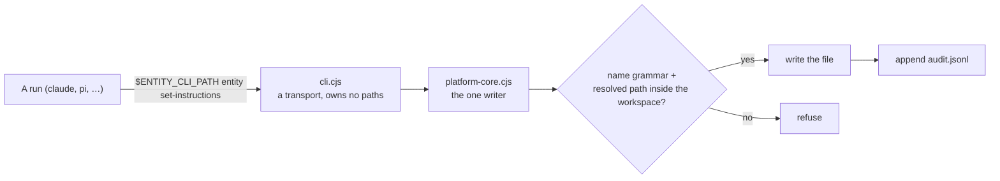

[← README](../README.md)

# The agent-facing CLI

Every run gets `ENTITY_CLI_PATH` and a short brief, so an entity can work on its own
workspace instead of asking you to copy things by hand.

```bash
"$ENTITY_CLI_PATH" entity list
"$ENTITY_CLI_PATH" entity get release-captain --output json
"$ENTITY_CLI_PATH" entity set-instructions release-captain --body-stdin
"$ENTITY_CLI_PATH" skill create writing-skill --description "Plain, warm prose" --body-stdin
"$ENTITY_CLI_PATH" mcp add github --command npx --args -y,server-github
"$ENTITY_CLI_PATH" workspace list
"$ENTITY_CLI_PATH" workspace set-context --context-stdin
```



Five things make that safe to hand out:

- **One writer.** `electron/platform-core.cjs` owns every verb; `cli.cjs` is a
  transport over it and touches no paths.
- **Containment on the resolved path.** A name must match the entity grammar *and* the
  resulting real path must be inside the workspace.
- **Optimistic concurrency.** `set-instructions --if-unchanged <stamp>` refuses a write
  that would clobber a person editing the same file in `$EDITOR`.
- **An audit line.** Every mutation appends to `<ws>/audit.jsonl`; `entity audit` reads
  it back.
- **One pinned workspace, reads elsewhere.** A run is pinned to the workspace it was
  started in and may not write to another one, but `--workspace <id>` on a *read* is
  allowed and recorded as `cross.read`. `workspace list` names every workspace on the
  machine, so a caller can name one instead of reading `~/.entity/workspaces` with
  `ls`. From a shell outside the app — including the in-app terminal, where nothing is
  pinned — `--workspace` works for writes too.

The same verbs are reachable from the window through `platform.verbs` /
`platform.call`, so a UI for them does not need a second implementation.

## Related

- [MCP servers](mcp.md) — `mcp add` writes into the workspace set
- [Skills](skills.md) — `skill create`
- [Security](security.md) — why containment is re-checked on the resolved path
