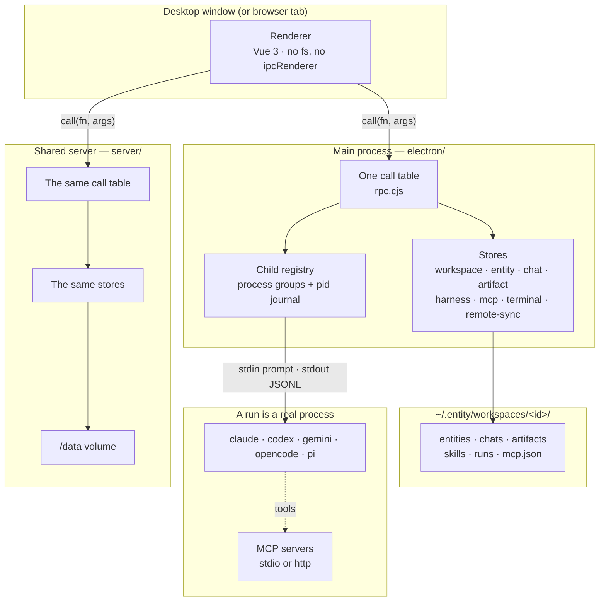

[← README](../README.md)

# How Entity is put together

Entity is three processes wearing one interface: a sandboxed renderer, a main
process that owns every file and every child process, and — optionally — a server
that exposes the *same* call table over HTTP so other people can share a workspace.

## The one call table

Every local read and write goes through **one** table, `electron/rpc.cjs`:

- Electron exposes it as `ipcMain.handle('entity:call')`.
- The Vite dev server exposes the same table at `POST /__entity/call` and streams
  run events at `GET /__entity/events`.
- The server build (`npm run serve`) mounts it behind accounts, membership checks
  and the sync API.

The renderer never touches `fs` and never receives a path or a shell string to
run. Adding a feature means adding a handler to that table — not inventing a
channel per feature. Keep `contextIsolation: true`, `nodeIntegration: false` and
`sandbox: true`, and never hand `ipcRenderer` to the window.

## Layers

| layer | directory | owns |
| --- | --- | --- |
| Renderer | `src/` | Vue 3, the two-tier rail, the interface contract in `DESIGN.md` |
| Call table | `electron/rpc.cjs` | the only door between the window and the disk |
| Main process | `electron/` | workspace, entity, chat, artifact, harness, MCP, terminal and sync stores |
| Agent writer | `electron/platform-core.cjs` | the only writer an agent can reach |
| Server | `server/` | the same table behind scrypt accounts, HMAC sessions, roles |
| Tests | `tests/` | unit + the static UI contract, and two Playwright packs |

## A run is not one process

`electron/child-registry.cjs` makes a harness a **process group**, not a pid:

- the child is a process-group leader on POSIX (`taskkill /T` on Windows);
- every live child is written to a pid journal as it starts;
- shutdown is `SIGTERM`, then `SIGKILL` after 3 s, on the whole group;
- a hard kill runs no handler, so the next boot **reaps what the last one left** —
  after proving the pid on disk is still ours.

That is what keeps a cancelled turn from leaving an orphaned `opencode` behind,
and what keeps the app from ever signalling an unrelated process that recycled
the number.

## Where the prompts go

Prompts reach the harness on **stdin**, never through a shell (`shell: false`).
`harness` must be one of the five known ids, a name must match `[a-z0-9-]+`, and a
`dir` is resolved in main before anything spawns. The body of an entity becomes a
system prompt (`claude`, `pi`) or prompt text (`codex`, `opencode`, `gemini`).

## Related

- [Security](security.md) — the trust boundaries this layout buys
- [Limits](limits.md) — what it deliberately does not do
- [`DESIGN.md`](../DESIGN.md) — the interface contract every UI change is held to
