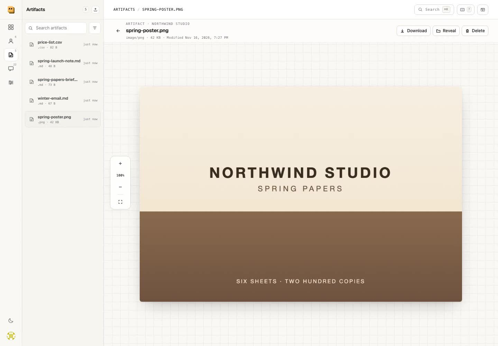
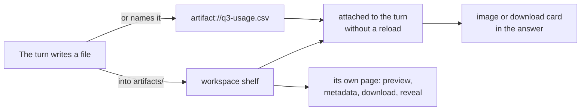

[← README](../README.md)

# Artifacts and backups

## Artifacts live beside the conversation

<picture><source srcset="assets/readme-features/artifacts.webp" type="image/webp" /></picture>

The harness is told that workspace artifacts belong in `<ws>/artifacts`, that a
screenshot goes there rather than `/tmp`, and that a saved file should be referenced as
`artifact://<relative-path>`.



The chat renders that reference as an image or a download card. It also attaches the
**rest of that deliverable**: a file the answer never links is still on the card when
it sits in a folder the turn wrote into — a page and the PNG beside it are one design.

What it never does is use the clock as an argument. The shelf is shared with this
machine, so a render for another design, a script in a terminal or a second conversation
can put fresh files there while a turn runs; "only one turn ran in those minutes" is not
evidence that the turn wrote it. A file reaches a card for one of three reasons:

1. **the turn says so** — `artifact://<id>`, the relative path in the answer, a write
   tool's path, or a shell write operator next to it;
2. **the folder** — the turn demonstrably wrote into it, and the file lands there while
   the turn runs (a render batch);
3. **the shelf root** — nobody's folder to be wrong about, and the turn ran alone.

Everything else stays on the shelf. That is deliberate: an unattached file costs a
click, while a file attached to the wrong design costs trust in every card.

### The file is locked to the session that made it

The three reasons above are still inferences, and an inference with a single candidate
is a guess. A second conversation that ran in the same folder at a different time is
not a candidate at all, so the guess cannot see it — and the card lists it anyway.

So the app writes the answer down. When a turn ends, the store records the files that
turn produced in `artifacts/.origin.json` (`<id> → <threadId>`), which is a dot file:
the shelf walk skips it and the sync manifest cannot carry it, because a thread id means
nothing on a clone. A stamp then outranks everything else:

- a file stamped to **this** conversation is on its card, even after the turn ages out
  of the transcript window;
- a file stamped to **another** conversation is never reachable by inference — no
  folder, no clock, no shelf root moves it;
- a turn that **names** a file it revised still shows it. A stamp records authorship,
  not custody, and a person expects the card beside the answer that talks about it.

The stamp is written while the turn's own evidence is in hand, which is why it can be
trusted where a later read cannot. A file that is erased takes its stamp with it, so a
new file of the same name belongs to nobody instead of to an old conversation.

### HTML artifacts: preview, and notes written on it

An `.html` artifact opens as the page it is, with a **Preview / Source** switch in
the bar. Preview is a same-origin frame holding the document: real `<html>`/`<body>`
structure, so the `body { … }` rules and media queries a generated page relies on
apply. Scripts and inline handlers are stripped — a preview renders, it does not
run; **Open in browser** is one click away for the interactive version. A page that
points at sibling files shows a line saying so, because a preview is one document.

**Annotate** (`⌘⇧A`, or `Alt+Shift+A` in a browser tab) turns the preview into a review surface. The controls float in
the bottom-right corner instead of taking a toolbar row: the key, the notes and the
two actions stay next to the pointer while you scroll the page. Click an element and
it is outlined; a card opens describing what you picked — `h1.title “Spring
papers”`, its selector, size and computed type. Write what should change, press `⌘↵`
to add it (`Esc` cancels the pick). Notes stack above the pill, each removable, and **Send to chat** puts them in
the conversation as a ready-to-send message:

```
Annotation notes on `index.html` (`artifact://design/artifacts-archive/index.html`):

1. **h1.title “Spring papers”** _(section#hero > h1)_
   Make the headline warmer, and move the price under the button.

2. **button.cta “Pre-order”** _(section#hero > button)_
   This needs to sit above the fold.
```

That is the loop the page is for: pick three things that look wrong, write three
lines, send once. The message is a draft — you read it and press send, nothing is
submitted for you. **Copy** puts the same text on the clipboard for a different
thread or a ticket.

### The page as a dialog

An artifact card in a conversation opens this page **over the conversation** — full
width and height, one X, Escape closes — instead of a lightbox or a navigation. That
holds for a screenshot, a document and a page: the card's name or thumbnail is the
door. Annotations sent from there land in the *current* thread's composer, so the
round trip is: look at the render, note what is wrong, send, and the agent already
knows which conversation it belongs to.

The preview belongs to that conversation, and so does the note. Switching threads closes
the dialog, and a note carries the thread it was written in: if the reader has moved on
by the time the composer is on screen, the words go to the clipboard with a toast
instead of into somebody else's box.

### What a card can do

Download is never the only action. The row is derived from the file, by one list on
the server (`capabilitiesFor`), so the card and the RPC cannot disagree:

| file | actions |
| --- | --- |
| Markdown and other text (`.md .txt .json .jsonl .yaml .yml .csv .log .js .ts .tsx .jsx .py .sh .css`) | Open in Finder · artifact page · **Open in VS Code** · Download |
| `.html` | the text row **plus Open in browser** — it renders the page |
| image (`png jpg jpeg gif webp avif bmp ico svg`) | lightbox (click the thumbnail) · Open in Finder · artifact page · Download |
| video, audio | Open in Finder · artifact page · Download |
| PDF | Open in Finder · artifact page · **Open in browser** · Download |
| anything else, including `.zip` | Open in Finder · artifact page · Download |

"Open in browser" goes through the operating system's handler, so a multi-file HTML
artifact still resolves its sibling files and assets — no local web server, no rewrite
of the page. The renderer only names an artifact id and a verb; the server resolves the
path, checks the verb against the file's own capabilities, and refuses anything else,
so a missing capability (a headless build, no VS Code installed) is a sentence, never a
dead button.

## Personal first, shared on purpose

A new save lands on **your** shelf: `<ws>/.personal/<account>/artifacts/`. Uploads,
**Save to workspace**, and the folder a turn is told to write into all go there first.
The shared shelf is `<ws>/artifacts/` — the artifacts tree an export bundle and remote
sync carry. The split is a location, not a flag, so another account on this machine (or a
clone on another machine) cannot see a file that was never shared.

### The settings card answers one shelf at a time

Workspace → Settings → Artifacts (`?tab=artifacts`) is two tabs, because the two
shelves do not have the same rule:

- **Shared shelf** — ①/② on one histogram, the cadence, the protections, the one
  machine that runs the pass. Workspace configuration, so every clone reads it.
- **Personal shelf** — no rule at all. Nothing sweeps it, nothing syncs it; sharing
  a file is what hands it to the rule above.

The shelf is the URL's second axis (`&shelf=personal`; `shared` is the default and
drops the parameter), so a link, a reload and a bookmark land on the shelf they
name while the page stays one address. **Erase** follows it too: the shared tab
offers *Erase shared*, the personal one *Erase personal*, and *Erase all* — the
only button whose scope is both populations — stays on both.

The rail's artifact panel says which shelf you are looking at:

- **Personal _n_** — only you, under the group head `Personal · only you`.
- **Shared _n_** — under `Shared · <workspace>`; every row names its owner.

**Share with workspace** moves the file into `artifacts/` — a rename, not a copy
(*one file, one place*) — and stamps the owner in `artifacts/.scope.json`.

**A path is not consent.** The shared tree is what an export bundle and a remote sync
carry, and it used to fill two ways: `share()`, and *anything that wrote a path under
`artifacts/`* — an agent told to leave a screenshot on "the workspace artifact shelf", a
render script, a hand-run command. Those files were never shared by anyone, but the shelf
called them Shared because of where they sat, so a colleague received them on the next
sync. Two rules close it:

- **The scope is the index entry, not the directory.** A file in `artifacts/` with no
  owner in `.scope.json` reads as `unclaimed`: personal, and the sync manifest refuses to
  carry it (`remote-manifest.cjs`, `claimedArtifacts`).
- **The tree heals.** `adoptUnclaimed` moves every such file into the personal root — a
  rename, so one file still exists in one place, and a name the person already has is kept
  as `<name>-2` rather than overwritten. It runs on the shelf's next read, is idempotent,
  and leaves `conflicts/` alone: that folder is the sync engine's record of a
  disagreement, evidence about a file rather than a file anybody made.

**Move back to Personal** is the same move in reverse. The button is labelled that
way on your own file and **Remove from workspace** on someone else's; either way the
file lands on your shelf. It asks for a second click and says what happens: *it
leaves the workspace shelf and goes back to yours; nothing is deleted.* Available to
the file's owner or a workspace owner/admin.

Refusals are sentences, not silent no-ops:

- `A file with that name is already on the workspace shelf.`
- `You already have a personal file with that name.`
- `Only the file's owner or a workspace owner/admin can move that file back.`

**Delete** is the one-way door: a hard unlink, offered only on a file you own.

| path | remote sync | local ZIP backup |
| --- | --- | --- |
| `artifacts/**` | yes | yes |
| `artifacts/.scope.json` | yes — the only dot file in the manifest | yes |
| `.personal/` | never | yes — the ZIP is the whole folder |
| `artifacts/.archive/`, `.trash/`, `.opened.json`, `.stamps.json` | never | yes |

The scope index merges as a union: a newer `at` wins per path, but there is no
tombstone, so a peer that never saw an un-share can bring the row back on its next
push.

The rail panel browses, uploads, searches and removes; a row opens the artifact's own
page.

## The archive shelf

The shared shelf is finite if you let it be. **Workspace settings → Artifacts**
(`/<workspace>/settings?tab=artifacts`) is one card with two clocks:

- **① Archive** counts days since the file was **last opened on this machine** — a
  read, a download, a reveal, the editor, a browser open. Default `30 days`; units
  `days` / `weeks` / `months`, or `Never` to stop the first clock (and with it both).
- **② Delete** counts days **in the archive**, not days of silence. Default `90 days`,
  so the death line is 120 days. There is no `Never` for ②: the archive is closed by ①
  reaching `Never`.

Both are a number plus a unit, capped at 3650 days. A file's path becomes
`artifacts/<path>` → `artifacts/.archive/<path>` → gone. The archive date is stamped
once in `artifacts/.stamps.json`, so a pass every thirty minutes cannot reset it. The
personal shelf is outside the walk: a file you never shared is never archived or
deleted by this card.

The chart is the control. Fourteen bands of *days since last opened* carry the two
dashed threshold lines; the legend splits Kept / Archived / Deleted in files and
bytes, and **Show what changes tonight** names the six files the next pass will touch,
what a protection holds back, and what the shelf settles at. Rows change the rules and
save as you type; **Archive due now** runs a pass without waiting.

### When it runs, and where

Cadence and deadline are **per pass**, not one shared schedule: `every day` /
`every week` / `every month` / `only when I ask`, with a `by 03:00` deadline. The
deadline is a *not before*, never an appointment: the timer lives in the main process,
ticks every thirty minutes and once a minute after launch, so a pass that came due
while the app was closed starts within a minute of the next launch. There is no pass
while the app is closed.

**One machine sweeps.** Workspace → Machines carries a `sweep` badge on the machine
that runs it and a **Run the sweep here** button on the others:

- the **owner's** first signed-in machine takes it, until somebody picks another;
- a **machine** pins it to one hostname;
- the **sync host** pins it to the always-on server. Its clock is the container's,
  usually UTC, so its `03:00` is not necessarily yours.

Every other clone stands down with `The artifact sweep runs on <label>; this machine
does not sweep it.` A workspace whose card was never opened is never swept, and a
`remote` clone stays unconfigured until an owner or admin saves.

A file is held back by a **live chat** that still names it by exact
`artifact://<path>` (a folder reference protects nothing, and an archived thread does
not protect its files), by a **turn in flight** when *wait while a run is answering*
is on, by the **archive** itself (② only ever looks inside it), and by the **age floor**
of a machine that just took the sweep over — a takeover inherits no age, so it cannot
archive a shelf that was healthy elsewhere.

**Restore** is a file-manager move back out of `artifacts/.archive/`: the app lists
everything except dot folders, so an archived file is off the shelf, not off the disk.
Deleted files go to the OS Trash when the build has one — the card says which door it
has — otherwise to `artifacts/.trash/`, which the OS cannot restore.

## Backups

**Account → Backups** keeps a rolling set of ZIP files outside the workspace. Each run
writes one `.zip` under `<folder>/<workspace>/`, with the workspace at the archive
root: entities, chats, artifacts (the shared shelf, every personal shelf and the
archive), attached skills, `workspace.json` (including the workspace context),
`members.json` and the MCP servers. It is a real snapshot, not a re-export that can
lose fields.

The **backup folder** defaults to `~/.entity/backups` and can be changed per workspace
(the desktop app opens a native folder picker; a typed path works in a browser build
too). Existing ZIPs move with the setting.

| schedule | keeps |
| --- | --- |
| **Smart** (default) | daily for 7 days, one a week this month, one a month this year |
| Daily | 14 days |
| Weekly | 12 weeks |
| Monthly | 12 months |
| Manual only | the last 20 snapshots |

- Older snapshots are pruned after every run, so the shelf stays around two dozen
  entries. **Back up now** works in every mode.
- The timer lives in the main process and runs while Entity is open. The page is where
  you choose the policy and see the shelf; it is not the scheduler.
- **Restore** extracts a ZIP into a *new* workspace, never over the one you are using.
  Skills whose library target is gone are dropped with a warning.
- Secrets and transient state are deliberately left out: `.remote.token`,
  `.remote.json`, `.remote-trash/`, `.bin/` (absolute paths of this build) and `runs/`
  (harness logs and attachment temp dirs).

ZIPs are complete snapshots, so a large artifact shelf costs disk in each retained
file; compression helps text, not already-compressed images. The page shows the total
ZIP size and the retention policy that keeps it bounded. Because a local ZIP is the
folder, it also carries `.personal/` and `artifacts/.archive/`; a portable export
bundle carries the shared shelf only.

## Related

- [Workspaces and entities](workspaces.md) — the tree a backup is a copy of
- [Conversations](conversations.md) — how a saved file reaches the answer
- [Limits](limits.md) — what a backup leaves out on purpose
