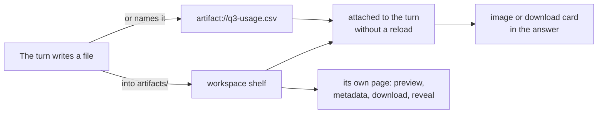

[← README](../README.md)

# Artifacts and backups

## Artifacts live beside the conversation

<picture><source srcset="assets/readme-features/artifacts.webp" type="image/webp" /></picture>

The harness is told that workspace artifacts belong in `<ws>/artifacts`, that a
screenshot goes there rather than `/tmp`, and that a saved file should be referenced as
`artifact://<relative-path>`.



The chat renders that reference as an image or a download card, and also attaches any
file written to the shelf during the turn even when the answer never names it. The
rail's artifact panel browses, uploads, searches and removes; a row opens the
artifact's own page.

### HTML artifacts: preview, and notes written on it

An `.html` artifact opens as the page it is, with a **Preview / Source** switch in
the bar. Preview is a same-origin frame holding the document: real `<html>`/`<body>`
structure, so the `body { … }` rules and media queries a generated page relies on
apply. Scripts and inline handlers are stripped — a preview renders, it does not
run; **Open in browser** is one click away for the interactive version. A page that
points at sibling files shows a line saying so, because a preview is one document.

**Annotate** (`⌘⇧A`, or `Alt+Shift+A` in a browser tab) turns the preview into a review surface. The controls float in
the bottom-right corner instead of taking a toolbar row: the key, the notes and the
two actions stay next to the pointer while you scroll the page. Click an element and
it is outlined; a card opens describing what you picked — `h1.title “Spring
papers”`, its selector, size and computed type. Write what should change, press `⌘↵`
to add it (`Esc` cancels the pick). Notes stack above the pill, each removable, and **Send to chat** puts them in
the conversation as a ready-to-send message:

```
Annotation notes on `index.html` (`artifact://design/artifacts-archive/index.html`):

1. **h1.title “Spring papers”** _(section#hero > h1)_
   Make the headline warmer, and move the price under the button.

2. **button.cta “Pre-order”** _(section#hero > button)_
   This needs to sit above the fold.
```

That is the loop the page is for: pick three things that look wrong, write three
lines, send once. The message is a draft — you read it and press send, nothing is
submitted for you. **Copy** puts the same text on the clipboard for a different
thread or a ticket.

### The page as a dialog

An artifact card in a conversation opens this page **over the conversation** — full
width and height, one X, Escape closes — instead of a lightbox or a navigation. That
holds for a screenshot, a document and a page: the card's name or thumbnail is the
door. Annotations sent from there land in the *current* thread's composer, so the
round trip is: look at the render, note what is wrong, send, and the agent already
knows which conversation it belongs to.

### What a card can do

Download is never the only action. The row is derived from the file, by one list on
the server (`capabilitiesFor`), so the card and the RPC cannot disagree:

| file | actions |
| --- | --- |
| Markdown and other text (`.md .txt .json .jsonl .yaml .yml .csv .log .js .ts .tsx .jsx .py .sh .css`) | Open in Finder · artifact page · **Open in VS Code** · Download |
| `.html` | the text row **plus Open in browser** — it renders the page |
| image (`png jpg jpeg gif webp avif bmp ico svg`) | lightbox (click the thumbnail) · Open in Finder · artifact page · Download |
| video, audio | Open in Finder · artifact page · Download |
| PDF | Open in Finder · artifact page · **Open in browser** · Download |
| anything else, including `.zip` | Open in Finder · artifact page · Download |

"Open in browser" goes through the operating system's handler, so a multi-file HTML
artifact still resolves its sibling files and assets — no local web server, no rewrite
of the page. The renderer only names an artifact id and a verb; the server resolves the
path, checks the verb against the file's own capabilities, and refuses anything else,
so a missing capability (a headless build, no VS Code installed) is a sentence, never a
dead button.

## Backups

**Account → Backups** keeps a rolling set of ZIP files outside the workspace. Each run
writes one `.zip` under `<folder>/<workspace>/`, with the workspace at the archive
root: entities, chats, artifacts, attached skills, `workspace.json` (including the
workspace context), `members.json` and the MCP servers. It is a real snapshot, not a
re-export that can lose fields.

The **backup folder** defaults to `~/.entity/backups` and can be changed per workspace
(the desktop app opens a native folder picker; a typed path works in a browser build
too). Existing ZIPs move with the setting.

| schedule | keeps |
| --- | --- |
| **Smart** (default) | daily for 7 days, one a week this month, one a month this year |
| Daily | 14 days |
| Weekly | 12 weeks |
| Monthly | 12 months |
| Manual only | the last 20 snapshots |

- Older snapshots are pruned after every run, so the shelf stays around two dozen
  entries. **Back up now** works in every mode.
- The timer lives in the main process and runs while Entity is open. The page is where
  you choose the policy and see the shelf; it is not the scheduler.
- **Restore** extracts a ZIP into a *new* workspace, never over the one you are using.
  Skills whose library target is gone are dropped with a warning.
- Secrets and transient state are deliberately left out: `.remote.token`,
  `.remote.json`, `.remote-trash/`, `.bin/` (absolute paths of this build) and `runs/`
  (harness logs and attachment temp dirs).

ZIPs are complete snapshots, so a large artifact shelf costs disk in each retained
file; compression helps text, not already-compressed images. The page shows the total
ZIP size and the retention policy that keeps it bounded.

## Related

- [Workspaces and entities](workspaces.md) — the tree a backup is a copy of
- [Conversations](conversations.md) — how a saved file reaches the answer
- [Limits](limits.md) — what a backup leaves out on purpose
