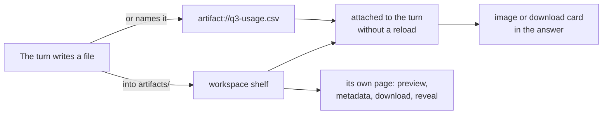

[← README](../README.md)

# Artifacts and backups

## Artifacts live beside the conversation

<picture><source srcset="assets/readme-features/artifacts.webp" type="image/webp" /></picture>

The harness is told that workspace artifacts belong in `<ws>/artifacts`, that a
screenshot goes there rather than `/tmp`, and that a saved file should be referenced as
`artifact://<relative-path>`.

The chat renders that reference as an image or a download card, and also attaches any
file written to the shelf during the turn even when the answer never names it. The
rail's artifact panel browses, uploads, searches and removes; a row opens the
artifact's own page.

## Backups

**Account → Backups** keeps a rolling set of ZIP files outside the workspace. Each run
writes one `.zip` under `<folder>/<workspace>/`, with the workspace at the archive
root: entities, chats, artifacts, attached skills, `workspace.json` (including the
workspace context), `members.json` and the MCP servers. It is a real snapshot, not a
re-export that can lose fields.

The **backup folder** defaults to `~/.entity/backups` and can be changed per workspace
(the desktop app opens a native folder picker; a typed path works in a browser build
too). Existing ZIPs move with the setting.

| schedule | keeps |
| --- | --- |
| **Smart** (default) | daily for 7 days, one a week this month, one a month this year |
| Daily | 14 days |
| Weekly | 12 weeks |
| Monthly | 12 months |
| Manual only | the last 20 snapshots |

- Older snapshots are pruned after every run, so the shelf stays around two dozen
  entries. **Back up now** works in every mode.
- The timer lives in the main process and runs while Entity is open. The page is where
  you choose the policy and see the shelf; it is not the scheduler.
- **Restore** extracts a ZIP into a *new* workspace, never over the one you are using.
  Skills whose library target is gone are dropped with a warning.
- Secrets and transient state are deliberately left out: `.remote.token`,
  `.remote.json`, `.remote-trash/`, `.bin/` (absolute paths of this build) and `runs/`
  (harness logs and attachment temp dirs).

ZIPs are complete snapshots, so a large artifact shelf costs disk in each retained
file; compression helps text, not already-compressed images. The page shows the total
ZIP size and the retention policy that keeps it bounded.

## Related

- [Workspaces and entities](workspaces.md) — the tree a backup is a copy of
- [Conversations](conversations.md) — how a saved file reaches the answer
- [Limits](limits.md) — what a backup leaves out on purpose
