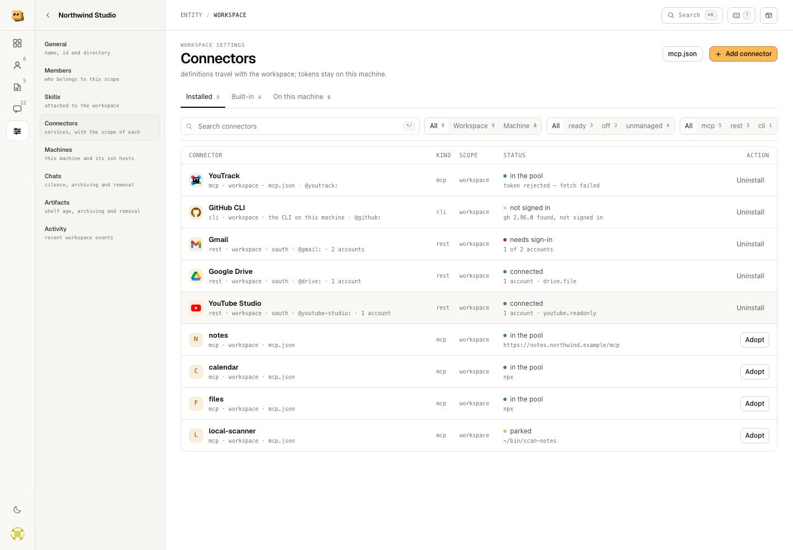
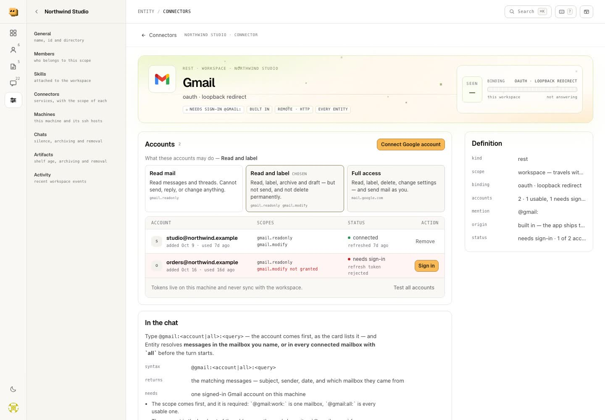

[← README](../README.md)

# Connectors

A connector is one row in one roster: something this workspace can reach. **Workspace
settings → Connectors** is that roster. Before it there were three answers to "can this
workspace reach that service" — `~/.entity/integrations.json` for the machine-wide
switch, the workspace's `mcp.json` for the binding, and each harness's own config on
this machine. One question, three places, and the *scope* was never stated — which is how
a definition people believe they shared turns out to be one laptop's. Connectors adds no
fourth store: it merges the three into rows that carry a scope, and writes back through
the store that owns each field.

## One roster

<picture><source srcset="assets/readme-features/connectors.webp" type="image/webp" /></picture>

The bulk MCP list is gone. `:workspace/mcp` and `:workspace/mcp/:name` are permanent
redirects into the roster — `:workspace/connectors/:id` is the page one connector opens,
whatever its kind. An MCP server is one *kind* of connector row, not a page beside the
others.

| pane | what it holds | the verbs |
| --- | --- | --- |
| **Installed** | what this workspace has | test, remove, uninstall |
| **Built-in** | catalog entries this workspace has *not* installed | install |
| **Machine** | what another app declares on this computer, one row per server name | copy here |

A server in the pool with no connector row is **unmanaged**: shown, not hidden, because
that is where a token lives. A definition that only works on the machine that wrote it —
a loopback URL, a command inside a home directory — arrives from a teammate *parked*, with
the reason.

## Three kinds

| kind | what it is | its credential lives in |
| --- | --- | --- |
| `mcp` | a server definition, bound to this workspace's `mcp.json` | `mcp.json`, `0600` |
| `cli` | a binary on this machine with a declared self-report | the CLI's own store |
| `rest` | a service reached over HTTP | a `mcp.json` header, an OAuth account, or a pasted API key |

`kind` is what the runtime needs, not a label: an `mcp` row writes a binding, a `cli` row
stores the `argv` and exit code that mean "usable" (`gh auth status`, nothing guessed for
it), and a `rest` row is a URL plus whatever its binding names. A `rest` row with
`oauth: true` is **account-bearing** — it holds several accounts, and it is the only kind
that does.

## Built-in versus added

The catalog is the one list of what the app ships, and every surface reads it: the
Built-in pane, the add sheet's cards and the composer's mention menu are three doors on
one table. Entity ships twelve — `gmail`, `google-drive`, `youtube`, `youtube-studio`,
`x` and `habitify` account-bearing (`habitify` reads through its provider's remote MCP
server, and signs in with a client it registers itself); `orca`, `youtrack` and `github`
the three the composer offered before connectors existed (`youtrack` is an `mcp` row, the
other two are `cli` rows); `maka` and `open-design`, the MCP-backed ones — `open-design`
launches from the workspace's own `skills/` directory, so its definition travels;
`clockify`, whose credential is one API key pasted once instead of an OAuth account, with
its workspace id and timezone kept as workspace state beside it. Anything else a person
adds is a custom row: real, working, and shipping no resolver — so it offers no `@` form.

**Installing records a definition, never a credential.** An `mcp` entry writes a
placeholder binding only when the workspace has none, because installing must not invent
a URL; a `cli` entry is done once installed, since the binary and its sign-in are this
machine's; an account-bearing entry lands with **zero accounts** and the page's empty
state, because installing a connector is not connecting a mailbox. `connectors.json` is
the index and syncs; `mcp.json` stays the binding, never renamed or moved, because it is a
runtime contract rather than a settings file.

## The connector page

**The page is readable before the connector is installed.** Reaching it from the Built-in
pane shows the same address with the pitch filled in — what the service gives you, the
mention it answers, where its credential would live — and the configuration cards held
back, because an uninstalled connector has no binding for an accounts card or a token box
to write to. One **Install** button turns it into the installed page in place.

`:workspace/connectors/:id` picks its shape from the row's `kind` — never from which route
object matched. Each fact is stated once, in the rail: **kind**, **scope**, **binding**,
**mention**, **origin** (`built in` or `added in this workspace`) and **status**. An MCP
row adds what the server actually reported — transport, the tool list with its search and
its `read`/`write` split — and the `every entity` chip that puts the no-per-entity rule
where somebody would look for the exception. An account-bearing row adds the accounts card
instead. A `cli` row has no credential field, deliberately: that credential is the CLI's,
and a box that pretended to hold it would lie about where it lives. **Test connection**
runs the service and prints what came back — projects, an identity, the scopes it holds —
and a refusal leaves the row unchanged, saying nothing was saved.

## Accounts, and the consent round-trip

<picture><source srcset="assets/readme-features/connector-accounts.webp" type="image/webp" /></picture>

An account is a credential, so it is not a definition and does not travel. Connecting one
is the OAuth 2.0 loopback flow: a server starts on `127.0.0.1` for the redirect (an
OS-chosen port where the provider allows one, a fixed port where it validates the callback
by exact match); the **system browser** opens the consent screen, never a webview, because
a webview would defeat the provider's own "this app wants access" screen; the provider
redirects back with `code` and `state`, or with `error=access_denied`; and the code is
exchanged over HTTPS with **PKCE S256**, the profile read once to name the account. One
app-wide OAuth client per machine, not one per workspace — a client per workspace would
put the same secret in a synced folder N times. It is asked for once, in the card, stored
`0600`, and only a hint is read back.

The accounts live in `~/.entity/oauth-accounts.json`, beside `integrations.json` — not in
the workspace — because a credential is not a definition and must not sync. **Every read
is reduced to seven fields**, so a page cannot render what it was not given, and the
refresh token sits in a file no call-table entry returns. `connector-tokens.json` is the
second vault, also `0600` and atomic, for the one credential kind that never refreshes: a
pasted API key, one per connector, of which a page learns only `{ configured, hint }` and
the hint is the last four characters. In the account file, `email` and `localpart` name the
row and the scope segment a mention takes; `scopes` and `missing` are what this account
holds and what a tier asked for and the provider refused; `status` is `connected`, `needs
sign-in`, `signing in` or `parked`; `addedAt` and `refreshedAt` are when the consent
landed and the last successful refresh. An account whose sign-in expired is **skipped,
not failed**: a mention spanning several mailboxes names the one that did not answer.

## Tiers

`read` → `write` → `full`, cumulative — a write scope with no read scope cannot see what
it is replying to — and chosen **per connector, per workspace**, on the index row in
`connectors.json`. Two rooms may want different access from one mailbox, and a person who
lowers it to `read` sees that in the card before the next consent. Changing it does not
touch a token: the next **Connect** asks for the new set, and an existing account keeps
what it has until it is re-consented. Each tier prints the scopes it will ask for, in the
short form the provider displays.

## Mentions

An installed row offers its `@id:` form **only when a resolver ships for it**; a row with
no resolver is context-only and says so rather than promising an `@` to silence.

| mention | reaches |
| --- | --- |
| `@gmail:<account\|all>:<query>` | messages, one mailbox or every connected one |
| `@drive:<account\|all>:<query>` | files, by name, contents or Drive's own query language |
| `@youtube:<account\|all>:<query>` | videos, searched as that account's grant |
| `@youtube-studio:<account>[:<channel>]:<what> [<days>]` | the channel's own analytics, comments and traffic |
| `@x:<account\|all>:<query>` | recent posts, retweets excluded |
| `@habitify:[<habit>:]<date\|today\|yesterday>` | the habits a day was scheduled, and whether they were done |
| `@maka:[<vault>:]<query>` | notes, in one vault or across every vault |
| `@opendesign:<artifact\|file\|search>:<query>` | an artifact, one file, or a search across the design workspace |
| `@clockify:<project\|login>:<monday\|this week>` | the hours one project or one person logged in a week |
| `@youtrack:[<PROJECT>:]<query>` | issues, scoped to a project key or searched |
| `@orca:<project>[:<path>]` | a project's real path, or one file inside it |

The scope segment is **required**, and `all` is explicit: there is no implicit "no scope
means every mailbox", which is what made the first word ambiguous. A word that is not one
of your accounts is an error rather than a search, so a typo cannot quietly read the wrong
mailbox. The query is the rest of the line; the instruction goes on the next line.

## What it deliberately does not do

- **No credential sync.** An account is a refresh token on this machine. A teammate who
  opens the same workspace sees the connector row, no accounts, and connects their own.
- **No per-entity connector.** A connector is the workspace's or it is not, and one agent
  cannot reach a service its siblings are denied. An `mcp:` line left in an older entity
  file is ignored by the reader.
- **No proxy.** Entity resolves a mention, hands over a definition, or files a token;
  between the agent and the provider there is nothing of ours.
- **No webview sign-in.** The consent screen is the system browser, at the provider's
  real address, with the provider's own address bar above it.
- **No guessing at a definition.** Installing an `mcp` entry the workspace has no
  binding for writes a placeholder, not an endpoint.

## Related

- [MCP servers](mcp.md) — the `mcp` kind in full, and how each harness receives the set
- [Security](security.md) — the trust boundary, and where a credential may sit
- [Remote workspaces](remote-sync.md) — what a teammate's connector lands as, and why a
  machine-bound one arrives parked
