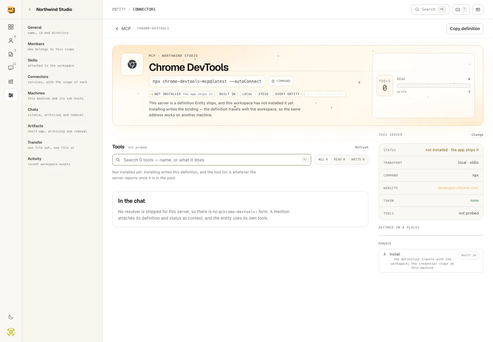

[← Connectors](../connectors.md)

# Chrome DevTools



Google's own `chrome-devtools-mcp` server, which drives the Chrome this machine already has
open: its tabs, its console, its network log, and a screenshot of whatever is on screen.
The standard install is `npx -y chrome-devtools-mcp@latest`.

An `mcp` row with no credential of its own. What proves who you are here is Chrome's own
signed-in profile, and the row stores none of it: the definition lives in this workspace's
`mcp.json` beside every other MCP server's, which is why the rail says **none** where a
token would sit. Nothing here is a secret this app hands out.

It ships no `launcher`, because a launcher is a script this app would have to hold and no
folder here creates one. What it ships instead is the server's own command, which
**Install** writes into `mcp.json` as the definition — once, and never over one you edited:

```json
{ "command": "npx", "args": ["chrome-devtools-mcp@latest", "--autoConnect"] }
```

Nothing in that line is a path on this machine, so the definition travels. Read on for what
the two flags choose.

## Two ways to attach, and a default

| you pass | what it reaches |
| --- | --- |
| `--browserUrl http://127.0.0.1:9222` (also `--browser-url`, `-u`) | a Chrome already listening on its remote-debugging port |
| `--wsEndpoint ws://127.0.0.1:9222/devtools/browser/<id>` | the same browser, addressed by its websocket endpoint — the id is in `http://127.0.0.1:9222/json/version` |
| `--autoConnect` (also `--auto-connect`) | a browser that enabled it, with no port to pass |
| nothing | a Chrome of the server's own, on a dedicated profile |

The first two are the same browser reached two ways, and they need the browser started with
remote debugging on. `--autoConnect` is the path with no port at all, and it is the one the
shipped definition passes: it has two requirements that are not this app's to satisfy,
Chrome 144 or later and the person turning it on at `chrome://inspect/#remote-debugging`.
The definition passes nothing else — no address and no channel — so it looks for the stable
Chrome a person is most likely looking at.

With no flag the server launches its own Chrome on a profile of its own. That is a clean
browser with none of your tabs or sign-ins, which is the right shape for a scripted run and
the wrong one for "look at the page I have open" — the whole point of the two attach paths
above. The flags that change which browser runs (`--headless`, `--isolated`,
`--executablePath`, `--userDataDir`, and which channel `--channel` names) are the server's
own; this row sets none of them, so a run against a beta or canary Chrome is one arg added
on the row.

A browser that goes away is not an error that outlives it. The server has an idle timeout,
and with a remote endpoint it disconnects when that runs out and leaves the browser open,
exactly as it found it.

## The browser on this machine

What the row reaches is *this* machine's browser: the definition names no address, so it
attaches to whichever Chrome is in front of the person running it. That is why it can
travel — a teammate installs the same row and it opens *their* Chrome, not a port
somewhere else.

The one edit that changes that is pinning `--browserUrl http://127.0.0.1:9222` instead. A
loopback port on someone else's laptop is not your Chrome, so a definition carrying one is
machine-bound, and a teammate's workspace lands it **parked** with the reason rather than
dialling an address that points at their own machine by accident. Both shapes are one row
with one field changed, and the roster says which one you have.

## There is no `@` form

The catalog entry carries no `work.mention` and no resolver, so `@chrome-devtools:` is not a
thing you can type and the composer will not offer it. A browser is something a turn drives,
not something typed into a line: what a mention would have to paste into the prompt is a
window's state, and the server's own tools are what read it.

→ [MCP servers](../mcp.md) — the `mcp` kind in full, and how each harness receives the set
→ [Connectors](../connectors.md) — the roster, the three kinds, and the rows that answer no `@`
