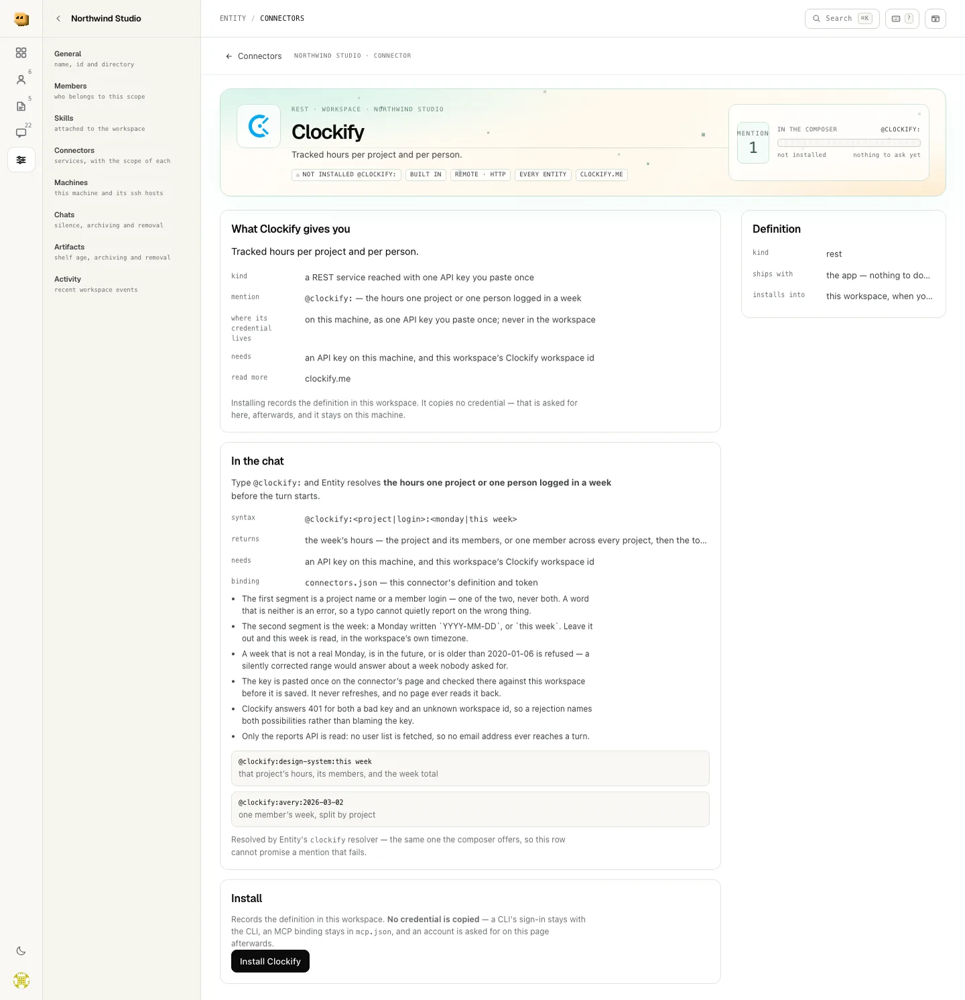

[← Connectors](../connectors.md)

# Clockify

Tracked hours per project and per person. Clockify is the one connector whose credential
is neither an OAuth account nor a CLI's own store: it is **one API key you paste once**,
checked on this page against this workspace before it is saved, and it never refreshes.

## The mention

`@clockify:<project|login>:<monday|this week>`

| you write | you get |
| --- | --- |
| `@clockify:design-system:this week` | that project's hours, its members, and the week total |
| `@clockify:avery:2026-03-02` | one member's week, split by project |

The first segment is a project name **or** a member login — one of the two, never both. A
word that is neither is an error, so a typo cannot quietly report on the wrong thing.

The second segment is the week: a Monday written `YYYY-MM-DD`, or `this week`. Leave it
out and this week is read in the workspace's own timezone. A week that is not a real
Monday, is in the future, or is older than `2020-01-06` is **refused** — a silently
corrected range would answer about a week nobody asked for.

Clockify answers `401` for both a bad key and an unknown workspace id, so a rejection
names both possibilities rather than blaming the key.

Only the reports API is read: no user list is fetched, so no email address ever reaches a
turn.

## Where the credential lives

`~/.entity/connector-tokens.json`, `0600`, atomic, beside `oauth-secrets.json` — the
second vault, for the one credential kind that never refreshes. A page learns
`{ configured, hint }` and the hint is the last four characters. The workspace id and
timezone live in `connectors.json` as workspace state, because they are not secrets.

→ [Connectors](../connectors.md) — the roster, the tiers and the two vaults
→ [Security](../security.md) — the trust boundary, and where a credential may sit
