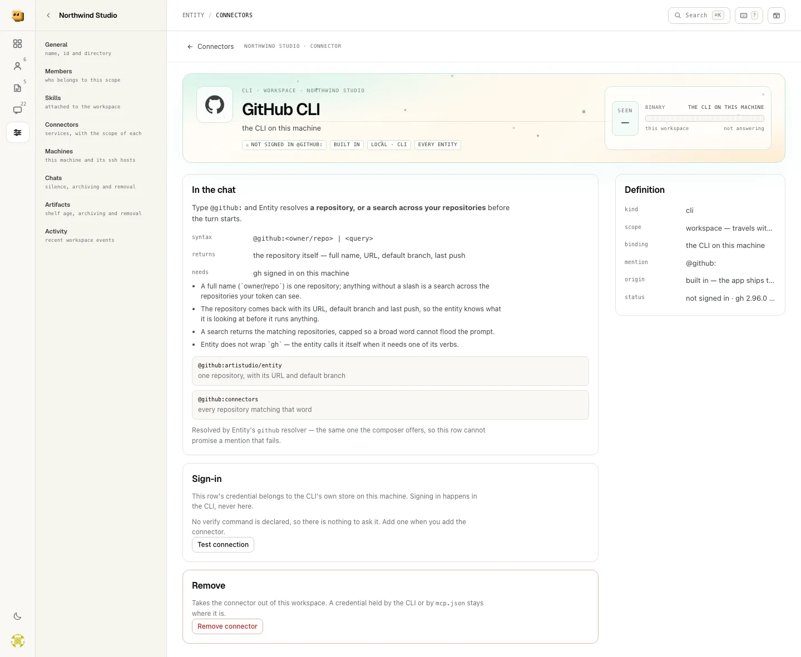

[← Connectors](../connectors.md)

# GitHub CLI

Repositories and searches, read through the `gh` on this machine that is already signed
in. The connector does not wrap the CLI: the entity calls `gh` itself when it needs one of
its verbs, and all the mention does is put a full name on the prompt.

A `cli` row, so the credential is `gh`'s own — the token `gh auth login` stored. Entity
holds nothing, and installing the row stores only the `argv` and exit code that mean
"usable": `gh auth status`, then `gh --version`.

## The mention

`@github:<owner/repo> | <query>`

| you write | you get |
| --- | --- |
| `@github:artistudio/entity` | one repository — full name, URL, default branch, last push |
| `@github:connector` | every repository that word matches |

A slash means a repository; anything without one is a search across what your token can
see. The search is capped, so a broad word cannot flood the prompt. The repository comes
back with its URL and default branch, so the entity knows what it is looking at before
it runs anything.

## Where the credential lives

In `gh`'s own store, on this machine. A signed-out `gh` is not a failure the page can fix
— it says so and points at `gh auth login`.

→ [Connectors](../connectors.md) — the roster, the three kinds, the tiers and the
consent round-trip
