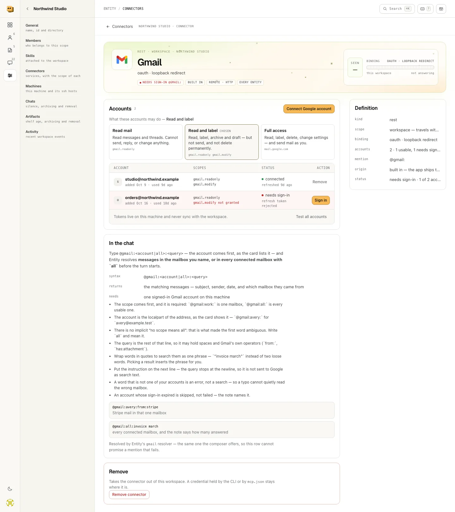

[← Connectors](../connectors.md)

# Gmail

Mail an agent may read, from however many mailboxes you connected — one row, not one per
mailbox. Gmail is the `rest` kind with `oauth: true`, which makes it **account-bearing**:
the only kind of row that holds several accounts, each a consent you granted in a browser.

## The mention

`@gmail:<account|all>:<query>`

| you write | you get |
| --- | --- |
| `@gmail:avery:from:stripe` | Stripe mail in that one mailbox |
| `@gmail:all:invoice march` | every connected mailbox, and a note on how many answered |

The scope comes first and is **required**. There is no implicit "no scope means all" —
that is exactly what made the first word ambiguous. `all` is a word you write and mean.
The account is the localpart of the address, as the card shows it.

The query is the rest of the line, so it holds spaces and Gmail's own operators
(`from:`, `has:attachment`). Quote words to search them as one phrase. Put the
instruction on the **next** line: the query stops at the newline, so it is never sent to
Google as search text.

A word that is not one of your accounts is an error, not a search — a typo cannot
quietly read the wrong mailbox. An account whose sign-in expired is **skipped, not
failed**, and the note names it.

## The tiers

`read` reads messages and threads; `read + label` adds archive and draft; `full` adds
sending and settings. Lowering the tier does not touch a token — an existing account keeps
what it holds until the next **Connect** asks for the new set.

## Where the credential lives

`~/.entity/oauth-accounts.json`, beside `integrations.json` and outside every workspace,
`0600` — and the refresh token sits in a file no call-table entry returns. A page learns
seven fields about an account and never a credential, which is why the card can show two
mailboxes and still be safe to screenshot.

→ [Connectors](../connectors.md) — the roster, the tiers and the consent round-trip
→ [Security](../security.md) — the trust boundary, and where a credential may sit
