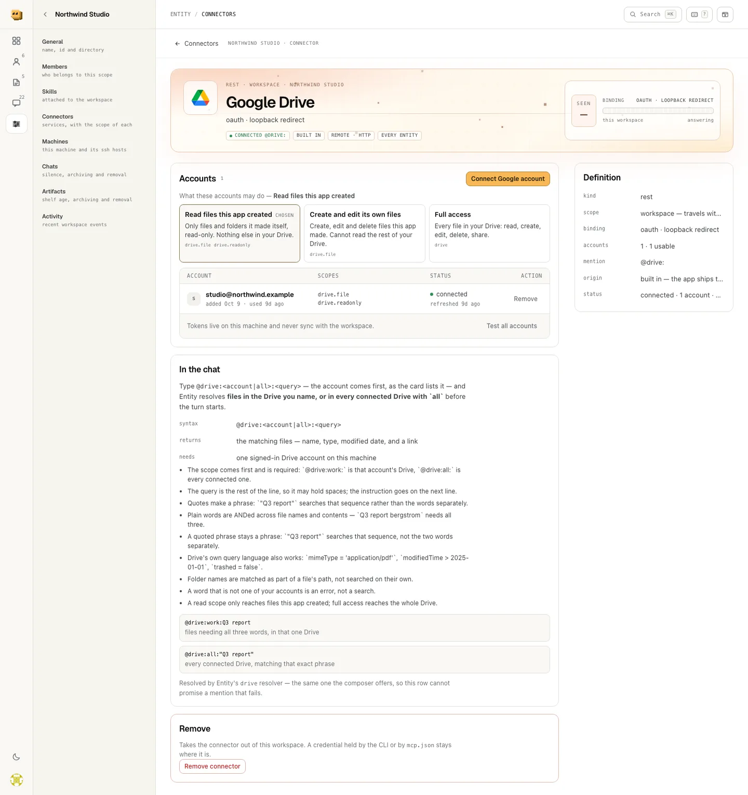

[← Connectors](../connectors.md)

# Google Drive

Files an agent may open, from one connected Drive or from every one you connected. The
same `rest` + `oauth` shape as Gmail and YouTube, and the same rule about scope: the Drive
comes first.

## The mention

`@drive:<account|all>:<query>`

| you write | you get |
| --- | --- |
| `@drive:work:Q3 report` | files needing all three words, in that one Drive |
| `@drive:all:"Q3 report"` | every connected Drive, matching that exact phrase |

Plain words are ANDed across file names and contents. Quotes keep a phrase a phrase.
Drive's own query language also works — `mimeType = 'application/pdf'`,
`modifiedTime > 2025-01-01`, `trashed = false` — because the query goes to Drive as
written and Entity does not translate it.

Folder names are matched as part of a file's path, not searched on their own. A `read`
tier only reaches files this app created; `full` reaches the whole Drive. That difference
is why the tier is chosen per workspace and stated on the card rather than assumed.

## Where the credential lives

`~/.entity/oauth-accounts.json` for the row a page reads, and `oauth-secrets.json`
beside it, `0600`, for the refresh token — outside the workspace, so neither can sync.
Entity gets a file name, a type, a modified date and a link; it never proxies the
download.

→ [Connectors](../connectors.md) — the roster, the tiers and the consent round-trip
→ [Artifacts](../artifacts.md) — where a file a turn produced lands instead
