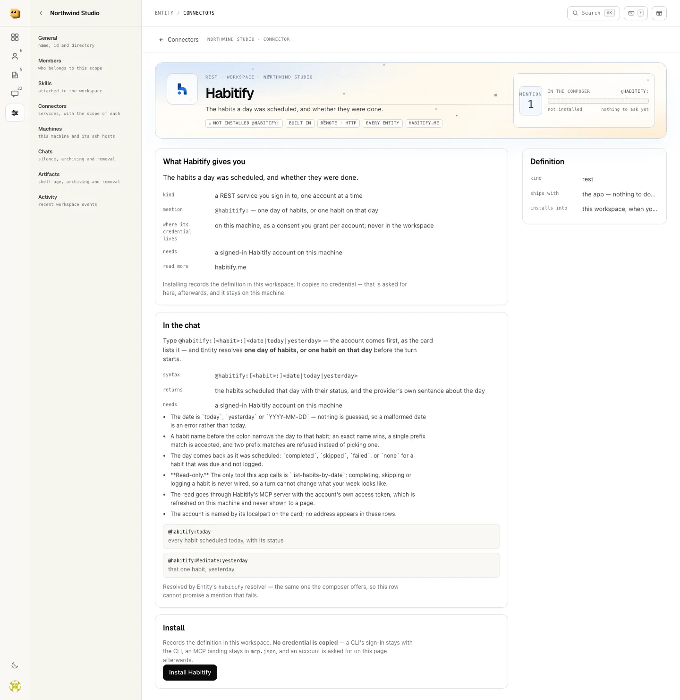

[← Connectors](../connectors.md)

# Habitify

The habits a day was scheduled, and whether they were done. The shape is unusual for this
roster: Habitify is a `rest` + `oauth` row, but its read happens **through the provider's
remote MCP server** with the account's own access token, refreshed on this machine. The
composer offers one mention, so which transport carries it is not something you have to
know.

## The mention

`@habitify:[<habit>:]<date|today|yesterday>`

| you write | you get |
| --- | --- |
| `@habitify:today` | every habit scheduled today, with its status |
| `@habitify:Meditate:yesterday` | that one habit, yesterday |

The date is `today`, `yesterday` or `YYYY-MM-DD` — **nothing is guessed**, so a malformed
date is an error rather than silently today. A habit name before the colon narrows the day
to that habit: an exact name wins, a single prefix match is accepted, and two prefix
matches are refused instead of picking one.

The day comes back as it was scheduled: `completed`, `skipped`, `failed`, or `none` for a
habit that was due and not logged.

**Read-only.** The only tool this app calls is `list-habits-by-date`; completing,
skipping or logging is never wired, so a turn cannot change what your week looks like.

## Where the credential lives

`~/.entity/oauth-accounts.json` for the row a page reads, and `oauth-secrets.json`
beside it, `0600`, for the access token — refreshed here and never shown to a page. The
account is named on the card by its localpart; no address appears in these rows.

→ [Connectors](../connectors.md) — the roster, the tiers and the consent round-trip
