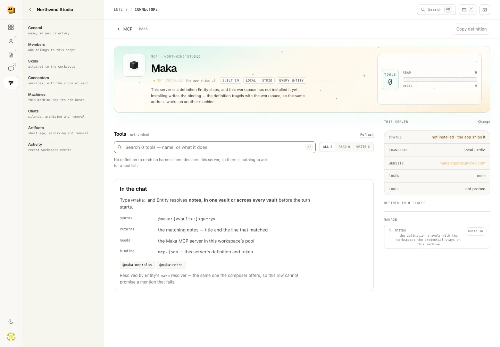

[← Connectors](../connectors.md)

# Maka

Notes, PDFs and feeds from a local vault, read through the Maka MCP server in this
workspace's pool. Maka is the `mcp` kind: the vault and its agent-facing tools are
Maka's, and Entity's job is to put a query in front of the server and hand back what it
matched.

The row is installed by adding the server to the pool through Maka's own setup, not by a
`launcher` script — which is why a workspace that has not installed it shows a page with
no command to copy. Read the page, install it there.

## The mention

`@maka:[<vault>:]<query>`

| you write | you get |
| --- | --- |
| `@maka:one:plan` | notes in the `one` vault matching "plan" |
| `@maka:retro` | every vault, one query |

A vault name before the colon scopes the search; without one it reads every vault. A note
comes back as a title and the line that matched, so a long note is never pasted whole —
the entity asks for the note itself if the line says it is worth it.

## Where the credential lives

The Maka MCP server's own configuration, on this machine. The connector row holds a
binding to the pool, not a token: nothing about a vault password is stored in
`connectors.json`.

→ [MCP servers](../mcp.md) — the `mcp` kind in full
→ [Connectors](../connectors.md) — the roster, the three kinds and the tiers
