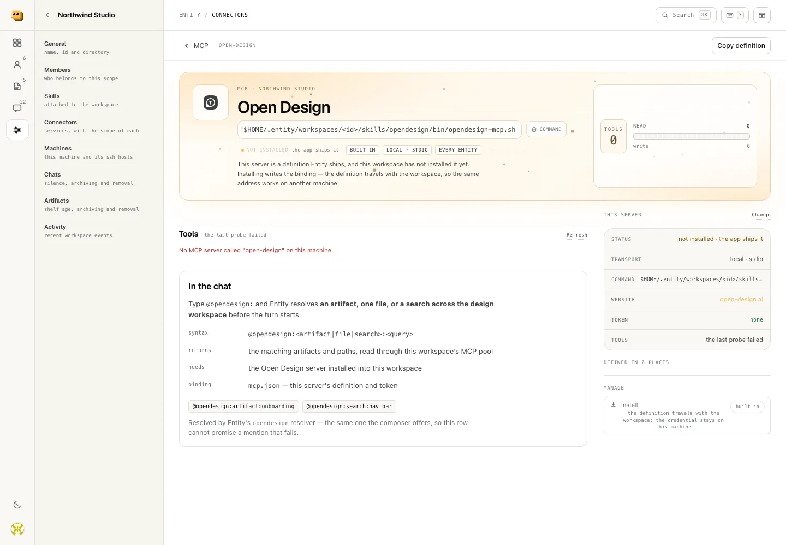

[← Connectors](../connectors.md)

# Open Design

Artifacts, files and searches from a design workspace's own MCP server. Unlike the other
MCP-backed rows, Open Design's definition **travels**: the server launches from
`<workspace>/skills/opendesign/`, inside the workspace folder, so a teammate who syncs the
workspace gets a mention that works rather than a path into your home directory.

## The mention

`@opendesign:<artifact|file|search>:<query>`

| you write | you get |
| --- | --- |
| `@opendesign:artifact:onboarding` | that artifact's path and content summary |
| `@opendesign:search:nav bar` | every file the server matches for those words |

The first segment is *what to read*; the rest of the line is the query and may hold
spaces. `artifact` and `file` name one thing directly, `search` lists what matched.

Every read is one of the server's own read tools. `delete_file` and `delete_project` are
in the pool and are **never offered by a mention**, so a typo cannot remove anything.

Its first start downloads and builds, so a cold run gets a 90-second deadline; after that
the pool answers immediately.

## Where the credential lives

Nowhere in Entity: the server is the workspace's own `skills/opendesign/`, and whatever it
needs it holds itself. Installing the row writes a binding in `mcp.json`, not a secret.

→ [MCP servers](../mcp.md) — the `mcp` kind in full
→ [Skills](../skills.md) — the `skills/` directory a definition can travel in
→ [Connectors](../connectors.md) — the roster, the three kinds and the tiers
