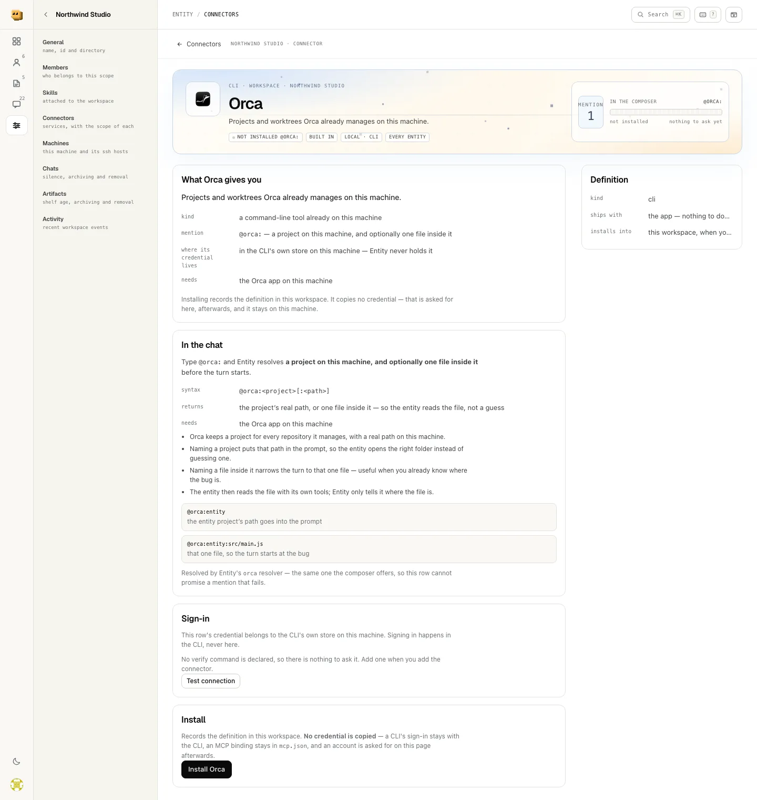

[← Connectors](../connectors.md)

# Orca

The repositories Orca already manages on this computer, as paths. Nothing is installed
and nothing is fetched: Orca keeps a project list, and the connector reads it so an agent
can be pointed at a folder by name instead of being handed an absolute path.

It is a `cli` connector, so its credential is the CLI's own — the `orca` binary on
`PATH` and whatever sign-in it holds. Entity stores no token for it, and the page says
that rather than offering a field that would lie about where the secret lives.

## The mention

`@orca:<project>[:<path>]`

| you write | you get |
| --- | --- |
| `@orca:entity` | that project's real path, in the prompt |
| `@orca:entity:src/main.js` | that one file, so the turn starts at the bug |

A project name resolves to the directory Orca records for it; a path after the second
colon narrows the turn to one file inside it. Entity puts the path in the prompt and the
entity reads the file with its own tools — the resolver only says *where* it is, so a
stale project name cannot turn into a stale copy of the code.

## Where the credential lives

In Orca's own store on this machine. Sign-in happens in Orca, never on this page —
which is why the row has no token box and only a **Test connection** that runs
`orca --version` and then `orca repo list --json`.

→ [Connectors](../connectors.md) — the roster, the three kinds, the tiers and the
consent round-trip
