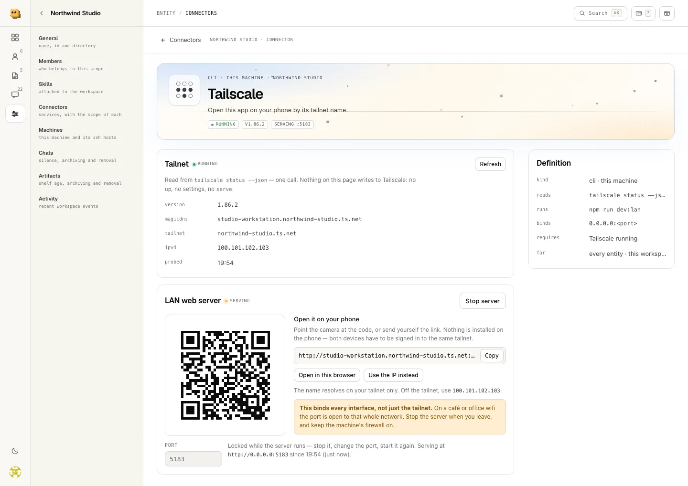

[← Connectors](../connectors.md)

# Tailscale

Open this app on your phone by its tailnet name. That is the whole offer: the phone is
already signed in to the same tailnet, so it needs no install, no pairing and no
credential — it needs the address, and a code it can read off a screen.

A `cli` row, and the odd one: it authenticates nothing for a workspace and stores no
token. It reads one machine-local daemon — `tailscale status --json`, one call — and then
does exactly two things with what it read: it puts this machine's tailnet address in a QR
code, and it gates one command, the repo's own `npm run dev:lan`.

That makes it the fourth thing a connector can be in practice, whichever chip the rail
prints: `mcp`, `cli` and `rest` all reach something and hold whatever proves who you are;
this one holds nothing and reaches nothing, it only reads and gates. Adding a fourth
`kind` to the catalog for a single row would have been a runtime branch with one
inhabitant, so it stays a `cli` row with `verify: tailscale version` — the one fact the
three kinds do share.

**Nothing on this page is ever written to Tailscale.** No `up`, no `set`, no
serve/funnel, no auth key, no settings. The daemon is a source of truth here, never a
target: a page that could enable a funnel is a page that could expose a laptop, and the
answer is that this one cannot.

## The tailnet card

One read, five facts, and a sentence where a fact cannot be had. `state` is `running`,
`stopped`, `signed-out`, `starting` or `absent` — and `absent` is a sentence naming
Tailscale and offering **Get Tailscale**, never a zero in a version field.

The address is the MagicDNS name only when the daemon says MagicDNS is on; otherwise it
is the first IPv4 in `Self.TailscaleIPs`. A name the phone cannot resolve is a QR that
dead-ends, so the app would rather hand over the number that always works.

One field the daemon reports is deliberately never read: `CurrentTailnet.Name` holds the
account address when a tailnet has no org domain. The MagicDNS suffix is the same fact
with nothing personal in it, so that is what the card prints.

## The LAN web server card

**Start server** binds every interface on the chosen port (5183 by default) and starts
the repo's own `npm run dev:lan` with `--strictPort`, so a port collision is an error
rather than a silent move to 5184. When it reports serving, the card shows the URL, a
**Copy**, an **Open in this browser**, a **Use the IP instead** toggle and the QR.

It is a dev server, and the page says so in the card: this binds every interface, not
just the tailnet, so on a café network the port is open to that network too. **Stop
server** kills the process tree and waits for the port to be free — the check is `lsof`,
not a promise — and the server is also stopped on quit, when the daemon leaves `running`,
and when the port changes.

## The mention

**There is none.** The catalog entry carries no `work` block, so `@tailscale:` is not a
thing you can type and the composer will not offer it — a row with no resolver says so
rather than promising an `@` that would fail. What the page gives an agent is the
address, in the prompt-visible URL, and what it gives a person is the QR.

→ [Connectors](../connectors.md) — the roster, the three kinds, and this one's place apart
→ [Machines](../machines.md) — the ssh hosts this machine knows
