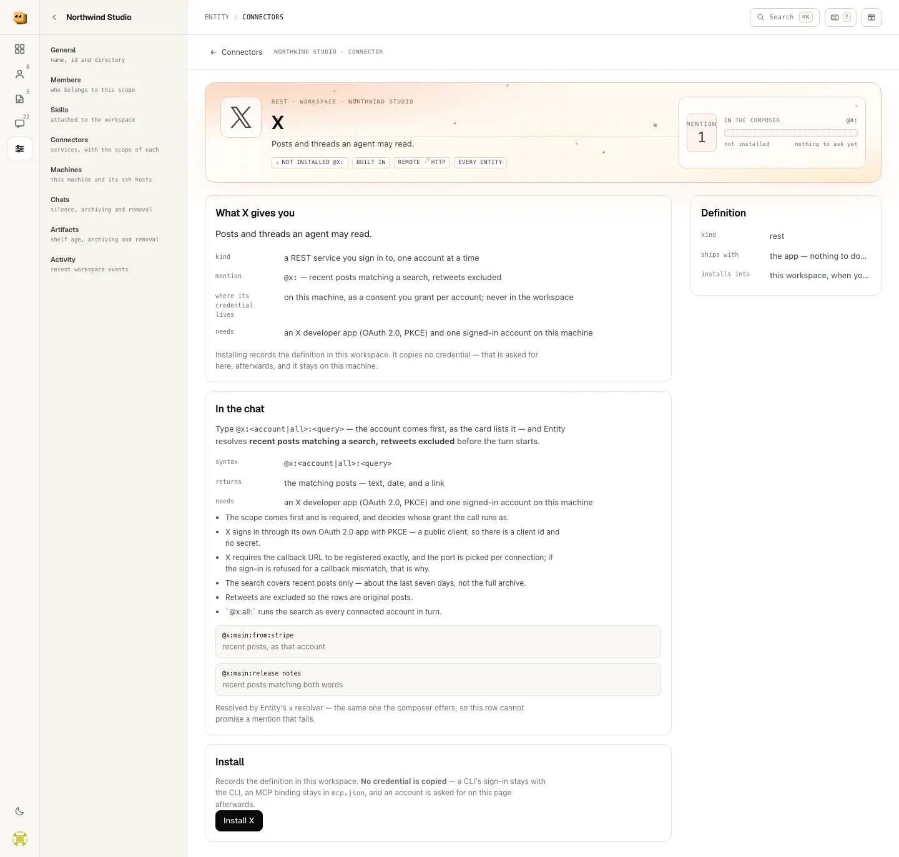

[← Connectors](../connectors.md)

# X

Recent posts and threads an agent may read. The `rest` + `oauth` shape again, with the
provider's own quirks stated on the page rather than discovered at the first refusal.

## The mention

`@x:<account|all>:<query>`

| you write | you get |
| --- | --- |
| `@x:main:from:stripe` | recent posts, as that account |
| `@x:main:release notes` | recent posts matching both words |

The scope comes first and is required, and decides whose grant the call runs as.
`@x:all:` runs the search as every connected account in turn.

The search covers **recent posts only** — roughly the last seven days, not the archive —
and retweets are excluded, so the rows are original posts. A title, a date and a link is
what comes back; Entity does not fetch the thread behind it.

## The sign-in

X signs in through its own OAuth 2.0 app with **PKCE**: a public client, so there is a
client id and no secret. X requires the callback URL to be registered exactly, and the
port is picked per connection — if a sign-in is refused for a callback mismatch, that is
why, and X says it in those words.

## Where the credential lives

`~/.entity/oauth-accounts.json` for the row a page reads, and `oauth-secrets.json`
beside it, `0600`, for the refresh token. The client id is asked for once, app-wide,
stored `0600`, and only a hint is read back.

→ [Connectors](../connectors.md) — the roster, the tiers and the consent round-trip
