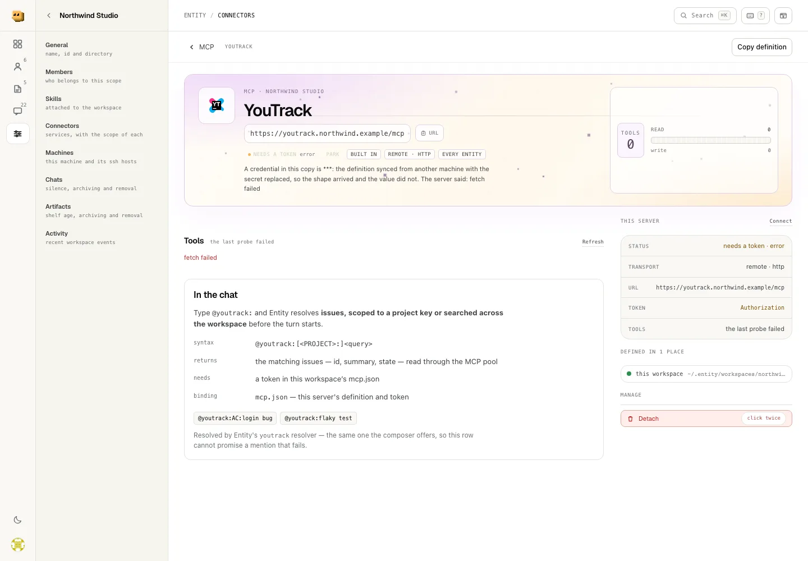

[← Connectors](../connectors.md)

# YouTrack

Issues, read through this workspace's MCP pool. YouTrack is the `mcp` kind, not a REST
connector of its own: the server is a definition in `mcp.json` with a token in its
header, and the connector row is the face on that binding. Pull the token and the row
stops answering in the same breath.

## The mention

`@youtrack:[<PROJECT>:]<query>`

| you write | you get |
| --- | --- |
| `@youtrack:AC:login bug` | issues in `AC` whose text matches that |
| `@youtrack:flaky test` | that search across every readable project |

A short upper-case word before the colon is a project key; without one, the whole text is
searched. The rows come back as id, summary and state — the same rows a dashboard panel
would draw — so a wide query costs a table, not a page of issue bodies.

Because it goes through the pool, the mention stops working the moment the token does.
That is the trade: no second credential store, no proxy of ours between the entity and
YouTrack.

## Where the credential lives

In this workspace's `mcp.json`, `0600`, as a header on the server's definition. A
definition that syncs from another machine arrives **parked** with the secret replaced by
`***`, so the shape travels and the token does not.

→ [MCP servers](../mcp.md) — the `mcp` kind in full
→ [Connectors](../connectors.md) — the roster, the three kinds and the tiers
