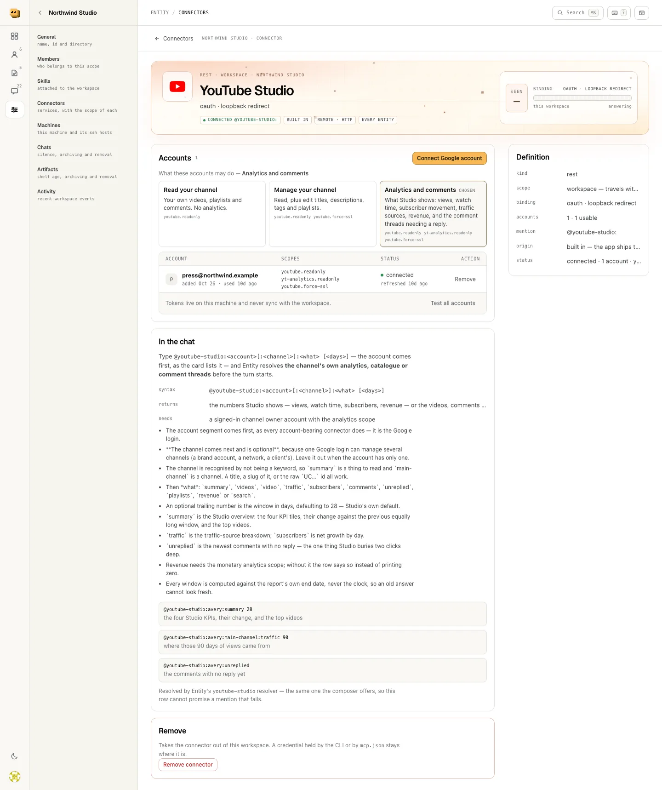

[← Connectors](../connectors.md)

# YouTube Studio

Views, watch time, subscribers, revenue and comments from your own channel — the numbers
Studio shows, read as the account that owns them. It is the only connector here whose
mention takes **three** segments before the query, because one Google login can manage
several channels.

## The mention

`@youtube-studio:<account>[:<channel>]:<what> [<days>]`

| you write | you get |
| --- | --- |
| `@youtube-studio:avery:summary 28` | the four Studio KPIs, their change, and the top videos |
| `@youtube-studio:avery:main-channel:traffic 90` | where those 90 days of views came from |
| `@youtube-studio:avery:unreplied` | the comments with no reply yet |

The account segment comes first, as every account-bearing connector does. **The channel
comes next and is optional**: leave it out when the login manages one channel. It is
recognised by not being a keyword, so `summary` is a thing to read and `main-channel` is a
channel — a title, a slug of it, or the raw `UC…` id all work.

Then *what*: `summary`, `videos`, `video`, `traffic`, `subscribers`, `comments`,
`unreplied`, `playlists`, `revenue` or `search`. The optional trailing number is the window
in days, defaulting to 28 — Studio's own default.

`unreplied` is the newest comments with no reply, which is the one thing Studio buries two
clicks deep. Revenue needs the monetary scope; without it the row **says so instead of
printing zero**.

Every window is computed against the report's own end date, never the clock, so an old
answer cannot look fresh.

## Where the credential lives

`~/.entity/oauth-accounts.json` for the row a page reads, and `oauth-secrets.json`
beside it for the refresh token, `0600`, in a file no call-table entry returns. The
analytics scope is asked for at consent time and named on the tier card before you grant
it.

→ [YouTube](youtube.md) — the catalogue, as opposed to the channel's own numbers
→ [Connectors](../connectors.md) — the roster, the tiers and the consent round-trip
