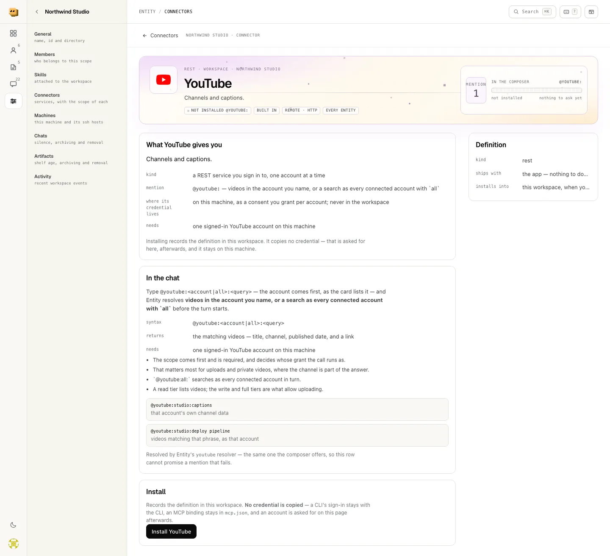

[← Connectors](../connectors.md)

# YouTube

Channels and captions, read as the account you name. Three of these connectors speak to
Google — Gmail, Drive and YouTube — and each keeps its own accounts, so a personal login
and a brand channel are two rows on the same machine and never one merged identity.

The page in the picture is read **before** installation, and that is the point: you learn
what the service gives you, the mention it answers and where its credential would live
without installing anything first. The accounts card and the tier cards are held back,
because an uninstalled connector has no binding for them to write to.

## The mention

`@youtube:<account|all>:<query>`

| you write | you get |
| --- | --- |
| `@youtube:studio:captions` | that account's own channel data |
| `@youtube:studio:deploy pipeline` | videos matching that phrase, as that account |

The scope comes first and is required, because it decides **whose grant the call runs
as**. That matters most for uploads and private videos, where the channel is part of the
answer: `@youtube:all:` runs the search as every connected account in turn, and a video
only one of them can see is only found by the account that can.

A `read` tier lists videos. The write and full tiers are what allow uploading, which is
why the tier is a per-workspace decision rather than a per-account one.

## Where the credential lives

`~/.entity/oauth-accounts.json` holds the row a page reads — address, scopes, status,
timestamps — and `oauth-secrets.json` beside it holds the refresh token, `0600`, in a file
**no call-table entry returns**. The read only ever returns a title, a channel, a
published date and a link.

→ [YouTube Studio](youtube-studio.md) — the channel's own numbers, not just its catalogue
→ [Connectors](../connectors.md) — the roster, the tiers and the consent round-trip
