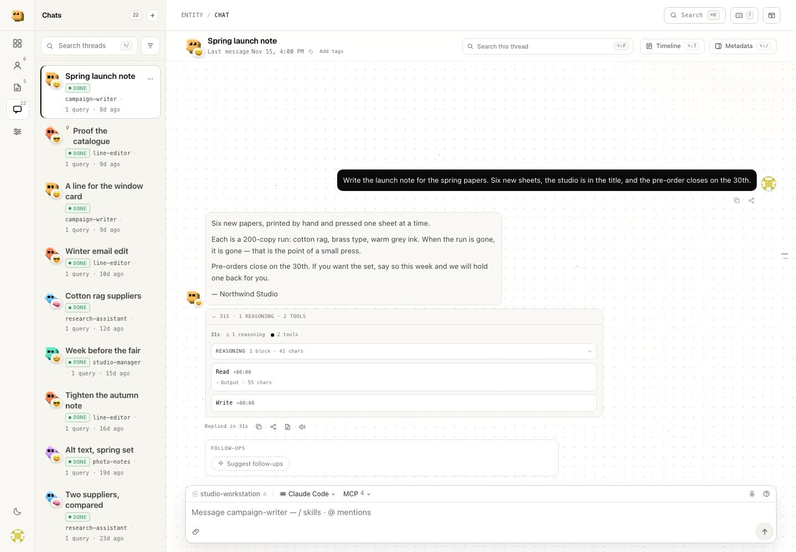
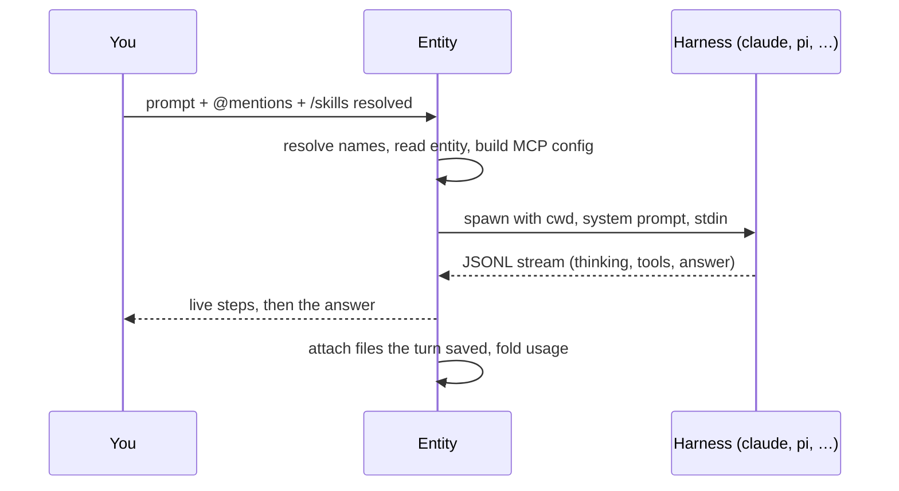
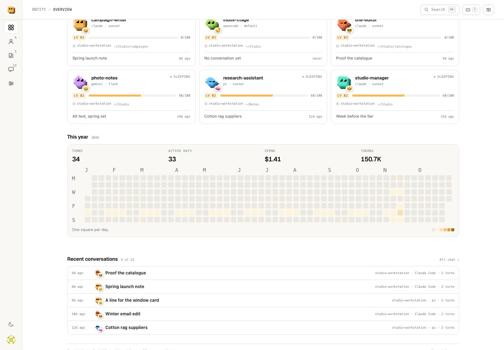
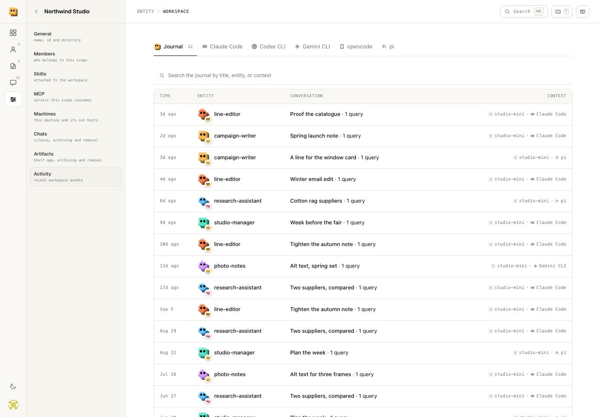

[← README](../README.md)

# Conversations

Every turn is a **real harness process** in JSONL stream mode
(`claude --output-format stream-json`, `pi --mode json`, equivalents for the rest).
Nothing is simulated, and an answer you cannot reproduce is still one you can read.

<picture><source srcset="assets/readme-features/chat.webp" type="image/webp" /></picture>

## What a turn keeps

- The thinking, the answer, and **a row per tool call** with its output.
- Execution metadata on the assistant message: command, `cwd`, model, duration,
  token usage, exit code. There is no second copy anywhere.

## The timeline

<picture><source srcset="assets/readme-features/timeline.webp" type="image/webp" /></picture>

Click a step to read the thought or the tool output behind it. Tokens in/out, time
and spend sit beside the steps, from the same records the charts use.

## Working with answers

- A slow turn does not lock the composer for other conversations: each thread has its
  own live turn, Stop control and trace. A working thread cannot be deleted until it
  is stopped.
- A failed turn carries **Retry** — it re-runs the same question without adding a
  second copy of it, and keeps the files it already saved.
- Every message has copy and share; share is a deep link (`?thread=…&msg=…`) that
  opens the thread and scrolls to the row.
- The newest reply offers three **follow-ups** — short actions with a full prompt
  behind them. One click sends it down the same path as typed text.
- A screenshot or document a turn saved is attached to that turn as soon as it
  finishes, so it appears without reloading the thread.
- Asking to delete an entity in a thread opens a confirmation first: what will be
  removed, how many conversations it owns, and what closing them means. The harness
  never sees the request.
- A thread records the account that created it. List, read, rename, send, cancel and
  remove only see that account's threads, even in a shared workspace.
- The first message names a thread — until you rename it. A title you typed (or cleared)
  is never replaced by a later turn; the rail falls back to the first message only while
  the thread has no title of its own.
- The right-edge outline draws one tick per message and opens a jump card.
- The transcript follows a streaming turn only while you are at the bottom. Scroll
  up mid-answer and it stays put — the text keeps arriving below — and a pill above
  the composer (`↓ Newest activity`) puts you back on it in one click. Reaching the
  bottom by hand resumes following too.

## The links and paths are a second view

The useful residue of a thread — the issue, the PR it opened, the files it read, the
folder it worked in — is scattered across answers and tool output. The panel button in
the chat header opens a drawer with that residue, newest first:

- **Links** — every URL in the transcript, including resolved `@youtrack:` and
  `@orca:` mentions. Click one to open it in your browser; copy puts it on the
  clipboard.
- **Paths** — files and folders the conversation mentioned, relative to the directory
  the turn actually ran in. Click a row for **Reveal in Finder / File Explorer** (a
  folder opens directly) or **Open in VS Code** for a file; every row copies its
  absolute path.
- Only paths that exist on this machine are listed. A remote thread lists its paths
  but offers copy only, because opening them here would look at the wrong machine.
- Nothing is stored twice: the drawer is derived from the thread's own messages and
  tool calls on demand, so it cannot disagree with the chat.

## Mentions are resolved before the agent sees them

| mention | becomes |
| --- | --- |
| `@release-captain cut the branch` | that entity **runs** the job first; its answer is injected into this turn |
| `@artifact:q3-usage.csv` | a file on this workspace's shelf, as `artifact://…` plus its path |
| `@maka:atlas:plan` | notes found through the Maka MCP server (vault, then query) |
| `@youtrack:AC:login bug` | issues through the YouTrack MCP server, scoped to `project: AC` |
| `@orca:Atlas:src/app.ts` | an absolute path inside an Orca project |

A mention owns the text after it up to the next `@`, which is how a query can contain
spaces without quotes. While one word is being typed the composer lists matches ten at
a time, with **Show 10 more** to page the source. A **name** that does not exist stops
the message; a **search** with no hits only adds a note.

## A folder per thread

<picture><source srcset="assets/readme-features/folder.webp" type="image/webp" /></picture>

**New thread → Start from a folder** pins an optional project directory to the
conversation. It hides behind a toggle because most threads do not need one.

- The harness starts in that folder instead of the entity's `dir`.
- `/` lists the folder's own skills first — `.claude/`, `.agents/`, `.pi/`,
  `.opencode/`, `.codex/`, `.gemini/`, `.antigravity/` and a plain `skills/` — as
  `/project:<name>`.
- `@file:` lists files under the folder (bounded walk, VCS and build folders skipped)
  and resolves relative paths from it when the turn is sent.
- The composer shows the folder beside the harness, and the thread keeps it after a
  reload.
- Absolute, existing directories only, and only on this machine — a remote thread
  cannot read this disk, so the field is hidden there.

## Usage and activity

<picture><source srcset="assets/readme-features/usage.webp" type="image/webp" /></picture>

Every turn stores its execution: model, duration, token counts and, when the harness
reports it, a price. The overview folds those records into the current year; an entity
page folds the same set for one entity.

- **Spend** — one bar per day with a priced turn, plus the year's total spend and
  tokens. A day with no price is not invented into one.
- **Activity** — one square per day, darker for more turns; a day with nothing stays
  grey rather than taking the faintest warm step.
- The source is the conversation itself, not a second ledger: deleting a thread
  removes its cost, and a harness that reports no price contributes turns and tokens
  but no dollars.

## The activity journal and the palette

<picture><source srcset="assets/readme-features/activity.webp" type="image/webp" /></picture>

<picture><source srcset="assets/readme-features/command-palette.webp" type="image/webp" /></picture>

The Activity journal keeps a row per thread — who, what, when and where — with a tab
for each assistant's own session history. One shortcut opens a palette over
workspaces, conversations, assistants, skills, machines and the journal: type three
letters, press enter, and you are there.

## Related

- [Skills](skills.md) · [MCP servers](mcp.md) · [Artifacts](artifacts.md)
- [Machines](machines.md) — where a pinned thread actually runs
- [Voice](voice.md) — talking to a thread and interrupting it
