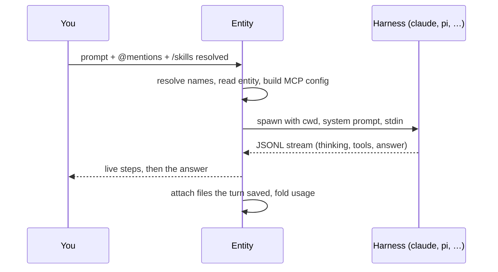
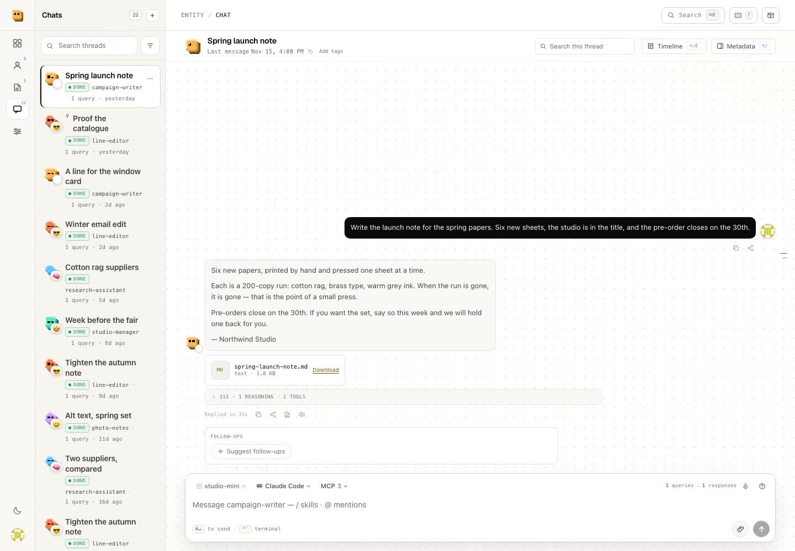
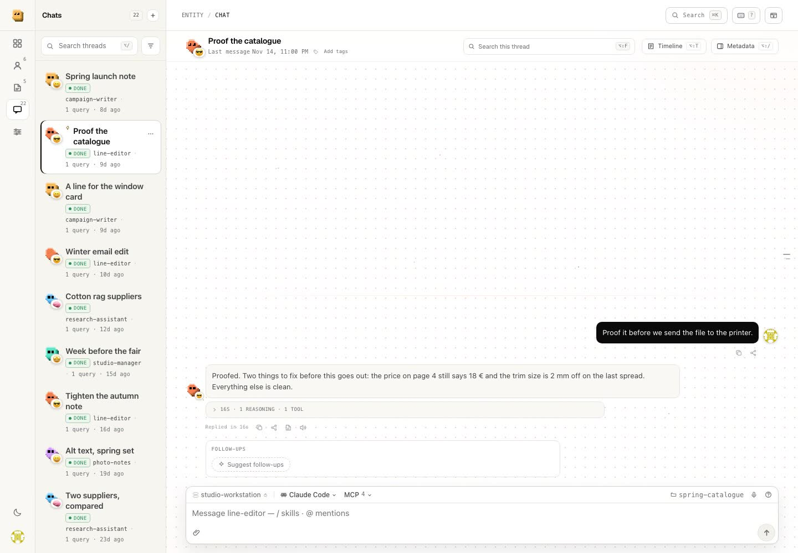
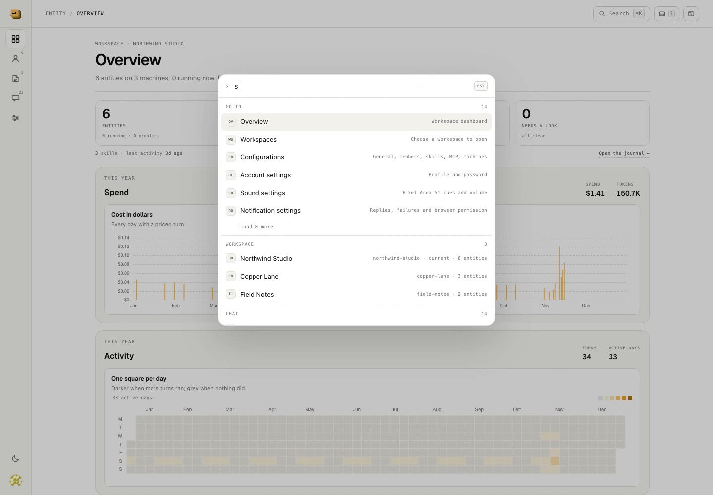

[← README](../README.md)

# Conversations

Every turn is a **real harness process** in JSONL stream mode
(`claude --output-format stream-json`, `pi --mode json`, equivalents for the rest).
Nothing is simulated, and an answer you cannot reproduce is still one you can read.

<picture><source srcset="assets/readme-features/chat.webp" type="image/webp" /></picture>

## What a turn keeps

- The thinking, the answer, and **a row per tool call** with its output.
- Execution metadata on the assistant message: command, `cwd`, model, duration,
  token usage, exit code. There is no second copy anywhere.



## The timeline

<picture><source srcset="assets/readme-features/timeline.webp" type="image/webp" /></picture>

Click a step to read the thought or the tool output behind it. Tokens in/out, time
and spend sit beside the steps, from the same records the charts use.

## Working with answers

- A slow turn does not lock the composer for other conversations: each thread has its
  own live turn, Stop control and trace. A working thread cannot be deleted until it
  is stopped.
- A failed turn carries **Retry** — it re-runs the same question without adding a
  second copy of it, and keeps the files it already saved.
- A turn finishing somewhere else does not move you: the rail row turns from
  *working* to *done* and the reply waits where it belongs. Nothing switches the
  conversation you are reading — not a completion, not a retry, not a failure.
- Unsent text belongs to its thread. Type half a question, go read another
  conversation, come back: it is still in the box. It also survives a reload —
  drafts are kept in this window, never in the workspace files — and sending in
  one thread empties only that one.
- Every message has copy and share; share is a deep link (`?thread=…&msg=…`) that
  opens the thread and scrolls to the row. In a browser tab the share sheet takes
  the link and the text; the packaged app has no share sheet, so Share puts the
  link on the clipboard and says so — a card in the rail offers the thread's
  **link** in a tab and its **id** in the app, never a quoted block.
- The newest reply offers three **follow-ups** — short actions with a full prompt
  behind them. One click sends it down the same path as typed text.
- A screenshot or document a turn saved is attached to that turn as soon as it
  finishes, so it appears without reloading the thread.
- Asking to delete an entity in a thread opens a confirmation first: what will be
  removed, how many conversations it owns, and what closing them means. The harness
  never sees the request.
- A thread records the account that created it. List, read, rename, send, cancel and
  remove only see that account's threads, even in a shared workspace.
- **Archive** is the reversible middle between keeping a thread forever and
  deleting it: one click in the ⋯ menu, an `Undo` in the toast for five seconds,
  and no confirm (Delete keeps its two clicks). The row leaves the working list
  and lands in a collapsed **Archived** group at the foot of the same rail — one
  click to open, one hover-visible **Restore** to come back, pin and all. Search
  and every filter reach into it: a query that only an archived thread matches
  opens the group and counts matches instead of lying with an empty list.
  `archivedAt` records **when it went in**, and is written once — the move is a
  state setter, not a button press: archiving an archived thread changes nothing
  and writes no file, so a scheduled pass can call the same write every boot
  without resetting the clock a "delete it N days after it was archived" rule
  would count from.
- The first message names a thread — until you rename it. A title you typed (or cleared)
  is never replaced by a later turn; the rail falls back to the first message only while
  the thread has no title of its own.
- The right-edge outline draws one tick per message and opens a jump card.
- The transcript follows a streaming turn only while you are at the bottom. Scroll
  up mid-answer and it stays put — the text keeps arriving below — and a pill above
  the composer (`↓ Newest activity`) puts you back on it in one click. Reaching the
  bottom by hand resumes following too.

## The links and paths are a second view

The useful residue of a thread — the issue, the PR it opened, the files it read, the
folder it worked in — is scattered across answers and tool output. The panel button in
the chat header opens a drawer with that residue, newest first:

- **Links** — every URL in the transcript, including resolved `@youtrack:` and
  `@orca:` mentions. Click one to open it in your browser; copy puts it on the
  clipboard.
- **Paths** — files and folders the conversation mentioned, relative to the directory
  the turn actually ran in. Click a row for **Reveal in Finder / File Explorer** (a
  folder opens directly) or **Open in VS Code** for a file; every row copies its
  absolute path.
- Only paths that exist on this machine are listed. A remote thread lists its paths
  but offers copy only, because opening them here would look at the wrong machine.
- Nothing is stored twice: the drawer is derived from the thread's own messages and
  tool calls on demand, so it cannot disagree with the chat.

## Mentions are resolved before the agent sees them

| mention | becomes |
| --- | --- |
| `@release-captain cut the branch` | that entity **runs** the job first; its answer is injected into this turn |
| `@artifact:q3-usage.csv` | a file on this workspace's shelf, as `artifact://…` plus its path |
| `@thread:t_abc123` | another conversation in this workspace: its title, questions and last answer, injected as context |
| `@file:notes/brief.md` | a file under the thread's base folder, resolved to a real path |
| `@maka:atlas:plan` | notes found through the Maka MCP server (vault, then query) |
| `@youtrack:AC:login bug` | issues through the YouTrack MCP server, scoped to `project: AC` |
| `@orca:Atlas:src/app.ts` | an absolute path inside an Orca project |

A mention owns the text after it up to the next `@`, which is how a query can contain
spaces without quotes. While one word is being typed the composer lists matches ten at
a time, with **Show 10 more** to page the source. A **name** that does not exist stops
the message; a **search** with no hits only adds a note.

## A folder per thread

<picture><source srcset="assets/readme-features/folder.webp" type="image/webp" /></picture>

**New thread → Start from a folder** pins an optional project directory to the
conversation. It hides behind a toggle because most threads do not need one.

- The harness starts in that folder instead of the entity's `dir`.
- `/` lists the folder's own skills first — `.claude/`, `.agents/`, `.pi/`,
  `.opencode/`, `.codex/`, `.gemini/`, `.antigravity/` and a plain `skills/` — as
  `/project:<name>`.
- `@file:` lists files under the folder (bounded walk, VCS and build folders skipped)
  and resolves relative paths from it when the turn is sent.
- The composer shows the folder beside the harness, and the thread keeps it after a
  reload.
- Absolute, existing directories only, and only on this machine — a remote thread
  cannot read this disk, so the field is hidden there.

## A mention leaves a session behind

`@secretary check the pricing page` runs the job inside *this* turn — that is what lets
the reply above it use the answer — and it also files a **session**: a real conversation
with that entity, linked to this one.

- The transcript shows a **delegation card**: who ran it, which harness and model, how
  long it took, the job, and the answer. **Continue** at the card's top right opens the
  session, with the job and the answer already in it.
- The session is a thread like any other: send another message there and the entity
  continues with that history, its harness and model, its own folder.
- It is linked by **one optional field**, `spawnedFrom: { workspace, id }` — on the
  session, not on the parent. Both directions are derived from it, so there is no
  children array to keep in sync.
- **Sessions are not rows in the rail.** A thread that delegates a few jobs would drown
  the list, so the rail keeps the conversations you started and the parent row carries
  `spawned N chats`. Clicking that count opens a tree of the sessions it started
  (including sessions a session started); one click opens one. While a session is open,
  the rail marks the conversation it belongs to and the header shows
  `↳ from #<parent>` to go back.
- Archiving a parent does not touch its sessions, and deleting one simply leaves the
  link pointing nowhere — the session is still a readable thread.
- Sessions stay in the **same workspace**, run on **this machine** (a mention is resolved
  by the app, not by a remote host), and nothing about them is stored beyond the thread
  itself.

A delegated run is given an hour (`ENTITY_MENTION_TIMEOUT_MS`), not the two minutes a
search would need: a job that has to *finish* gets a fix round and a screenshot. It is
still bounded, and **Stop** cancels it and keeps the answers that already landed.

The turn that contains the delegation has its own clock, and it is the one that saves
you. A turn gets **90 minutes by default** from spawn, whatever it is doing — it is armed
once and progress does not extend it. The number is a setting (Workspace → Chats → *How
long a turn may run*), so it is read when the turn starts; `ENTITY_TURN_TIMEOUT_MS` still
outranks it. The other clock only catches a
*silent* harness (15 minutes with no output), and a harness that keeps printing thinking
steps is never silent: one turn here streamed for 7.5 hours because the silence timer was
the only bound. When the deadline fires the row says `The turn ran past its 90-minute
limit and was stopped`, which is the truth, instead of blaming a lack of output.

**The turn is told its deadline** (`platform.turnBudget`) — a stop the harness cannot see
is only a way to lose the work, because it lands wherever the turn happens to be. The
text sits with the platform brief, before the workspace's own rules, and asks the harness
to commit to its first plan, to read a line rather than sweep a file, and to land a whole
version before refining it. Two threads here ran the full 90 minutes, wrote `let me plan`
fifteen times and edited nothing at all; the fix is the number, not a shorter clock. A
queued **run** is not given this: it has no turn deadline, and a budget it does not have
would change how the work is done for no reason.

**One instruction, several sessions.** Start the message with `spawn N` and the mention
runs N times, in parallel — N answers, N cards, N sessions:

```
spawn 3 @secretary write a poem
```

Each run is told which one it is (run 1 of 3, and so on) because three answers to the
same sentence only differ if each knows it must; the sessions are titled
`write a poem · 1/3` … `3/3`, and the parent's reply sees all three answers. `N` is
capped at 5, and `spawn 3 tasks in the backlog` (no mention after the number) stays
prose.

**One run per row.** `spawn per` takes its count from a list instead of a number — the
row *is* the run:

```
spawn per @youtrack:ENTITY:relates to: ENTITY-21 #Unresolved @coder /workspace:orca-worktree fix it
```

The list mention resolves first, then the entity is copied once per row, so seven issues
become seven sessions titled by their issue id and title, seven delegation cards and seven
continuations.

**The rows are on screen while they run.** The turn's live bubble paints one delegation card
per run the moment it exists — queued, then `Working…`, then the answer it produced — and the
foot says `3 of 7 done · 2m 04s`. A fan-out can hold the turn for half an hour, and a bare
"Waiting for …" for that long reads as a hang. Stop ends all of them: the delegated runs are
the turn, so the button kills every child harness, keeps the answers that already landed, and
leaves `Stopped by you.` Each run is told which row is its own ("do only that row — the other six
runs handle the rest"). Two rules come with it:

- **The rows can be typed** when nothing can resolve them: `spawn per [a, b, c] @entity <job>`,
  comma or newline separated. Same rules — one run per row, the row is the session title — and the
  same cap, so a list that is really a file's array can be fanned out without a selector syntax.
- **Twelve rows, one row per run** — the reply above reads at most twelve rows, and a
  fan-out may not silently lose an answer. More rows is a hard error before anything runs;
  narrow the query.
- **The skill belongs inside the job.** A fan-out routes each *run*, not the message, so
  `/workspace:…` goes after the entity (`@coder /workspace:orca-worktree …`). Leading with
  the skill is refused with that sentence, because it would route the parent instead and
  leave seven agents in one checkout. The exception is the derived fan-out below: there the
  composer's `/workspace:` is moved onto every run, which is what it already meant.

**A `spawn` with no count is read, once.** `spawn @coder <job>` is the shape that used to
run once — silently, because a bare `spawn` matched no prefix and the whole sentence became
one ordinary job, so the session looked like the summary of a fan-out that never happened.
Before anything is parsed, the same harness that is about to answer the turn is asked what
was meant, and its answer is handed back as the `spawn per …` sentence above. So this:

```
/workspace:code-milestone spawn @coder entity for each issue relates to : \
  https://youtrack.example.test/issue/ENTITY-25 #Unresolved only. let it work on the issue.
```

…becomes six sessions, one per issue that relates to `ENTITY-25` and is still unresolved.
Four things it will not do:

- **It only looks at a `spawn` with no count.** A message the grammar already reads is never
  second-guessed, so an exact `spawn 3` or `spawn per` costs no model call at all.
- **It proposes; you confirm.** The result is an ordinary fan-out, so the hold card lists
  the rows and their folders before a harness starts — a wrong guess costs one keystroke.
- **It cannot invent.** The entity must be one this workspace has, and the list must be a
  mention that resolves. A reader that errors, or a plan naming an entity that is not here,
  is dropped and the message runs exactly as it did before.
- **A pasted issue URL is read without a model.** `…/issue/ENTITY-25/…` means
  `relates to: ENTITY-25`, so the fan-out survives a harness that will not answer — with a
  blunter job, never with no runs at all.

Routing is a first-message affair: the worktree exists after that turn, and the delegatee's
own rule sends every follow-up to the same terminal.

## Usage and activity

<picture><source srcset="assets/readme-features/usage.webp" type="image/webp" /></picture>

Every turn stores its execution: model, duration, token counts and, when the harness
reports it, a price. The overview folds those records into the current year; an entity
page folds the same set for one entity.

- **Spend** — one bar per day with a priced turn, plus the year's total spend and
  tokens. A day with no price is not invented into one.
- **Activity** — one square per day, darker for more turns; a day with nothing stays
  grey rather than taking the faintest warm step.
- The source is the conversation itself, not a second ledger: deleting a thread
  removes its cost, and a harness that reports no price contributes turns and tokens
  but no dollars.

## The activity journal and the palette

<picture><source srcset="assets/readme-features/activity.webp" type="image/webp" /></picture>

<picture><source srcset="assets/readme-features/command-palette.webp" type="image/webp" /></picture>

The Activity journal keeps a row per thread — who, what, when and where — with a tab
for each assistant's own session history. One shortcut opens a palette over
workspaces, conversations, assistants, skills, machines and the journal: type three
letters, press enter, and you are there.

## Related

- [Skills](skills.md) · [MCP servers](mcp.md) · [Artifacts](artifacts.md)
- [Machines](machines.md) — where a pinned thread actually runs
- [Voice](voice.md) — talking to a thread and interrupting it
