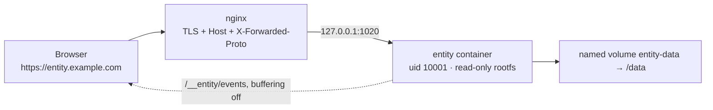

[← README](../README.md)

# Deploy the server (Docker)

```bash
cp .env.example .env        # set ENTITY_ADMIN_EMAIL + a long ENTITY_ADMIN_PASSWORD
docker compose up -d --build
docker compose logs -f entity
```



The admin account is created only while the account store is empty. Add teammates from
the container (the password is read from the environment, never argv):

```bash
docker compose exec -e ENTITY_NEW_PASSWORD='a long password' entity \
  node server/users.cjs add teammate@example.com "Teammate"
```

Then sign in, create a workspace, and add the teammate's email under Workspace
settings → Members. Clients connect with **Connect remote** — see
[Remote workspaces](remote-sync.md).

## The published image

Tagged builds publish to GitHub Container Registry:

```bash
docker pull ghcr.io/agung2001/entity:v0.0.1
```

Use it as the `image:` in a compose file (or `docker run`) instead of building locally.
The image is `linux/amd64` and runs as uid 10001 with no writable root filesystem;
mount `/data` for workspaces and keep the same `ENTITY_ADMIN_*` and
`ENTITY_SECURE_COOKIE` settings as the compose example. If the GHCR package is private,
either authenticate with `docker login ghcr.io` or make the package public in its
GitHub package settings.

## Reverse proxy

`docker-compose.yml` publishes **port 1020** and nothing else. Point nginx at it:

```nginx
proxy_pass http://127.0.0.1:1020;
proxy_set_header Host $host;
proxy_set_header X-Forwarded-Proto https;
proxy_buffering off;   # for /__entity/events
```

Keep `ENTITY_SECURE_COOKIE=true` behind TLS.

## What the image is

- uid **10001**, read-only root filesystem, tmpfs `/tmp`, `cap_drop: ALL`,
  `no-new-privileges`.
- Production Node modules only (the ZIP backup path needs `yazl` and `unzipper`), no
  build tooling.
- Data is the named volume `entity-data` at `/data` (`ENTITY_HOME`).
- No harness binaries: chat runs happen in the desktop app, and a terminal is not
  offered server-side. The server is for files, entities, members and sync.

## Related

- [Remote workspaces](remote-sync.md)
- [Security](security.md)
- [Quickstart](quickstart.md) — the desktop side
