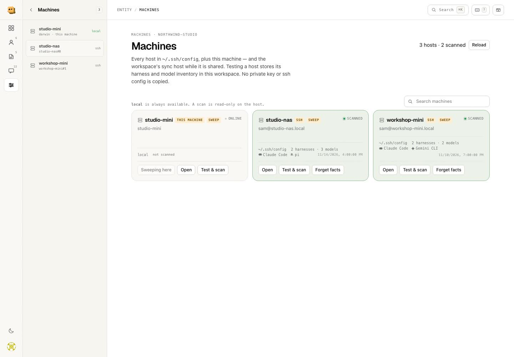

[← README](../README.md)

# Machines

<picture><source srcset="assets/readme-features/machines.webp" type="image/webp" /></picture>

Two rules make the scope coherent:

1. **The workspace is data; the machine is the source.** `~/.ssh/config` is the only
   list of hosts, and it stays user-local. Nothing is attached to a workspace.
2. **No cross-workspace references.** A skill or MCP server belongs to its own
   workspace and resolves only there. The same name in two workspaces is two
   unrelated things.

## Which machine a turn runs on

```mermaid
sequenceDiagram
  participant You
  participant App as Entity (this window)
  participant Box as ssh host
  participant H as Harness there
  You->>App: send in a thread pinned to "root-ubuntu"
  App->>App: stage a temporary workspace
  App->>Box: ssh -tt + rsync/scp the payload
  Box->>H: run the installed CLI, cwd staged dir
  H-->>Box: JSONL stream
  Box-->>App: stream back over ssh
  App-->>You: live steps, then the answer
  App->>Box: pull artifacts back, delete the run directory
```

The staged payload is bounded. `entities/` and `skills/` travel whole (kilobytes), and
`artifacts/` travels **newest first up to 24 MB / 120 files**, minus the sync engine's
`conflicts/` copies — a working shelf can hold
hundreds of megabytes of renders, and staging all of it made every remote turn wait a
minute before the harness started. When files stay behind, the prompt says so, so the
model reports the absence instead of guessing; attach a specific old file to send it.
The transfer's deadline follows the payload rather than a fixed minute. Raise the
budget with `ENTITY_REMOTE_ARTIFACT_MB` when a workspace lives on a fast link.

Runs still execute on the machine whose window started them. The stored inventory is a
capability snapshot, not a placement engine or a credential — see
[Limits](../docs/limits.md).

## The page

Workspace → Settings → Machines (`?tab=machines`) is the entity profile page, one
scope down, and it wears the same shell:

```
.entp-bar          ← Settings ‹ back-crumb · Machines · Reload · Test every host · Forget every fact
  .entp-hero       ← the workspace's space station, and the fleet counter
  .mach-strip      ← LOCAL · CONFIG · HOSTS · SCANNED · SWEEP RUNS ON · LAST SCAN
  .mbar            ← the one search field, full width
  .mftable         ← the roster, straight under the field
```

There is no section head over the roster. "The fleet · 16 of 16" sat between the
facts row and the field saying what the hero, the counter and the facts row had
already said three times, and charged a heading's worth of gap for it.

Three things about that shell are deliberate:

- **The page's verbs are on the second row.** *Reload*, *Test every host* and *Forget
  every fact* act on the whole page, which is what a second row is for — not a card
  that would push the roster down. The bar sticks, and the hero and the table scroll
  under it.
- **The facts are a row, not a rail.** They were the entity page's reading rail, and
  beside a five-column roster it cost a third of the band to repeat what the hero and
  the rows already said. Same `entp-facts` grammar, laid horizontally, so the table
  owns the whole measure — `5 harnesses · 1278 models` reads in full instead of
  `1278 mo…`.
- **One filter, the band's full width, flush with the table.** It is the page's only
  filter, and it opens the roster rather than sitting under a heading.

| column | what it answers |
| --- | --- |
| Machine | the alias, its kind (`this machine`, `ssh`, `sync host`, `git`), and the address |
| State | `scanned`, `testing`, `unreachable`, `available`, `not tested`, `not a host` |
| Inventory | what a scan found — or **why it found nothing**, which is the line that used to be a toast |
| Actions | *Test & scan* on a host that was never read, *Open*, and the sweep control on the two machines that can run it |

The roster never grows the page: one bounded scroll box (`min(62vh, 620px)`), a sticky
desk, and 60 px rows. A failure stays on its row, so the next glance still knows why a
host is red.

## The drawings

Six icons carry this page, and every one of them is a vendored [iconoir](https://github.com/iconoir-icons/iconoir)
glyph (MIT — `src/components/icons/LICENSE.iconoir.md`) rendered by
`src/components/UiIcon.vue`. They are copied as files rather than imported as a
package: this app already vendors its harness marks from `thesvg.org`, and five
24 × 24 drawings do not justify the first runtime dependency added for markup.

| where | glyph | means |
| --- | --- | --- |
| bar | `refresh` | read `~/.ssh/config` again |
| bar | `refresh-double` | test every host — one read per machine, together |
| bar | `trash` | forget every fact this copy kept |
| row | `nav-arrow-right` | open one machine's page |
| row | `scanning` | test and scan one host |
| row | `trash` | forget the facts kept about one host |

The set that shipped before was hand-drawn and wrong twice over: two broken arcs
for *reload*, and then a **table grid** and a smaller grid for two different
"forget" actions a pixel apart — one promising to delete a table, the other a
snapshot. The bar's fleet-wide verbs and a row's single-host verbs now use
different drawings for the same reason: sharing one makes the bar look like it
does what a row does.

## Test & scan

**Test & scan** probes a host, runs a read-only scanner over ssh, and stores the result
in the workspace's `machine-facts.json`: installed harnesses, their paths, the models
each CLI reports, and the configured default.

The result lands in the row, not only in a toast. A host that could not be reached keeps
its last inventory in the second line, prefixed `kept from <date>`, so an unreachable
machine is never mistaken for an unscanned one.

No private key and no ssh config enters the workspace, and the inventory is not a
secret. A host that disappears from `~/.ssh/config` simply stops appearing in the list.

`~/.ssh/config` also holds aliases that are git remotes (a forge host, a mirror, a
repo shortcut). They stay in the roster and in the count — hiding them would be
inventing a rule the file does not state — but they read `not a host`, keep their
contrast, and carry no scan or sweep action.

## The machine that sweeps

Artifact retention runs on exactly one machine per workspace, because two clones
sweeping one shared shelf would race each other's moves. The Machines page shows a
**Sweep here** button in the row of a machine that can take it — the local row, or the
`sync host` that serves the shared workspace — and `owner decides` in every ssh row,
because an ssh host is a run target and not a daemon. A member sees the same words as
text rather than a control that fails after a click.

- The **owner's** first signed-in machine takes it until somebody picks another.
- A sync host runs it with no desktop open, so it gets a card of its own.
- Every other clone stands down: `The artifact sweep runs on <label>; this machine
  does not sweep it.`
- The executor's **local clock** is the deadline's clock. A sync host in a container
  usually runs UTC, so its `03:00` is not your `03:00`.

The rule, the forecast and the two clocks are in
[Artifacts → the archive shelf](artifacts.md#the-archive-shelf).

## The terminal follows the thread

``Ctrl+` `` opens a shell beside the conversation. A thread pinned to another machine
opens the shell *there*, over `ssh -tt` with the alias from `~/.ssh/config` and
nothing else — no password prompt, no stored key. A local thread opens it in the
thread's base directory. The picker that routes the turn also routes the shell, so the
shell and the answer run on the same host.

- The relay is util-linux `script` on Linux and `python3` on macOS. macOS `script`
  calls `tcgetattr` on its own stdin and exits when that is not a terminal, which is
  what Electron always hands a child, so `python3` allocates the pty itself.
- Inside the shell every key belongs to the shell, including `Esc`, the interrupt and
  reverse search. The terminal shortcut is the one exception, because it has to be able
  to close the panel from inside it.
- Scrollback lives in the main process, so hiding and reopening the panel comes back to
  the same prompt. Closing the window ends the shell.

The server build does not offer a terminal: a shell is code execution on the host that
serves the page, so the shared server reports why instead of half-offering one.

## Related

- [Conversations](conversations.md) — the thread that carries the pin
- [Limits](limits.md) — remote chat is one ssh turn at a time
- [Security](security.md) — what a run may reach
