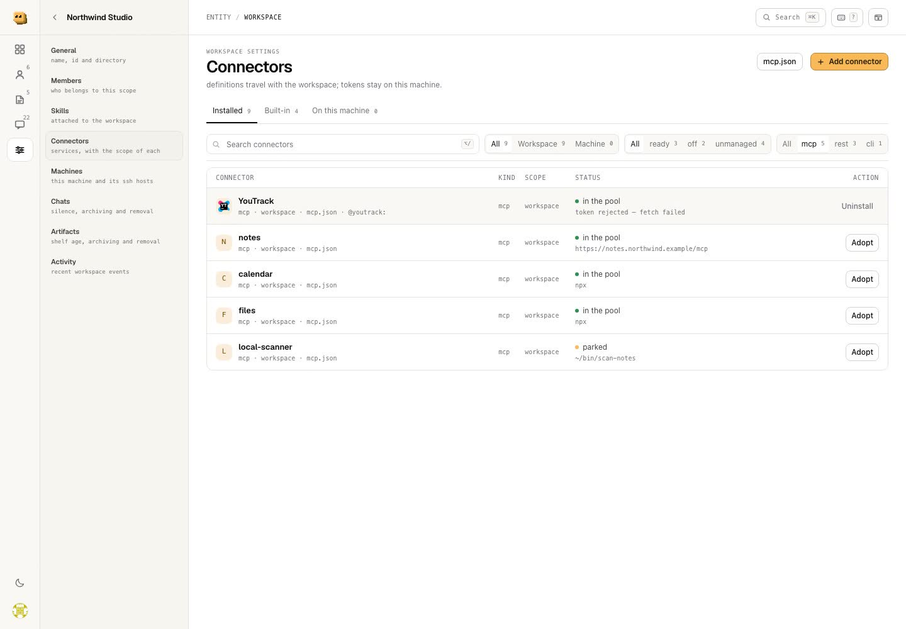
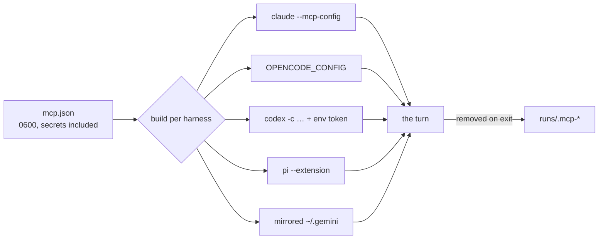

[← README](../README.md)

# MCP servers

<picture><source srcset="assets/readme-features/mcp.webp" type="image/webp" /></picture>

A workspace has one set of servers (`<ws>/mcp.json`) and **every entity gets all of
them**. Add a server once — on the MCP page, or by **attaching** one a harness
already has configured — and any thread can use it.

There is no per-entity list, on purpose: a server is attached to the workspace or it
is not, and one agent cannot be given a server its siblings are denied. A `mcp:` line
left in an older entity file is ignored by the reader and dropped by the next write;
`mcp: none` no longer opts anything out.

- **Attach** copies the definition verbatim, including the header or env value that
  makes it work. That is the point, and it is why the file is `0600`.
- **No verb returns a value.** The inventory reports `envKeys`/`headerKeys`, the page
  shows names, and the audit log records the server name only.
- **Detach** removes it; **Park** keeps the definition but takes it out of every turn.

A definition that can only work on the machine that wrote it — a loopback URL, or a
command inside a home directory — is still shared with a teammate but lands parked,
with the reason. See [Remote workspaces](remote-sync.md).

## The server page

A row — in either rail scope — opens one page for one server. It states each fact
once, in the rail, instead of repeating it in a table:

- **Status** — `attached`, `parked` or `not attached`.
- **Transport** — `remote · http` or `local · stdio`; an HTTP server is never called
  “sse” here, because the word describes the definition, not the experience.
- **URL**, **Command**, **Args**, **Headers** (key names only) and the tool count.
- `every entity` in the header, so the no-per-entity rule is visible where somebody
  would look for the exception.
- **Environment** lists env *keys*, never values: values are handed to the harness
  when the turn starts and are never returned by a read.
- **Defined in** lists `this workspace` (`mcp.json`) and every harness file,
  `N of M places`. When a name exists twice the page says the turn reads the file it
  runs from, so the copies can drift. **Edit** opens a masked view — headers and env
  as `•••` — beside a full-value editor.

**Attach** copies a harness's definition verbatim (a two-click arm; tokens differ); if
the harness already has a copy, the page names which harness defined it. **Detach**
removes it from the workspace and every harness. **Park** keeps the definition and
takes it out of every turn; a server parked by a sync says which reason it came with.

### The tool list

`N from the server · R read · W write`. The list searches the tool's name and its
description (`Search N tools — name, or what it does`), and the `All / Read / Write`
segments recompute their counts after the search. The keyboard guide's **Search this
server's tools** shortcut puts the caret in the field. `read`/`write` is a guess from the
tool's leading verb, not a permission claim. Empty states are explicit — a server that
reported no tools says so, including the token-missing case for an HTTP server — and a
failure is the raw sentence, not a spinner.

### Two scopes in the rail

The rail's MCP section carries a **Workspace _n_** / **Harness _n_** switch, and the
section stays mounted while a server page is open (the current row gets
`aria-current="page"`). Workspace rows show the transport, the `parked` state and a
drift chip naming any other harness that declares the same name; harness rows show the
harness, the command and `in pool` / `attach`. Both open the same page. The search
survives the switch — comparing one server across lists is the point — while the
harness chip resets. `Esc` clears the filter before it closes the rail. A harness that
declares nothing gets no chip; a failed scan says `Could not read harness configs.`
with **Try again** and leaves the pool intact.

## How the set reaches each harness

What the turn spawns was checked against each CLI; none of it writes into your own
config.

| harness | how the set reaches it | merge or replace |
| --- | --- | --- |
| `claude` | `--mcp-config <file> --strict-mcp-config` | replaces (only this set) |
| `opencode` | `OPENCODE_CONFIG=<file>` | merges over its own |
| `codex` | `-c mcp_servers.<name>.*`; a bearer token rides in `ENTITY_MCP_<NAME>_TOKEN` | merges; the token never appears in `ps` |
| `pi` | a generated `--extension` that calls `pi.registerMcpServer()`; an older pi gets a mirrored agent dir with a merged `mcp.json` | merges; pi's own file wins a clash |
| `gemini` | a mirrored temp `~/.gemini` with `settings.json` merged, plus `--skip-trust` | merges |

The temp file or directory sits under `<ws>/runs/.mcp-*`, mode `0600`, and is removed
when the process exits. A server that is missing, or whose secret is unset, is
reported on the turn instead of half-written — and the turn still runs.

**A server cannot delay the first token.** Each harness reaches MCP tools the same way
it reaches a search — on demand — so a slow or dead server costs nothing at start-up.
This matters because a stdio definition is a *program*, and a launcher script that boots
an app can block for as long as that app takes: one such server here added **8.1 s to a
10.9 s cold start** and then never answered at all. pi gets `exposure: "deferred"`
(`tool_search` and `codemode` still reach every tool, `direct` puts nothing on the
critical path) and a `timeout: 15` on the handshake it does eventually make. Measured
on a real turn: 10.9 s → 2.8 s to the first event.

## The other direction: an MCP server for agents

**Account → MCP server** exposes the *workspace* to a client outside a run: a loopback
Streamable HTTP server with a bearer token and writes opt-in, listing and reading
workspaces, entities, chats and artifacts. It is off until you enable it.

That is the opposite direction from the workspace set: here Entity is the server, and
the client is whatever agent you point at it.

## Related

- [Agent CLI](agent-cli.md) — the same verbs, for a process inside a run
- [Remote workspaces](remote-sync.md) — how the set travels
- [Security](security.md) — where the credentials live
