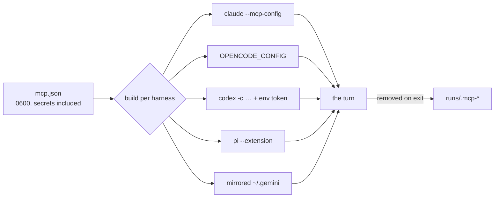

[← README](../README.md)

# MCP servers

<picture><source srcset="assets/readme-features/mcp.webp" type="image/webp" /></picture>

A workspace has one set of servers (`<ws>/mcp.json`) and every entity gets it. Add a
server once — on the MCP page, or by **attaching** one a harness already has
configured — and any thread can use it. An entity may narrow the list in its own
frontmatter, and `mcp: none` opts out entirely.

- **Attach** copies the definition verbatim, including the header or env value that
  makes it work. That is the point, and it is why the file is `0600`.
- **No verb returns a value.** The inventory reports `envKeys`/`headerKeys`, the page
  shows names, and the audit log records the server name only.
- **Detach** removes it; **Park** keeps the definition but takes it out of every turn.

A definition that can only work on the machine that wrote it — a loopback URL, or a
command inside a home directory — is still shared with a teammate but lands parked,
with the reason. See [Remote workspaces](remote-sync.md).

## How the set reaches each harness

What the turn spawns was checked against each CLI; none of it writes into your own
config.

| harness | how the set reaches it | merge or replace |
| --- | --- | --- |
| `claude` | `--mcp-config <file> --strict-mcp-config` | replaces (only this set) |
| `opencode` | `OPENCODE_CONFIG=<file>` | merges over its own |
| `codex` | `-c mcp_servers.<name>.*`; a bearer token rides in `ENTITY_MCP_<NAME>_TOKEN` | merges; the token never appears in `ps` |
| `pi` | a generated `--extension` that calls `pi.registerMcpServer()`; an older pi gets a mirrored agent dir with a merged `mcp.json` | merges; pi's own file wins a clash |
| `gemini` | a mirrored temp `~/.gemini` with `settings.json` merged, plus `--skip-trust` | merges |

The temp file or directory sits under `<ws>/runs/.mcp-*`, mode `0600`, and is removed
when the process exits. A server that is missing, or whose secret is unset, is
reported on the turn instead of half-written — and the turn still runs.

## The other direction: an MCP server for agents

**Account → MCP server** exposes the *workspace* to a client outside a run: a loopback
Streamable HTTP server with a bearer token and writes opt-in, listing and reading
workspaces, entities, chats and artifacts. It is off until you enable it.

That is the opposite direction from the workspace set: here Entity is the server, and
the client is whatever agent you point at it.

## Related

- [Agent CLI](agent-cli.md) — the same verbs, for a process inside a run
- [Remote workspaces](remote-sync.md) — how the set travels
- [Security](security.md) — where the credentials live
