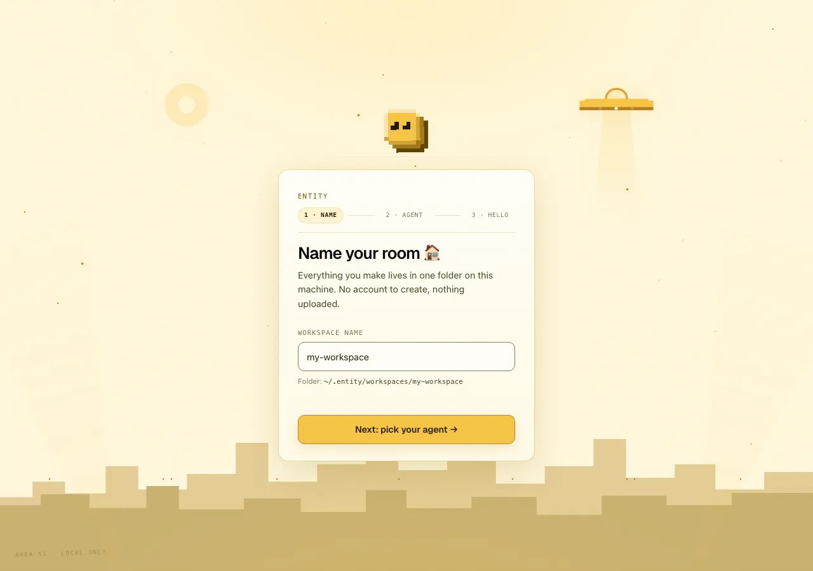
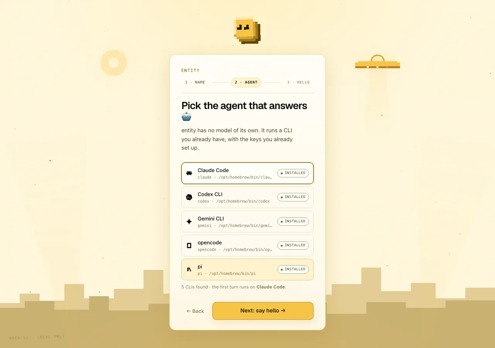
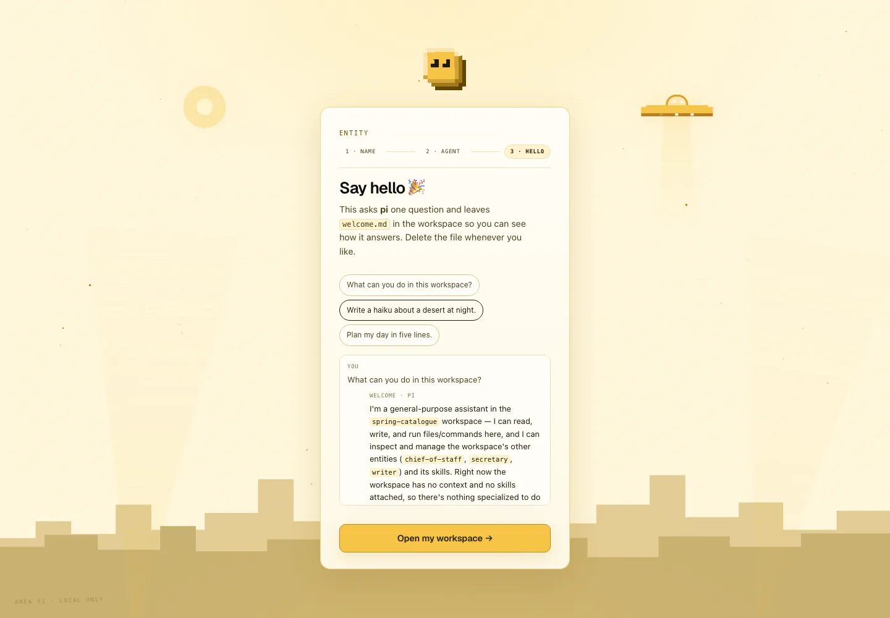
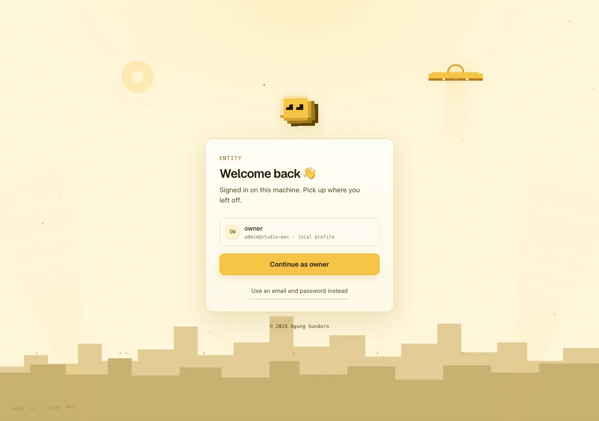

[← README](../README.md)

# Onboarding

## What a first run is

The trigger is the disk, not a flag. While there is no directory under
`~/.entity/workspaces/`, the app opens `/welcome` — and that card is the only screen
that can make a room, because the picker's own dialog only exists inside a hub. A
profile that already holds a workspace never sees it.

There is no sign-in form on the way in. The account is machine-local and
single-tenant — `auth.register()` refuses a second one with *"An account already
exists on this machine"* — so the wizard registers the owner itself and signs it in.
The first run asks for a folder name and nothing else. Inside the wizard the word
"password" never appears; it shows up once, on the return launch, as the link under
**Continue as owner**.

## The three steps

One route, one card, a three-step rail on top of it. The card is the sign-in screen's
own shell — the same desert stage behind it, the same 404 px column, the same input and
button styles — so a new install's first screen is the product, not a setup form.

### Step 1 · Name your room 🏠

One field, defaulted to `my-workspace`, with the folder it will become printed
underneath and re-derived on every keystroke. The derivation is the workspace store's
own: NFKD-normalise, lowercase, every run of non-alphanumerics to a single `-`, at most
40 characters, no trailing dash. Type `Spring Catalogue Q3` and the preview says
`~/.entity/workspaces/spring-catalogue-q3` before you commit to it.

The room is written on submit, with the three default sample entities already in
`entities/`: `chief-of-staff`, `writer` and `secretary`. A name whose folder already
exists keeps the message in the card's slot — `~/.entity/workspaces/<slug> already
exists. Pick another name.` — leaves the primary enabled and puts the focus back in the
field, so a clash is one edit away from fixed.

This is the only place the first room comes from. There is no `/setup` screen any more;
the rooms you add later come from the picker's modal.

### Step 2 · Pick the agent that answers 🤖

entity drives a CLI you already have, so this step is a probe, not a choice of model.
The five CLIs the app knows — `claude`, `codex`, `gemini`, `opencode`, `pi` — are looked
up on `PATH` and listed as a real radiogroup, so the arrow keys move the selection. Each
row shows the `command · path` the machine reported, the hint under the list counts
what was found (`5 CLIs found`, `1 CLI found`, `No CLI found yet`), and the first
installed CLI is preselected.

- Nothing chosen disables the primary, which reads `Choose one to continue`.
- An absent CLI stays in the list, dimmed and labelled `not installed`, so the option
  is visible even when it is not usable.
- While the probe runs the rows are skeleton bars and the primary is disabled.
- Zero CLIs installed replaces the list with an install panel carrying the `npm i -g`
  command for each, and the primary becomes `Check again`. `Open my workspace →` under
  the card still gets you through: the room already exists, and a harness can be wired
  up afterwards.

The wizard detects a CLI. It never installs one and never asks for a key.

### Step 3 · Say hello 🎉

Three fixed chips, so the same question produces the same kind of answer on every
machine. The one you send is a real one-shot turn of the chosen CLI into a real thread,
so the demo doubles as a readiness check: the reply in the transcript is the agent's own
words.

The copy names the file before you click. The demo writes `welcome.md` to
`~/.entity/workspaces/<slug>/entities/welcome.md` and tells you so in the body text —
it is scaffolded before the turn runs, so it is there even when the turn fails. Delete
it whenever you like; nothing depends on it.

- The turn runs under a typing row; when it settles the reply lands in the transcript
  and the primary flips to `Open my workspace →`.
- A non-zero exit puts the CLI's own stderr in the transcript verbatim, in mono, as its
  own turn, with `Try again` and `Leave for now` under it. The thread and the room are
  yours either way.

## The guard

`router.beforeEach()` reads the disk before it reads the route, so the first screen of
a launch has exactly one answer per combination:

| session | workspace on disk | where you land |
| --- | --- | --- |
| none | none | `/welcome` |
| none | one | `/login` |
| live | none | `/welcome` |
| live | one | `/workspaces` |

The order is session → workspace → route. A live session never sees either public
screen, and `/welcome` stays reachable for a signed-in machine with no room on disk,
because it is the only thing that can create one.

## The return launch

A machine that finished first run does not ask for a credential again: the profile on
disk is the credential. The next launch shows `Welcome back 👋` with the owner row, one
primary `Continue as owner`, and one text link `Use an email and password instead`. The
primary signs in and opens the room the workspace store last remembered; the link opens
the email form on the same card. That link is the only place the word "password"
appears anywhere in first run.

## After the wizard

The room opens on its Overview with the three sample entities in it and the demo thread
already in **Recent conversations**. Adding another room later happens from the
workspace picker — its **New workspace** button opens the same form as a modal over the
hub — not by leaving it.

## Related

- [Quickstart](quickstart.md) — requirements, every `npm` command, ports, profiles
- [Workspaces and entities](workspaces.md) — the folder tree and the entity file
- [Agent CLI](agent-cli.md) — the verbs an entity can call on its own workspace
- [Conversations](conversations.md) — what the demo thread becomes
- [Artifacts and backups](artifacts.md) — the shelf your room writes to
