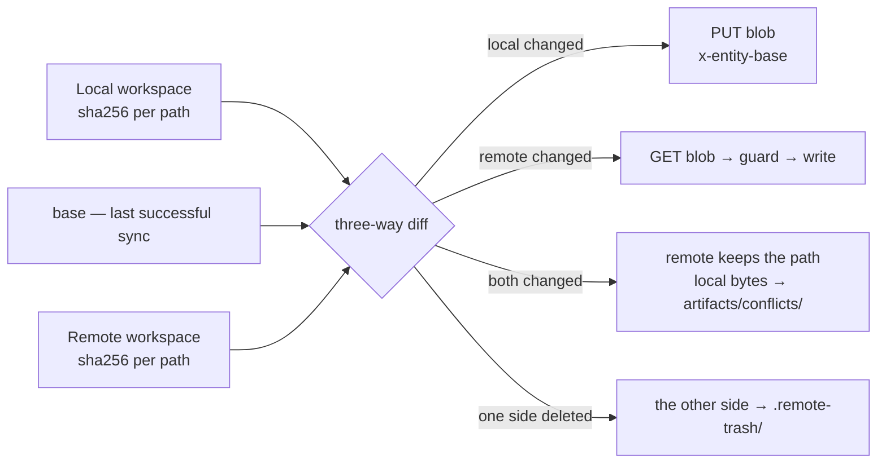

[← README](../README.md)

# Remote workspaces (two-way sync)

The same app can run as a shared server. On the workspace picker **Connect remote**
asks for the server URL and your account, lists the workspaces you may open, and
clones the one you pick into a local workspace of the same name.

A pass with nothing to do is one manifest request and one walk of the workspace on each
end — milliseconds, not a re-upload.

## What travels

| syncs | does not |
| --- | --- |
| `entities/**`, `artifacts/**` | chats and run logs |
| attached skill **bodies** under `skills/` | machine capability snapshots (they describe local machines) |
| the MCP set, with every secret replaced by `***` | any MCP secret |
| workspace metadata: label, context, strictness, members | the workspace id and path |

## The rules that keep it honest

- **Conflict copies, never silent loss.** If both sides changed a file, the remote
  version keeps the path and the local bytes go to
  `artifacts/conflicts/<path>.<stamp>.local.<ext>`. Deletes move to
  `.remote-trash/<stamp>/`. Writes are conditional (`x-entity-base`), so a concurrent
  edit answers `409` and is resolved on the next pass.
- **MCP travels ready to use, except where it cannot work.** A portable server is
  enabled on the clone with no second setup step. A definition bound to the machine that
  wrote it — a loopback URL, a command inside a home directory — is still shared but
  lands parked with the reason; enabling it by hand pins it, and the next sync leaves it
  alone. A server a teammate parked is never switched on by a sync.
- **The guard runs first.** Every pulled text blob is scanned for prompt injection,
  credential export, shell pipes, invisible unicode and injected markup. A
  high-severity finding aborts before any write, marks the connection `blocked` and
  shows the excerpt. Approving binds to the exact `sha256`.
- **Second opinion (opt-in).** The connect dialog can run one installed CLI over the
  pulled bytes with a strict JSON brief. If that evaluator cannot run, the sync stops
  with an error rather than pretending it was checked.

## What a pass shows

The panel reports the phase it is in — reading both manifests, pulling *n* of *m*,
checking, reviewing, writing, pushing, removing — with a bar, the current path and
elapsed time. The pull side polls every six hours and after launch; a local edit
schedules a pass 2.5 s later, which batches an editor's save burst into one sync.

## State on disk

Connection state lives in `<ws>/.remote.json`; the bearer token in `<ws>/.remote.token`
(`0600`). **The password is not stored at all.**

## Related

- [Security](security.md) — the guard and the trust boundaries
- [Deploy the server](deploy.md) — the other end of this diagram
- [Skills](skills.md) — why bodies are copied, never linked
- [Limits](limits.md) — file-level, not a CRDT
