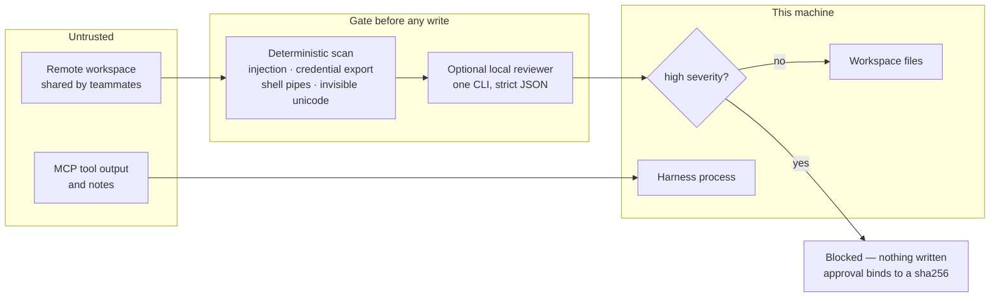

[← README](../README.md)

# Security notes

Entity runs other people's instructions on your machine. The design assumes that
text which came from somewhere else — a shared workspace, a pulled file, a note
from a vault — may be hostile.

## The window

- The renderer is sandboxed with context isolation; the CSP in `index.html` allows
  the HMR websocket in dev and nothing extra in production.
- Prompts go to the harness on stdin, never through a shell. `harness` is one of
  five known ids; names are `[a-z0-9-]+`; `dir` is resolved in main before
  anything spawns.

## What a run may write

- A run can write its own workspace, so the CLI re-checks containment on the
  **resolved** path, refuses a write that raced an outside edit, and logs every
  mutation.
- It cannot reach another workspace, the ssh config or a key.
- `--workspace <id>` on a *read* is allowed and audited as `cross.read`; a write to
  another workspace is not.

## Credentials

- The MCP pool may hold a credential and is written `0600`. **No verb returns a
  value**: the inventory reports `envKeys`/`headerKeys`, the MCP page shows names,
  and the audit log records the server name only.
- Per-harness wiring keeps the token out of `ps` — `codex` receives it as
  `ENTITY_MCP_<NAME>_TOKEN`, and the temp config that carries it is `0600` and
  removed when the process exits.
- Chat transcripts hold model thinking and tool output. They live only in the
  workspace's thread JSON and are never sent anywhere by the hub.

## The shared server

- Every call, and the event stream, requires a session. Membership is enforced per
  workspace; host-level actions are owner/admin only.
- Sync paths are scoped to `entities/`, `artifacts/` and `skills/`, plus the one
  scope index `artifacts/.scope.json`. Every other dotfile, `..`, absolute path and
  file over 25 MB is refused or skipped; a nested symlink is not followed. The
  personal shelf (`.personal/<account>/artifacts/`) is outside the manifest, so it
  never leaves this machine unless a file is explicitly shared.
- Workspace-owned skills under `skills/` travel as real files, **including execute
  bits and only execute bits**. A skill attached from a harness library is
  dereferenced on the way out, so the receiving machine never gets a link into
  `/Users/…`.
- The password never leaves the sign-in call: the server stores a scrypt verifier,
  the client keeps a bearer token `0600` and no password at all.

## The sync guard

Nothing is written from a pull until it passed the guard:

1. **Deterministic scan** — prompt injection, credential export, shell pipes,
   invisible unicode, injected markup. Microseconds, always on.
2. **Second opinion (opt-in)** — one installed CLI over the pulled bytes with a
   strict JSON brief. If the reviewer is configured but cannot run, the pass fails
   closed instead of pretending it was reviewed.
3. **Approval** — a high-severity finding blocks *before the first write* and binds
   the approval to the exact `sha256`, so editing the file re-arms it.

See [Remote workspaces](remote-sync.md) for the pass itself.

## Related

- [Architecture](architecture.md)
- [Limits](limits.md)
