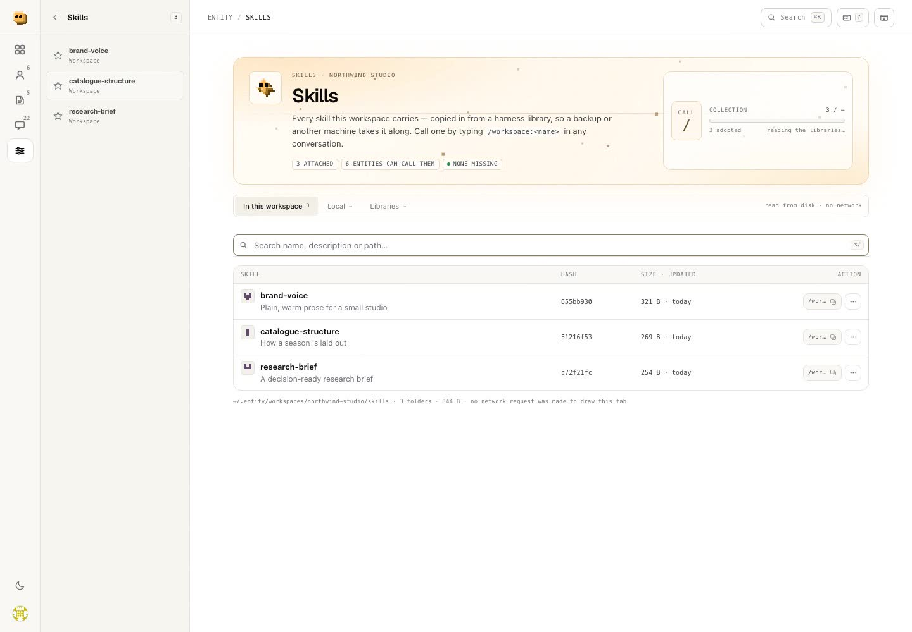
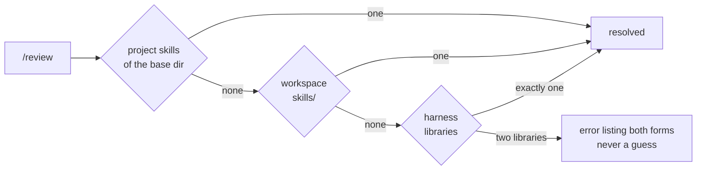

[← README](../README.md)

# Skills

A skill is a recipe: how you write, how you research, how you check numbers. It is a
folder with a `SKILL.md` and, often, `references/` and `scripts/` beside it.

<picture><source srcset="assets/readme-features/skills.webp" type="image/webp" /></picture>

## Attaching versus linking

A skill you attach is **copied** into the workspace (`<ws>/skills/<name>/`) — not
symlinked. A symlink would make the workspace depend on `~/.pi/agent/skills` existing
on whatever machine restores a backup or pulls a remote copy. The bytes live in the
workspace, the execute bits travel, and an older build's links are converted to real
copies the first time the inventory is read.

Updates to the library do not flow through afterwards. That is the trade: portable
over live. Re-attach (or edit the workspace copy) on purpose.

## Calling one in a message

Type `/` in the composer to hand a skill to the assistant. The menu inserts the
qualified form; a bare name is accepted only when exactly one library has it.

| reference | resolves to |
| --- | --- |
| `/project:<name>` | a skill in the thread's base directory — `.claude/skills`, `.agents/skills`, `.pi/skills`, … |
| `/workspace:<name>` | `<ws>/skills/<name>` — attached to this workspace |
| `/<harness>:<name>` | that harness's own library, e.g. `~/.claude/skills/<name>` |
| `/<name>` | any library this thread can reach, when exactly one has that name |

In a thread with a base directory, project skills come first, then the workspace's,
then the machine's. The backend resolves the reference to an absolute path **on the
machine the thread is pinned to** and sends `use this skill /abs/path` above the
prompt. The reference itself is not sent, and a reference this app owns that does not
resolve stops the message.

## An entity can write one

`entity skill create <name> --body-stdin` writes `<ws>/skills/<name>/SKILL.md`, audits
the write, and the composer's `/` menu picks it up without reopening the workspace.

See [the agent CLI](agent-cli.md) for the rest of the verbs.

## Two libraries, one name

Two libraries with the same name is an error, not a guess — the message lists both
qualified forms so you can say which one you meant. A library skill that is missing
its body (a link into a library this machine does not have) is shown as *missing* on
the skill itself.

Nothing here is per entity. A skill belongs to the workspace — every entity sees all
of them — so there is no `skills:` list to keep in step, and one agent cannot hold a
skill its siblings lack.

## Related

- [Workspaces and entities](workspaces.md)
- [Agent CLI](agent-cli.md)
- [Remote workspaces](remote-sync.md) — how skill bodies travel between machines
