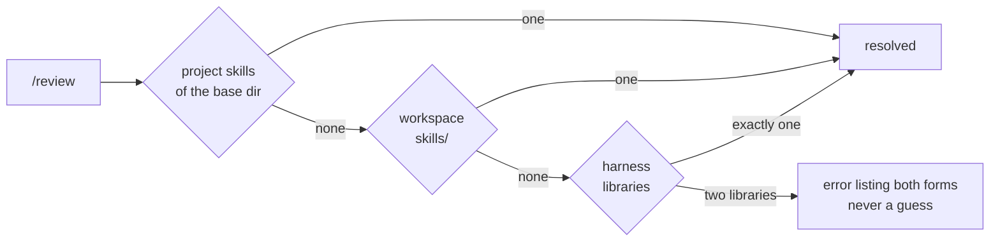

[← README](../README.md)

# Skills

A skill is a recipe: how you write, how you research, how you check numbers. It is a
folder with a `SKILL.md` and, often, `references/` and `scripts/` beside it.

<picture><source srcset="assets/readme-features/skills.webp" type="image/webp" /></picture>

## Attaching versus linking

A skill you attach is **copied** into the workspace (`<ws>/skills/<name>/`) — not
symlinked. A symlink would make the workspace depend on `~/.pi/agent/skills` existing
on whatever machine restores a backup or pulls a remote copy. The bytes live in the
workspace, the execute bits travel, and an older build's links are converted to real
copies the first time the inventory is read.

Updates to the library do not flow through afterwards. That is the trade: portable
over live. Re-attach (or edit the workspace copy) on purpose.

## The roster

`Skills` in the sidebar lists what this workspace carries, as a **table**, not a
grid of cards: one row per skill with its description, file count, size and age.
The list is searchable — `/` puts the caret in the search field — and it never
grows the page without bound; a workspace with a hundred skills scrolls inside
the same box.

What it draws for the awkward cases:

| state | what you see |
| --- | --- |
| reading the directory | skeleton rows, never a spinner over nothing |
| nothing attached | the empty note and a way to the harness libraries |
| no row matches | the query, how many skills are attached, and **Clear the search** |
| the directory cannot be read | the path, the reason from the OS, and **Try again** |
| a skill whose folder is gone | a tinted row, `—` for its size, `Copy…` unavailable |

## Copying a skill into another workspace

Each row has **Copy…**, which opens a sheet for one decision: where does it go?
The copy is the workspace's **own bytes** — the edits you made here, not the
harness library's version — and the source keeps its copy.

If the destination already has a skill with that name, the sheet says so before
anything is written and asks you to choose:

- **Replace the copy** — the destination's folder is deleted and the new one takes
  its place. There is no undo.
- **Keep both** — the new one lands as `<name>-2` (or `-3`, …), and its declared
  name is rewritten to match, so `/workspace:<name>-2` resolves and the roster
  shows two different rows.

The copy is staged inside the destination and renamed into place, so a failed copy
never leaves a half-written skill behind. `Esc` and a click on the backdrop close
the sheet — except while the copy is in flight, when both do nothing.

## Calling one in a message

Type `/` in the composer to hand a skill to the assistant. The menu inserts the
qualified form; a bare name is accepted only when exactly one library has it.

| reference | resolves to |
| --- | --- |
| `/project:<name>` | a skill in the thread's base directory — `.claude/skills`, `.agents/skills`, `.pi/skills`, … |
| `/workspace:<name>` | `<ws>/skills/<name>` — attached to this workspace |
| `/<harness>:<name>` | that harness's own library, e.g. `~/.claude/skills/<name>` |
| `/<name>` | any library this thread can reach, when exactly one has that name |

In a thread with a base directory, project skills come first, then the workspace's,
then the machine's. The backend resolves the reference to an absolute path **on the
machine the thread is pinned to** and sends `use this skill /abs/path` above the
prompt. The reference itself is not sent, and a reference this app owns that does not
resolve stops the message.

## An entity can write one

`entity skill create <name> --body-stdin` writes `<ws>/skills/<name>/SKILL.md`, audits
the write, and the composer's `/` menu picks it up without reopening the workspace.

See [the agent CLI](agent-cli.md) for the rest of the verbs.

## Two libraries, one name

Two libraries with the same name is an error, not a guess — the message lists both
qualified forms so you can say which one you meant. A library skill that is missing
its body (a link into a library this machine does not have) is shown as *missing* on
the skill itself.

Nothing here is per entity. A skill belongs to the workspace — every entity sees all
of them — so there is no `skills:` list to keep in step, and one agent cannot hold a
skill its siblings lack.

## Related

- [Workspaces and entities](workspaces.md)
- [Agent CLI](agent-cli.md)
- [Remote workspaces](remote-sync.md) — how skill bodies travel between machines
