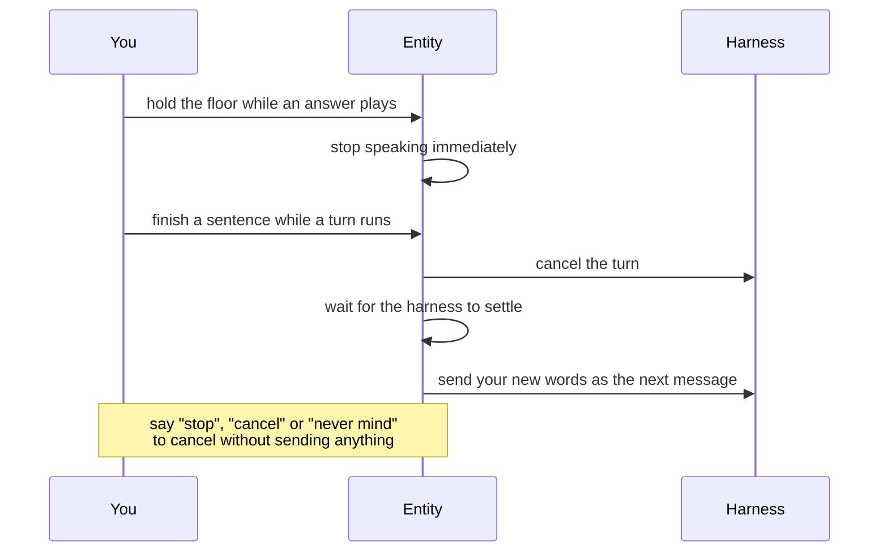
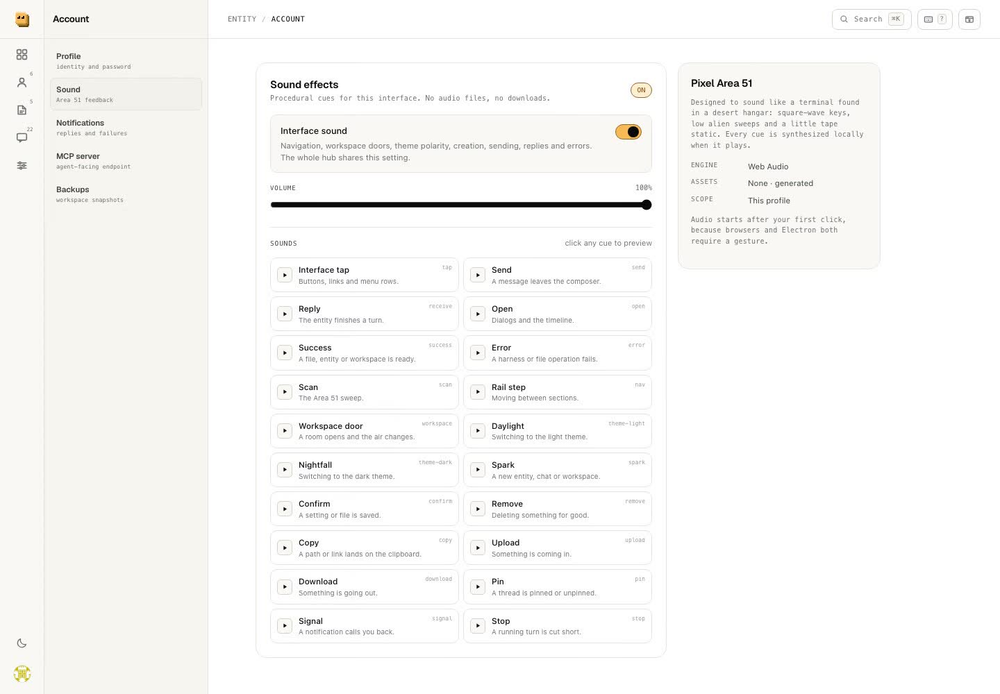

[← README](../README.md)

# Voice, and the sound of the hub

The microphone in the composer (immediately before Composer help, or `⌘⇧V`; `⌥⇧V` in
a browser tab, where `⌘⇧V` stays paste-as-plain inside a text field) opens a
full-screen voice surface: the entity's animated mark, its mood emoji at full size, and
a live transcript. Talk and the entity answers out loud.

## Interrupting is the point

Speaking *while* it works is part of the design:



While the entity speaks, the microphone keeps listening for an interruption but
records nothing, so the entity can never transcribe its own voice or cut itself off.
Taking the floor needs a sustained signal clearly above the room, not a single loud
frame.

## The transcription engine is chosen, not assumed

| Engine | Where it works | What it needs |
| --- | --- | --- |
| Browser speech (`SpeechRecognition`) | A Chrome/Edge tab | Nothing — the browser's recognition service |
| Local whisper | Desktop app and server | A `whisper-cli` or `whisper` binary **and a model** |
| Typing | Anywhere | Always available in the dialog |

Chromium in the desktop shell exposes `SpeechRecognition` but has no recognition
service behind it, so the packaged app uses whisper. Give it a model once and it works
offline:

```bash
brew install whisper-cpp          # or: pipx install openai-whisper
mkdir -p ~/.entity/models && cp ggml-base.bin ~/.entity/models/
```

The binary is found on `PATH` and in the usual install directories; pin it with
`$ENTITY_WHISPER_BIN` if it lives somewhere else. Models are looked up in
`$ENTITY_WHISPER_MODEL`, `~/.entity/models`, `~/.cache/whisper.cpp`,
`~/.cache/whisper` (the Python CLI's cache), and the Homebrew `whisper-cpp` share
directory. The smallest model wins: `tiny` and `base` are what make voice feel
immediate, and nothing is ever downloaded for you. There is no settings page to visit:
like a harness, this is a capability of the machine, discovered when voice mode opens.

## Privacy

A take is recorded as 16 kHz mono WAV in the renderer, sent as **bytes** to the main
process (never a path or a command), written to a private temp directory, transcribed,
and deleted in the same call — including when transcription fails. In a browser tab the
browser's own speech service does the transcription; the audio never passes through
Entity.

## Speaking

Speech synthesis is the platform's own voice (`speechSynthesis`), with a mute control
in the dialog and a real voice preferred over novelty voices. The words being spoken
are always on screen, with the current sentence highlighted. Every finished answer also
has its own **read aloud** button in the message actions, beside copy, share and save.

<picture><source srcset="assets/readme-features/sound.webp" type="image/webp" /></picture>

## Sound

Twenty small cues for opening a room, sending a message, landing a reply and failing a
turn — synthesized locally with Web Audio, no files and no downloads, with one volume
slider in **Account → Sound**.

## Related

- [Conversations](conversations.md) — the turn voice interrupts
- [Limits](limits.md) — why the desktop build needs a local transcriber
