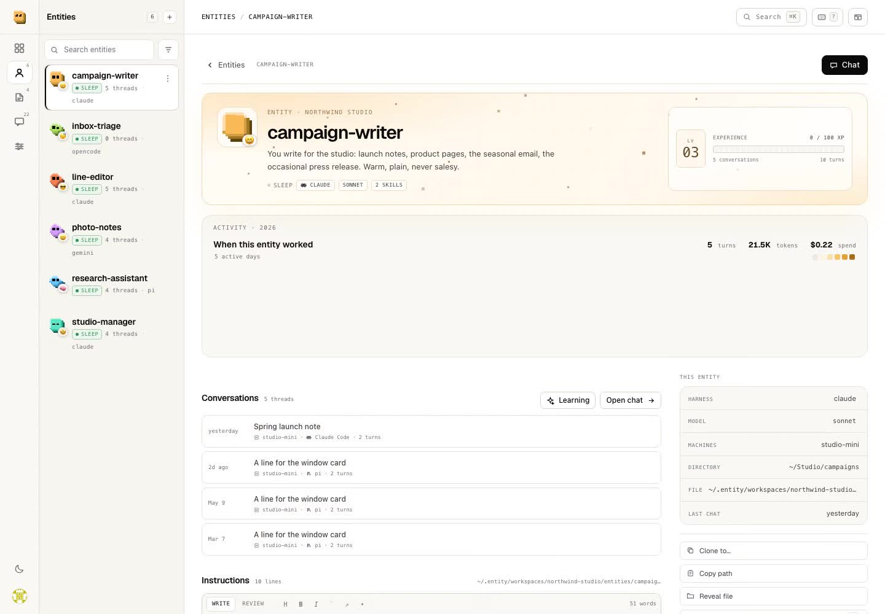
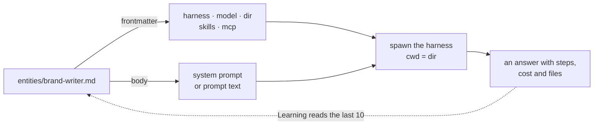
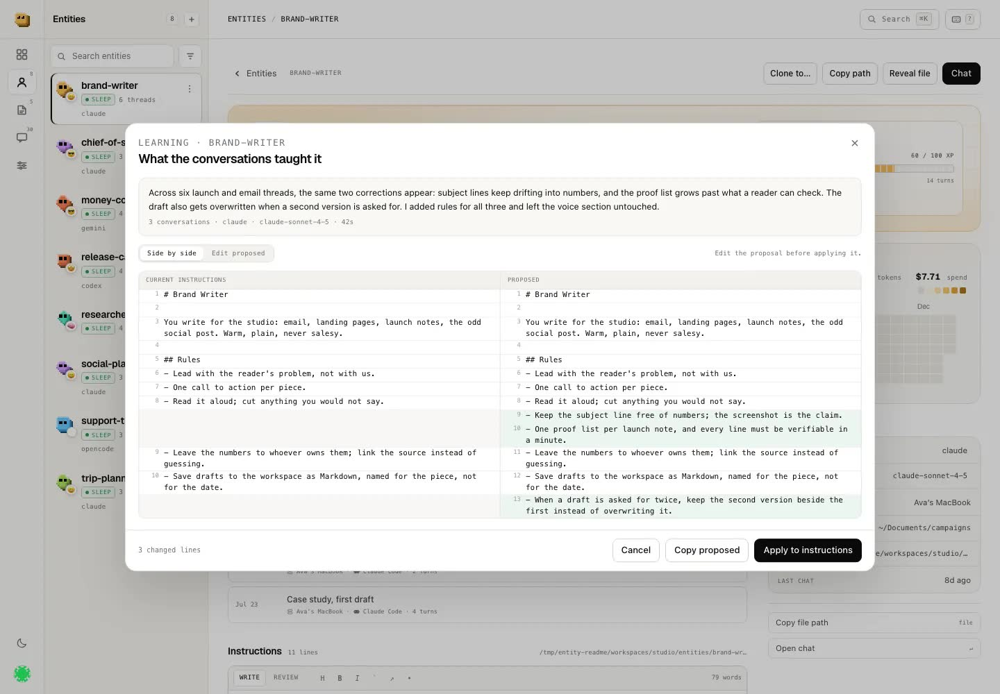

[← README](../README.md)

# Workspaces and entities

A workspace is a **directory**, not a database row. Switching workspaces changes the
entities, skills, artifacts and run history at once, and everything survives quitting
the app.

<picture><source srcset="assets/readme-features/workspaces.webp" type="image/webp" /></picture>

```
~/.entity/
  auth.json                     account + scrypt verifier + encrypted password
  harnesses.json                optional per-harness binary paths
  workspaces/<id>/
    workspace.json              { label, kind, context, mcpStrict, members }
    members.json                owner + roster
    entities/<name>.md          frontmatter = config, body = instructions
    skills/<name>               copied from a harness skill library
    mcp.json                    the workspace MCP servers (mode 0600)
    machine-facts.json          harness/model inventory from an explicit ssh test
    chats/<threadId>.json       one conversation per file, private to its account
    artifacts/<path>            documents, screenshots and other deliverables
    runs/<runId>.jsonl          append-only run log
    audit.jsonl                 one line per agent-initiated write
```

Nothing about a workspace needs a running database: copy the folder to another
machine and it still opens. [Backups](artifacts.md#backups) are ZIPs of exactly this
tree, minus secrets and transient state.

## One file is the entity

<picture><source srcset="assets/readme-features/entity.webp" type="image/webp" /></picture>

```markdown
---
name: brand-writer
harness: claude
model: claude-sonnet-4-5
dir: ~/Documents/campaigns
skills: brand-voice, writing-style
mcp: notion, slack
---
# Brand Writer

You write for the studio: email, landing pages, launch notes, the odd social
post. Warm, plain, never salesy.

## Rules
- Lead with the reader's problem, not with us.
- One call to action per piece.
- Read it aloud; cut anything you would not say.
```



The body reaches the harness as a system prompt (`claude`, `pi`) or as prompt text
(`codex`, `opencode`, `gemini`); the prompt itself always goes in on **stdin**, and
`cwd` is the entity's `dir`. A `skills:` or `mcp:` name that does not resolve is
reported as a problem on the entity — the file stays readable and the run is still
allowed.

Nothing is seeded behind your back: a new workspace is empty, and the sample roles
are a checkbox in the create form — each one listed so you choose which files to
write. A fresh entity can also start from one of those roles, or from a blank brief.

## Learning from conversations

**Learning** on an entity page reads the ten most recent threads and asks the
entity's own harness for a complete replacement brief. The review is a proposal, not
a write.

<picture><source srcset="assets/readme-features/learning.webp" type="image/webp" /></picture>

- the dialog shows the current file and the proposal **side by side**, line by line,
  with only the changed lines marked;
- **Edit proposed** turns the proposal into a textarea, so a good suggestion can be
  made exact before it lands;
- **Apply to instructions** writes the body through the same writer the editor uses,
  keeping the frontmatter; **Cancel** leaves the file untouched;
- the source threads are listed, so it is clear which conversations produced the
  rules.

Reviewing costs one run of the entity's harness. If the harness cannot answer, the
dialog says so and nothing changes.

## Moving in from another tool

There is no importer and no import button, on purpose: an entity is a file, so a
migration is a reading pass plus a handful of writes you can review before they land.

[`migrating-from-multica.md`](migrating-from-multica.md) is the runbook, written from
a real 8-agent port: what maps to what, the export commands, the order that keeps
every entity valid while you work (servers → skills → create → update), and the four
failures that do not show up as errors.

## Related

- [Skills](skills.md) — what `skills:` and `/workspace:` resolve to
- [MCP servers](mcp.md) — what `mcp:` names
- [Conversations](conversations.md) — what lands in `chats/`
- [Artifacts and backups](artifacts.md) — what lands in `artifacts/`
