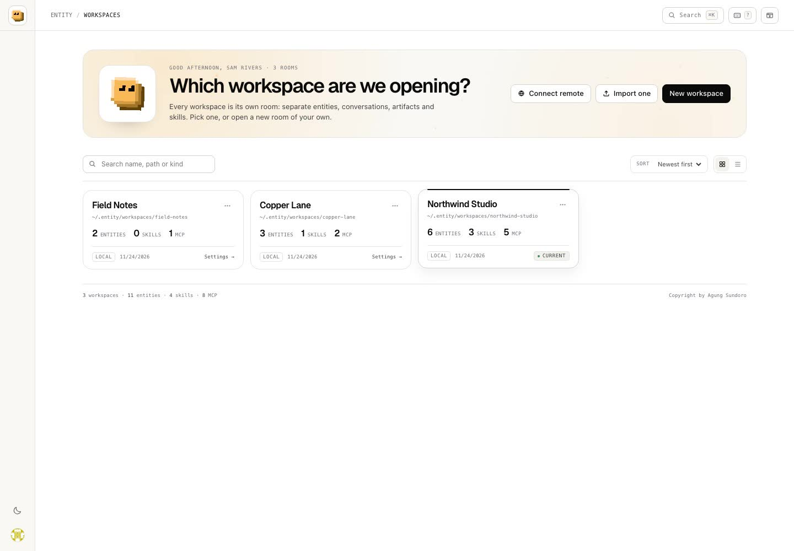
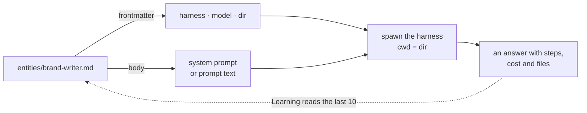

[← README](../README.md)

# Workspaces and entities

A workspace is a **directory**, not a database row. Switching workspaces changes the
entities, skills, artifacts and run history at once, and everything survives quitting
the app.

<picture><source srcset="assets/readme-features/workspaces.webp" type="image/webp" /></picture>

```
~/.entity/
  auth.json                     account + scrypt verifier + encrypted password
  harnesses.json                optional per-harness binary paths
  workspaces/<id>/
    workspace.json              { label, kind, context, mcpStrict, members }
    members.json                owner + roster
    entities/<name>.md          frontmatter = config, body = instructions
    skills/<name>               copied from a harness skill library
    mcp.json                    the workspace MCP servers (mode 0600)
    machine-facts.json          harness/model inventory from an explicit ssh test
    chats/<threadId>.json       one conversation per file, private to its account
    artifacts/<path>            shared deliverables — exported and synced
    artifacts/.scope.json       who shared which file
    artifacts/.archive/         archived deliverables, still on disk
    artifacts/.opened.json      last-opened stamps for the archive sweep
    .personal/<account>/artifacts/  your own shelf, never shared or synced
    artifact-retention.json     this machine's sweep position (the rule is in workspace.json)
    retention.json              chat-retention rule
    runs/<runId>.jsonl          append-only run log
    audit.jsonl                 one line per agent-initiated write
```

Nothing about a workspace needs a running database: copy the folder to another
machine and it still opens. [Backups](artifacts.md#backups) are ZIPs of exactly this
tree, minus secrets and transient state.

## One file is the entity

<picture><source srcset="assets/readme-features/entity.webp" type="image/webp" /></picture>

```markdown
---
name: brand-writer
harness: claude
model: claude-sonnet-4-5
dir: ~/Documents/campaigns
---
# Brand Writer

You write for the studio: email, landing pages, launch notes, the odd social
post. Warm, plain, never salesy.

## Rules
- Lead with the reader's problem, not with us.
- One call to action per piece.
- Read it aloud; cut anything you would not say.
```



The body reaches the harness as a system prompt (`claude`, `pi`) or as prompt text
(`codex`, `opencode`, `gemini`); the prompt itself always goes in on **stdin**, and
`cwd` is the entity's `dir`. Skills and MCP servers are not in that frontmatter:
they belong to the workspace, so every entity gets all of them and an entity cannot
narrow the list. Its problems are its own — an unknown harness, a `dir` that is not
there — and the file stays readable and the run is still allowed.

Nothing is seeded behind your back. The first room from the welcome wizard starts with
the three roles it names — `chief-of-staff`, `writer` and `secretary` — and the
**New workspace** form in the picker is empty unless you tick **Start with sample
entities** and choose which files to write. A fresh entity can also start from one of
those roles, or from a blank brief.

## Learning from conversations

**Learning** on an entity page reads the ten most recent threads and asks the
entity's own harness for a complete replacement brief. The review is a proposal, not
a write.

<picture><source srcset="assets/readme-features/learning.webp" type="image/webp" /></picture>

- the scope is chosen **before** the run is paid for — how many conversations, and a
  Since/Until window; the button names what it will read (`Review 5 conversations`);
- the review then shows the current file and the proposal **side by side**, line by
  line, with only the changed lines marked;
- **Edit proposed** turns the proposal into a textarea, so a good suggestion can be
  made exact before it lands;
- **Apply to instructions** writes the body through the same writer the editor uses,
  keeping the frontmatter; **Cancel** leaves the file untouched;
- the source threads are listed, so it is clear which conversations produced the
  rules.

Reviewing costs one run of the entity's harness. If the harness cannot answer, the
dialog says so and nothing changes.

## Chat retention

Workspace settings → **Chats** holds one rule for the whole workspace: when a thread
archives itself, and when it is gone.

- **① Archive** counts days since the thread's **last message**. A thread that reaches
  the threshold leaves the rail's working list and joins the archived group — the same
  group the ⋯ menu puts it in, with the same one-click Restore. Reversible.
- **② Delete** counts days **in the archive**, not days of silence. A thread archived
  today and left at 180 is removed at 210 days of silence, and moving ① moves both
  lines. `remove()` is a hard unlink: there is no Trash and no restore.
- **Both are a number plus a unit** (`days` / `weeks` / `months`), and `Never` is a unit
  rather than a switch. Both on `Never` is retention off, and the card says so.
- **When it runs** is a cadence plus a deadline (`every day by 03:00`, `every week`,
  `only when I ask`). The deadline is a "not before", not an appointment: the app is
  open all day and shut at night, so a pass that came due while it was closed runs
  within a minute of the next launch. There is no pass while the app is closed.
- **Three protections, counted live** before anything moves: a pinned thread is never
  archived by the rule, a thread with a turn in flight waits, and a thread that saved an
  artifact is never deleted (the conversation is how you remember why the file exists).
  Pinning is the per-thread escape hatch.
- **The chart is the control.** The two dashed lines are the two thresholds and the rows
  underneath move them; the legend and the two effect counts describe the axis, while
  the forecast says what tonight's pass actually does (including what a protection holds
  back), and names the six threads it will touch.
- **Answering an archived thread brings it back** into the working list, so a
  conversation somebody still uses can never be counting days toward deletion.

The rule lives in `<workspace>/retention.json`, so it travels with a backup. It is
not part of a remote clone's metadata: each machine keeps its own chat sweep until the
connection carries it. A workspace that has never had this tab opened is never swept.

## Moving in from another tool

There is no importer and no import button, on purpose: an entity is a file, so a
migration is a reading pass plus a handful of writes you can review before they land.

[`migrating-from-multica.md`](migrating-from-multica.md) is the runbook, written from
a real 8-agent port: what maps to what, the export commands, the order that keeps
every entity valid while you work (servers → skills → create → update), and the four
failures that do not show up as errors.

## Related

- [Skills](skills.md) — what `/workspace:` resolves to
- [MCP servers](mcp.md) — what the workspace pool is
- [Conversations](conversations.md) — what lands in `chats/`
- [Artifacts and backups](artifacts.md) — what lands in `artifacts/`
